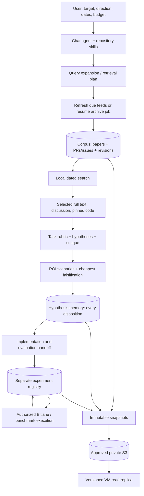

# Research operated from chat

The chat agent chooses questions, reads evidence, challenges claims and decides the next useful action. Repository skills describe that workflow; `researchctl` provides deterministic data, state and accounting operations. Optional `run --reason` invokes the existing bounded model stages. A background backfill is a downloader, not an independently reasoning agent. No research command launches GPU experiments.

## Components and ownership



| Skill | Request it handles | Main output |
|---|---|---|
| [inference-discovery](../.agents/skills/inference-discovery/SKILL.md) | Find new papers/PRs; inspect dated local results, coverage or synchronization | Source IDs, retrieval depth, omissions and receipts |
| [inference-research](../.agents/skills/inference-research/SKILL.md) | Propose useful changes for this deployment/objective | Source-grounded hypotheses, adaptive rubric, ROI assumptions and cheapest tests |
| [inference-critic](../.agents/skills/inference-critic/SKILL.md) | Challenge, revise and prioritize proposals | Explicit verdicts, objections and uncertainty-resolving checks |
| [inference-implementation](../.agents/skills/inference-implementation/SKILL.md) | Prepare or execute an authorized implementation/evaluation | Pinned code/eval handoff and scoped attempt records |

These are repo-owned instruction files. Their presence does not make a daemon run them. The current chat uses them and invokes tools. The legacy research method and historical run folders remain useful evidence; new mutable state belongs outside Git.

## 1. Find new work and retain previous work

```bash
researchctl status
researchctl expand --question 'Reduce long-output ITL through adaptive speculation' \
  --after 2026-09-01 --before 2026-10-23
researchctl plan --query 'all:"adaptive speculation"'
researchctl refresh --query 'all:"adaptive speculation"'
researchctl search 'speculation acceptance draft' --after 2026-09-01 --before 2026-10-23 --limit 20
researchctl show github:vllm-project/vllm:62541 --history
researchctl history --limit 20
```

`expand` suggests queries; it does not contact a provider or assert relevance. Inspect the suggestions before passing selected arXiv expressions to `--query`. Configured keyword families supply aliases and broad discovery directions, while the user's question can introduce a new direction. `--repo` overrides repositories for one invocation; edit the resolved `research/config.json` for a persistent feed change. Completed tasks respect refresh intervals and successful responses use caching. New observations merge by source identity and retain observed material revisions.

`search` is local and does not refresh automatically. Its date predicate is **stored `updated_at >= after` and `< before`**, not a universal publication-date filter. Provider discovery dates and stored created/revised/fetched timestamps remain distinct. Query expansion and lexical scores are retrieval aids, not estimated performance gains.

Inspect command history for invocations and source checkpoints for ingestion progress. A command's completion timestamp is not proof that every configured feed was exhausted. A failed publication can leave valid newer local data; read its receipt before retrying.

### All-history GitHub openings

```bash
researchctl --env-file /path/to/private/providers.env backfill start --publish-every 300
researchctl backfill status
researchctl backfill stop
```

The configured repository list comes from the resolved discovery config. This job resumes archive cursors and reports rate limits, progress and available ETA information. `GITHUB_TOKEN` or `GH_TOKEN` provides authenticated public API allowance; credentials stay in the provider environment/file. A GitHub read token for ingestion is separate from permission to push this code repository.

Opening records include title, full initial body, URL, open/closed state, timestamps, labels and basic metadata. Comments, review threads, diffs and detailed PR file data are fetched selectively. Full-history completion requires exhaustion of the archive cursor for each configured repository; recent-window completion, an import receipt or a large record count does not establish that. Download speed depends on actual page latency and rate allowance. A background process still requires its host to stay running.

### Deep reads

```bash
researchctl run --question 'When does adaptive draft length improve useful progress per cycle?' \
  --deep-count 3 --max-http-calls 12
```

This refreshes due sources within limits and builds a bounded dossier. Add repeated `--source-id` to select exact records. Paper discovery uses arXiv, OpenAlex and Hugging Face; the reader obtains supported open full text where available. Metadata, abstracts, full text and actual implementation reads have different evidence strength. Unresolved citations remain explicit. There is no promise that every paper is freely available or that every linked repository was inspected. Known URLs and local retrieval do not require spending a Serper search request.

Use `--offline` for cached-only inspection. `--reason` opts into model calls and cannot be combined with `--offline`. Exact pinned `{repo, ref, path}` entries under the brief's `code_sources` direct inspection to implementation files; automatic README discovery alone does not verify the active code path.

## 2. Adapt selection to the task

A brief should identify the actual model/image/commit, GPU topology, workload manifest, objective and operating region, separate correctness/tail guards, constraints and available budget. Unknown pins or timings stay unknown. For the current improvement-oriented task:

```json
{
  "name": "Improve our deployed long-output ITL",
  "count": 3,
  "baseline": {"unknown": true, "needed": "Current image digest, topology and workload manifest"},
  "target": {"objective": "Long-output ITL", "workload": "Pinned Mooncake and agent-75"},
  "selection": {"require_novelty": false},
  "instructions": "Known methods and upstream ports are welcome. Establish local applicability, estimate exposed saved time, and prioritize CPU/source/trace checks. Treat unknown ROI as a named diagnostic, not an invented speedup. Reuse existing evaluators unless they cannot expose the mechanism.",
  "constraints": ["No GPU execution in this research stage", "Separate correctness and tail guards"]
}
```

Save it as a task JSON, then:

```bash
researchctl run --question 'Find useful changes for this deployment' \
  --reason --brief /path/to/task.json --deep-count 3 --max-http-calls 12
```

This uses the existing evidence extraction → task rubric → proposal → critique stages. Exact-quote checks establish that quoted text exists, not that a paper's claim transfers to our hardware. Task-defined criteria/weights and mandatory evidence requirements determine selection. Scientific novelty is off by default. Deduplicating two equivalent experiments does not require an unpublished idea.

Read [the ROI guidance](../ideation/docs/HYPOTHESIS_ROI.md) for screening. Distinguish the following questions:

1. **Applicability:** Is the affected path active, or what integration enables it? Source inspection and existing logs may answer this with no GPU time.
2. **Materiality:** How much exposed time can the change remove at relevant shapes/load, after overhead? Work counts or component percentages do not answer this by themselves.
3. **Cheapest discriminating test:** Which measurement would change the decision? Prefer existing traces, counters, CPU replay and correctness checks, then a bounded native/component probe if needed.
4. **Service qualification:** Can a matched unprofiled benchmark demonstrate the frozen objective without violating guards?

For fixed useful progress, conditional ITL saving is exposed saved cycle time divided by useful output tokens per cycle. If draft acceptance changes, compare time per useful token for both arms. Overlapped work, parallel ranks, affected request fraction and new control overhead matter. Queueing tails, capacity and dollars require separate reasoning and measurements. A small diagnostic with unknown ROI can be worthwhile; an expensive confirmation needs stronger justification.

`researchctl prescreen --record /path/to/prescreen.json` records the explicit task and arithmetic inputs/unknowns. Start from [prescreen-example.json](../ideation/config/prescreen-example.json), whose numbers are explicitly illustrative, and replace them with sourced inputs or unknowns. Its schema separates baseline iteration time, component savings, calls per iteration, exposed fraction, accepted progress, evidence/assumptions and tail guards. Its estimate is a conditional scenario, not measured service improvement or independent scientific review. Select a minimum worthwhile gain for this task; no historical campaign threshold is universal.

## 3. Persist chat-authored ideas too

Plain chat text is not automatically memory. `run --reason` persists its generated proposals and decisions. For an idea authored/reviewed in the current chat, write a record and use:

```bash
researchctl hypothesis record --record /path/to/chat-card.json
researchctl hypothesis recall --query sampler --limit 20
```

The input shape is:

```json
{
  "run_id": "my-research-batch",
  "card": {
    "id": "H1",
    "statement": "A conditional improvement claim for the stated baseline",
    "mechanism": "The work or waiting removed",
    "proposed_change": "Specific implementation or configuration change",
    "parents": [],
    "evidence": []
  },
  "brief": {
    "baseline": {"unknown": true},
    "selection": {"require_novelty": false}
  },
  "disposition": {
    "status": "proposed",
    "reasons": ["Source applicability still needs inspection"]
  },
  "prescreen": {
    "expected_relative_gain": null,
    "unknowns": ["Exposed time on target path"],
    "next_check": "Inspect dispatch and retained profile"
  }
}
```

Evidence entries use `{source_id, quote, relation}` with `supports`, `challenges` or `context`; source IDs must exist locally and quotations must match their text. An accepted selection additionally requires source evidence and an explicit prescreen record. Unknown gain can remain unknown. The command records a **caller-attributed** verdict and quote integrity, not an independently validated improvement. Keep all proposals including rejected/deferred ones.

The same `run_id` and card ID with identical content is retry-safe. Changed immutable card content requires a new ID, with the original in `parents`. A changed disposition for the same immutable card appends a review and preserves previous reviews. Experiment outcomes cannot be supplied as selection statuses. The existing hypothesis SQLite graph is reused; this does not create a second memory system.

## 4. Implementation and evaluation handoff

Use the implementation skill to produce a pinned change plan, correctness test, CPU-first falsification, matched control/treatment, evaluator commands, cost estimate and stopping conditions. Reuse Mooncake and agent-75/AIPerf manifests from the actual deployment. Add an evaluator only with a documented missing stimulus or observable; an installed tester's name does not prove it covers the mechanism.

```bash
researchctl experiment create --record /path/to/attempt.json
researchctl experiment get ATTEMPT_ID
researchctl experiment transition ATTEMPT_ID --record /path/to/transition.json
researchctl experiment list --scope service
```

See [portable setup](PORTABLE_SETUP.md#independent-experiment-registry) for the attempt schema. Each attempt has a fixed hypothesis/baseline and component, native or service scope. Selection acceptance is not validation. An execution error is not an invalidated hypothesis. New attempts preserve the old attempt and link its ID. This registry records execution; it does not launch Bitlane or design custom evaluators automatically.

## 5. State, S3 and another node

| State | Location under the configured state root | Meaning |
|---|---|---|
| Research sources | `research/corpus.sqlite` | Documents, observed revisions, retrieval graph and feed checkpoints |
| Hypotheses | `research/hypotheses.sqlite` | Immutable cards, task/policy/baseline snapshots, source links and dispositions |
| Dossiers/receipts | `research/records/` | Reproducible run inputs and outputs |
| Invocation journal | `commands.sqlite` | Command starts/finishes; a copy at `research/command-history.sqlite` is included in snapshots |
| Experiment attempts | `experiments/experiments.sqlite3` | Append-only scoped attempts and outcomes |
| Retained small evidence | `experiments/artifacts/` | Verified content-addressed files |
| Snapshots/lineage | `archives/`, `lineage.json` | Immutable recovery payloads and this writer's known published/restored ancestor |

`researchctl remote show` reports configured publication. With `auto_publish` enabled, supported mutations snapshot and publish using conditional lineage checks. Pure searches are local; explicit offline operations do not silently publish. Invocation history records tool activity; it does not prove publication or external evaluation occurred. A command's finish event occurs after its own snapshot and is retained in the next snapshot.

On a node with read access to the approved bucket:

```bash
researchctl sync-replica --bucket autoresearch-641134885443-us-east-1 \
  --prefix autoresearch --region us-east-1 --namespace research
researchctl --replica status
researchctl --replica search 'adaptive speculation' --limit 10
```

Replica synchronization restores a verified version into a separate directory and updates `replicas/research/CURRENT.json`. It does not overwrite the canonical writer's database or reconcile a VM's independent unpublished work. `--replica` selects the research read replica for `status`, `search` and `show`; write commands are not permitted in replica mode. Code releases still travel separately through Git or the documented S3 Git-bundle fallback. A successful S3 publication alone does not establish that every VM has pulled it. A scheduled pull, when installed, is a separate observable process; inspect its latest receipt rather than assuming it ran.

## Honest capability boundary

The system provides persistent retrieval, evidence/proposal records, conditional screening, append-only experiment tracking and portable snapshots. Chat reasoning or optional bounded model calls supply research judgment. It does not establish research quality from source count, estimate exact service gains from titles, reproduce every paper, continuously reason without invocation, execute GPU experiments from a research request, or turn a component result into a serving win. Those distinctions remain visible in records and final reports.
