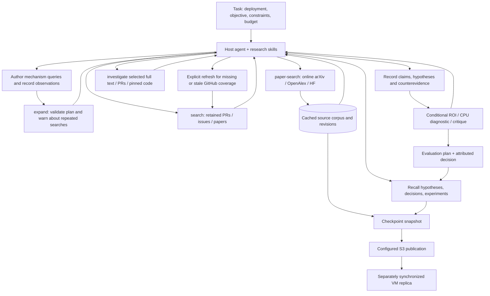

# Research operated from chat

The host agent interprets the task, authors semantic queries, reads evidence and chooses the next action. `researchctl` and the optional MCP server provide retrieval, provenance, memory and checked handoffs. No research tool launches GPU experiments. The optional `run --reason` is a bounded model pipeline; it is not required for chat-driven research.

## How an adaptive run works



This is a feedback loop, not a mandatory sequence or fixed number of searches. The next call should resolve a named uncertainty. An irrelevant paper suggests a more discriminating query; an empty search suggests checking errors and permitted relaxations; a useful paper suggests full text, code, counterevidence or related PRs. Stop when the decision is supported, budget is reached, or the missing evidence needs a deployment check. Retain that stop reason.

| Skill | Use | Output |
|---|---|---|
| [inference-discovery](../.agents/skills/inference-discovery/SKILL.md) | Adaptive paper/PR discovery and coverage | Query ledger, sources, omissions |
| [inference-pr-research](../.agents/skills/inference-pr-research/SKILL.md) | Trace source changes into target deployment | Applicability and contradiction evidence |
| [inference-research](../.agents/skills/inference-research/SKILL.md) | Form and improve useful hypotheses | Mechanism, transfer chain, falsifier |
| [inference-critic](../.agents/skills/inference-critic/SKILL.md) | Challenge hypotheses and ROI | Revisions, dispositions, next checks |
| [inference-implementation](../.agents/skills/inference-implementation/SKILL.md) | Prepare authorized execution | Pinned change/evaluation handoff |

Skills are repo-owned instructions, not daemons. MCP tools must be registered with the host client; their implementation alone does not expose them to this chat. CLI access works independently.

## Reuse retained sources in an isolated study

Before downloading a known paper again, inspect the source library as well as hypothesis recall. Recall matches cards, decisions and linked claims; it can miss a paper mentioned only in an investigation's artifact list. `search --kind fulltext`, `show ID --history`, and MCP `search_local` / `source_show` already read retained evidence. A versioned full text has an ID such as `fulltext:2610.00001v1`; an unversioned ID does **not** establish which current arXiv revision it represents.

```bash
# Inspect the library/replica first; choose the exact retained ID and revision hash.
researchctl --state-dir /path/to/library show fulltext:2610.00001v1 --history
# Import only selected evidence into an initialized isolated state. Repeat --source-id as needed.
researchctl --state-dir /path/to/study --local-only --defer-snapshot import-corpus \
  --source /path/to/library/research/corpus.sqlite --source-id fulltext:2610.00001v1
researchctl --state-dir /path/to/study show fulltext:2610.00001v1 --revision-hash HASH_FROM_HISTORY
```

MCP `import_sources(source_corpus, source_ids)` provides the same selected import, followed by `source_show`. SQLite selection imports the exact documents, all their retained revisions and incident provenance edges; it preserves newer local records and skips all collection checkpoints. Other edge endpoints may remain unresolved: explicitly select their records if the query/paper context is needed. This does not copy cache databases, credentials, hypothesis decisions or storage lineage. Without `--source-id`, the existing whole-corpus merge still includes checkpoints. JSONL import remains whole-file and rejects a selection instead of silently ignoring it.

Record the source ID, content hash and original retrieval date as **reused evidence**, not a new fetch or updated coverage. Use online discovery when freshness or a missing revision is the question. The import does not seed the HTTP cache or change `investigate`: a subsequent investigation may fetch again, even with a full-text document present. For an offline reread, use `show`/`source_show`; a zero-HTTP investigation budget prevents network calls but does not turn the existing fetch path into a retained-text lookup. Snapshot the isolated work when ready; reuse itself makes no S3 or VM synchronization claim.

## Online discovery and semantic expansion

```bash
researchctl hypothesis recall --query 'prefix routing' --limit 10
researchctl history --limit 20
researchctl --defer-snapshot expand --question 'Reduce TTFT without harming tails' \
  --after 2026-06-01 --before 2026-10-23 --plan /path/to/query-plan.json
researchctl --defer-snapshot paper-search 'prefix cache routing' \
  --provider arxiv --provider openalex \
  --after 2026-06-01 --before 2026-10-23 --limit 10
```

A minimal **agent-authored** plan:

```json
{
  "mechanism": "Avoid repeating prefill by routing to useful retained prefix state",
  "constraints": {
    "must_keep": ["correct outputs", "requested publication date interval"],
    "may_relax": ["model-specific wording"]
  },
  "queries": [
    {
      "query": "prefix cache routing",
      "provider": "arxiv",
      "purpose": "Find cache-aware placement mechanisms",
      "why": "Determine whether placement improves reuse beyond current session affinity",
      "relaxes": ["model-specific wording"]
    },
    {
      "query": "cache eviction admission control",
      "provider": "openalex",
      "purpose": "Find limitations and alternative mechanisms",
      "why": "A placement benefit may disappear when retained blocks are evicted"
    },
    {
      "query": "prefix affinity",
      "provider": "local",
      "repo": "vllm-project/vllm",
      "purpose": "Inspect existing implementation",
      "why": "Determine whether the suggested mechanism already exists"
    }
  ],
  "observations": [],
  "open_questions": ["Does explicit DP rank bypass engine affinity?"],
  "stop_reason": null
}
```

After executing selected queries, append observations (`query`, `provider`, date/repo scope, `status`, `reason`, optional `source_ids`) and revise the next queries. Status is `useful`, `irrelevant`, `empty`, `error` or `redundant`. Preserve source identities and why a new query matters. The tool validates bounds/dates/relaxation declarations, identifies repeated queries and emits runnable recipes; **semantic decomposition comes from the host agent**. A missing plan uses the basic lexical helper. No LLM or network call occurs inside `expand`.

Each `queries` or `observations` entry must be an object, not a narrative string.
CLI and MCP identify malformed rows with `query_plan_row_must_be_object` and a
zero-based location such as `observations[0]`, plus required field names. Use
`"observations": []` before any searches. This guidance never echoes the submitted
row; other failures retain their existing sanitized error behavior.

`paper-search` performs cached online retrieval with publication/submission dates: **after inclusive, before exclusive**. Limit is per provider. It returns abstracts alongside source IDs and retains metadata/abstracts, revisions and query receipts. Plain arXiv queries compile every content term/quoted phrase with AND (common stopwords are removed); there is no term-count truncation or automatic semantic fallback. Explicit arXiv field expressions are preserved. The receipt records the exact compiled query, status, result count and cache use; failed attempts retain the error type instead of pretending to have zero hits. A successful zero-result search remains zero, including on a cache hit.

Choose the next action from those observations: inspect a provider failure, try a more discriminating query after irrelevant hits, or explicitly revise overconstrained wording after empty hits. Retain the mechanism anchors and record any permitted relaxation in the next `expand --plan` round. For example, dropping `kernel scheduling layout transformation` from `LLM inference fine grained kernel scheduling layout transformation` would remove the research question; a host-authored alternative might instead be `abs:GPU AND (abs:"layout transformation" OR abs:"kernel scheduling")`. That alternative is a new search, not equivalent coverage. `constraints.must_keep` records semantic constraints for agent review; it does not mechanically prove that query wording obeys them. CLI and MCP use the same retrieval path.

Selected full text is retrieved separately. Provider ranking and keyword scores are not scientific qualification. Bounded top results are not exhaustive coverage; a failed or empty search is not proof of novelty.

OpenAlex needs its configured key; arXiv can run without one. Known-URL fetches and local searches do not require Serper. Citation edges are leads until their source text is read. No unattended paper-search scheduler is installed.

## Local PR search and selected deep reads

```bash
researchctl backfill status
researchctl pr-search 'prefix affinity' --repo vllm-project/vllm \
  --after 2026-06-01 --date-field created_at --limit 20
researchctl search 'cache eviction regression' --kind issue --repo vllm-project/vllm
researchctl show github:vllm-project/vllm:52464 --history
researchctl show SOURCE_ID --revision-hash CONTENT_HASH
researchctl --defer-snapshot investigate --question 'Does explicit DP rank bypass affinity?' \
  --source-id SOURCE_ID --deep-count 1 --max-http-calls 8 --max-repositories 1
```

`search`/`pr-search` never refresh. Use `--match all` for conjunction of terms/quoted phrases; the default `any` uses OR. Date field defaults to stored `updated_at`; choose `created_at`, `merged_at` or `fetched_at` explicitly when appropriate. A local miss is qualified by retained coverage. Reading a prior revision does not update it or revalidate its claims.

Run an explicit refresh when requested, for a newly pointed repository, or to resolve missing/stale coverage:

```bash
researchctl refresh --only github --repo owner/new-repo
```

This is bounded/resumable and invocation-scoped; edit resolved `research/config.json` for a persistent watchlist change. All-history backfill retains opening bodies/basic metadata. Comments, reviews and diffs are selective deep reads. Exhausted archive cursors establish completion, not record count or issue numbering. A background downloader requires its host to remain running.

When a paper links several repositories, choose the implementation explicitly instead of spending the README budget on its first cited dependency:

```bash
researchctl --defer-snapshot investigate --question 'What transfers from this implementation?' \
  --source-id PAPER_ID --repository author/project --max-repositories 1 \
  --code-source '{"repo":"owner/engine","ref":"EXACT_40_HEX_COMMIT","path":"relative/kernel.py"}'
```

`--repository` is repeatable and replaces automatic repository selection. The manifest retains discovered candidates, including skipped dependencies. Explicit selection does not establish authorship or a paper-to-code relationship. `--code-source` is repeatable (at most six unique files across arguments and the brief); exact pinned files are read before heuristic READMEs and share the HTTP budget. Use `--max-repositories 0` for files/full text only. MCP `investigate` exposes the same `repositories` and `code_sources` inputs; `repositories=[]` disables README discovery. Invalid pins or an explicit selection larger than its budget fail rather than silently dropping requests.

Code-only investigation needs no paper seed:

```bash
researchctl --defer-snapshot investigate --question 'Inspect this exact code path' \
  --deep-count 0 --max-http-calls 1 --max-repositories 0 \
  --code-source '{"repo":"owner/engine","ref":"EXACT_40_HEX_COMMIT","path":"relative/kernel.py"}'
```

Replace the placeholder with a real 40-hex commit. `--deep-count 0` disables stored-source selection/full-text reads; explicit pinned files, `--repository` READMEs and a brief's `code_sources` still run. MCP accepts `source_ids=[]` with `code_sources` or `repositories`. Selection validation happens before `run` refresh or deep-read network calls. `--offline` permits cache hits and prevents HTTP misses; it does not fetch an uncached file. No selected sources and no explicit requests returns `no_selected_sources`. Attempted reads that yield no nonblank source body return `no_usable_sources`, retain failures/empty-file receipts and disable optional reasoning. Nonblank text is only a minimal input guard, not a relevance, correctness or implementation qualification.

For full-text reads without citation expansion, add `--citations-per-paper 0` to `investigate` or `run`; MCP accepts `citations_per_paper=0`. The default remains 3, with valid values 0..5 checked before provider calls. This controls citation links per selected paper, not an HTTP request count: citation providers share the existing cache-miss budget and may require multiple requests. Zero skips citation work but still fetches selected full text; it does not disable `run`'s feed refresh or repository discovery. Use `investigate --max-repositories 0 --citations-per-paper 0` when only selected paper text is wanted. The dossier records the configured citation limit; skipped expansion establishes no citation coverage.

`investigate` selects original text, open full text and pinned implementation evidence within budget. `--offline` uses retained/cached evidence. Mark abstracts, full text and actual code separately. `run` also refreshes configured feeds; use `investigate` to avoid that broader refresh. `--reason --brief FILE` optionally invokes model stages; no model calls occur by default. A source's author-reported speedup remains attached to its original conditions.

## From evidence to a useful hypothesis

For each lead, connect:

> source mechanism → changed code and dispatch → actual workload exposure → affected service metric → contrary evidence → cheapest discriminating check

This requires more than links or a generic rubric score. Inspect our image/source/runtime pins; keep missing facts explicit. Check memory for prior failures and explain any changed premise when reopening. Count a paper, its README and its PR as related evidence, not three independent replications. Require novelty only when the user requests it.

Use [typed research contracts](RESEARCH_TO_IMPLEMENTATION.md) for new proposals:

```bash
researchctl --defer-snapshot claim record --record /path/to/claim.json
researchctl --defer-snapshot hypothesis propose --record /path/to/proposal.json
researchctl --defer-snapshot screen HYPOTHESIS_ID --record /path/to/screen.json
researchctl --defer-snapshot eval-plan HYPOTHESIS_ID --record /path/to/plan.json
researchctl --defer-snapshot decide HYPOTHESIS_ID --record /path/to/decision.json
researchctl hypothesis show HYPOTHESIS_ID
```

Records retain exact source revisions, quotations, support/refutation, baseline and attributed decisions. Quote matching proves text presence, not entailment. Legacy `hypothesis record` remains supported for history; prefer typed `propose` for new work. Plain chat text is not persisted automatically.

For synthesis, the research skill explains [component-level reuse](../.agents/skills/inference-research/references/synthesis.md): preserve a useful policy while omitting optional training only when its dependencies permit it; test cross-source compatibility rather than adding headline gains. Optional `card.synthesis` / `card.alternatives` fields and decision `review` / `tool_use` fields persist through the existing commands. They retain reasoning, not automatic semantic certification. Judge tool calls by a named uncertainty resolved and the decision changed; errors, cached repetition and unanswered questions remain explicit.

Adapt the rubric to the task. Separate applicability, materiality, diagnostic value and service qualification. A component result cannot be converted directly into ITL/TTFT/tail/capacity/dollars. For a conditional estimate, use sourced exposed critical-path savings, calls, relevant workload fraction, added overhead and useful progress in both arms. Unknown inputs remain unknown; an inexpensive CPU/source/trace diagnostic may still be valuable. See [ROI guidance](../ideation/docs/HYPOTHESIS_ROI.md).

An explicit user waiver can make the pre-implementation ROI screen optional in a new frozen brief; [evaluation gating](EVALUATION_GATING.md#explicit-task-waiver) gives the exact contract. This permits planning with unknown benefit and preserves correctness/evaluator requirements. It never authorizes GPU execution or converts an untested idea into a measured improvement.

Reuse actual Mooncake/agent-75 manifests where their stimulus and observables cover the mechanism. Add a probe only for a documented gap. An installed evaluator name does not prove coverage. A checked plan is not execution authorization or a measured win. Execution is tracked separately in `researchctl experiment`, with immutable attempt scope and explicit outcomes; research commands do not launch Bitlane.

## Interactive persistence and S3

Default research mutations still snapshot, and publish when configured. For repeated interactive calls, explicit `--defer-snapshot` skips that per-call bulk snapshot while retaining committed local sources, dossiers and command journal. It is restricted to interactive research; refresh/backfill and experiment operations retain their existing checkpoints.

Reviewed isolated corpora can join the same explicit batch:

```bash
researchctl --defer-snapshot import-corpus --source /path/to/isolated/research/corpus.sqlite
researchctl snapshot --namespace research
```

The import still holds the writer lock, preserves source revisions/discovery edges
and newer canonical records, and marks a pending checkpoint. The first command
does not create a recovery snapshot or publish S3. A running publisher is not
preempted. Without `--defer-snapshot`, imports retain their immediate checkpoint;
`--local-only import-corpus` checkpoints locally without publishing. Use the final
checkpoint receipt to establish durability, not the successful merge alone.

```bash
researchctl status
researchctl snapshot --namespace research
# Or explicitly capture a local recovery snapshot without publishing:
researchctl --local-only snapshot --namespace research
```

`pending-research-checkpoint.json` reports whether a recovery snapshot is still required. A failed checkpoint leaves pending state intact. A local checkpoint is not S3 publication. Only a successful publication receipt establishes backup; VM pull/restore requires its own receipt. Deferred calls still wait for the writer lock, including any backfill snapshot already underway.

For registered MCP clients, launch `research-mcp --allow-network --defer-snapshot` for local batching; add `--publish` only for the authoritative configured publisher. Call `checkpoint` at a useful batch boundary. Without `--allow-network`, live provider tools are denied. Without `--publish`, checkpoints remain local. This changes invocation behavior, not stored auto-publication configuration.

| State | Location under state root |
|---|---|
| Sources/revisions | `research/corpus.sqlite` |
| Claims, hypotheses, screens, plans, decisions | `research/hypotheses.sqlite` |
| Query plans, discoveries, deep-read receipts | `research/records/` |
| Invocation journal | `commands.sqlite` (copy retained in snapshots) |
| Experiment attempts | `experiments/experiments.sqlite3` |
| Recovery payloads and writer ancestry | `archives/`, `lineage.json` |

Preserve one authoritative writer per lineage. Never adopt remote HEAD to bypass a conflict. VM replica reads use `--replica search/show/status`; independent node research needs an isolated workspace and deliberate canonical import. See [portable setup](PORTABLE_SETUP.md) and [storage](../ideation/docs/STORAGE.md). Git code release, S3 research backup and VM restoration remain separate operations.

## Honest capability boundary

The system supplies online retrieval, cached evidence, structured memory, conditional arithmetic and reproducibility checks. The host agent performs semantic expansion, adapts research, judges relevance and critiques hypotheses. No tool guarantees independent corroboration, full literature recall, scientific merit, exact service gain or continuous unattended research. A useful outcome may be a rejected hypothesis or a precise missing measurement.

## Latest guided field check

[Guided discovery checkpoint, 22 October 2026](verification/guided-discovery-20261022/REPORT.md) records actual online searches, pinned-code counterexamples, diagnostic-only selections, source refinements and tool/cache checks. It distinguishes discovery yield from unmeasured serving benefit.
## Compact prior-decision inspection

Before drafting a candidate, use `researchctl hypothesis recall --compact --query "mechanism phrase" --limit 20`. `--source-id arxiv:IDENTIFIER` can
be repeated for exact stored source identities, including evidence linked
after the original proposal. Query and source matches are combined with OR;
exact source hits sort first, then newer proposals. This is literal matching,
not semantic deduplication. The response includes latest selection rationale,
reopening condition, baseline identity, `total_matches`, `next_offset`, and
explicit field truncation. Follow `--offset` until the relevant inventory is
covered; read full evidence and scoped outcomes using `hypothesis show ID`.
Compare `inventory_hash` across pages and restart if concurrent changes alter
it. It hashes the matching compact projections, not a frozen database snapshot
or the complete underlying evidence. Per-field bounds do not impose a global
response-character budget; use a smaller limit if needed.

MCP `recall_hypotheses` defaults to compact output with the same query,
source_ids, limit and offset controls. `compact=false` retains its older full
card response; CLI without `--compact` also retains the legacy format. Full
mode does not support source filtering or pagination. This change addresses
an observed failure where a known rejection was outside a manually printed
prefix of a 101,072-character recall file. It does not certify novelty or
scientific relevance.

`hypothesis show ID` / MCP `hypothesis_show` also exposes linked investigation
conclusions and evidence bundles before the historical dossier. This matters
when a later compatibility result or limitation was appended without changing
the original selection. Each linked artifact list includes four pointers and
explicit total/omitted counts. Use CLI `--include-artifacts` or MCP
`include_artifacts=true` for all references. Projection does not alter original
nodes, decisions, evidence bytes or qualification; artifact lists are retained
pointers and do not imply that source scripts have been rerun after restoration.

### Bound a busy writer wait

`researchctl --lock-timeout 2 --state-dir PATH --local-only --defer-snapshot search 'KV cache'`
limits time waiting to acquire the writer lock. Omit the option to retain the default indefinite wait; `0` tries once. Once acquired, command runtime is not limited. A busy attempt returns static `writer_busy` without starting the command or journal, so retry later or increase the budget. It does not bypass a publisher or permit concurrent state mutation. Lock directory/file creation can still occur before acquisition; this is not a promise of zero filesystem operations.

The MCP server accepts the same optional startup `--lock-timeout SECONDS` (or `create_server(..., lock_timeout=...)`); all its calls share that configured wait budget. Existing servers and queued jobs retain their original behavior. Invalid/nonfinite/negative budgets are rejected without echoing their submitted value. This improves responsiveness under contention, not publication throughput.

### Prior reports beyond hypothesis cards

`hypothesis recall --compact` searches registered hypothesis memory. A standalone
preflight can contain an already-developed intervention without having a formal
card. Search indexed reports as well, for example:

```bash
researchctl --lock-timeout 2 --local-only --defer-snapshot search 'Engram WKV reuse' --match all --kind report --limit 20
```

This reads local retained text and journals the command; it does not discover
unindexed filesystem reports. If the campaign has additional report directories,
inspect those selectively and register missing reports through the normal source
import/retention workflow. Preserve their authored provenance separately from the
new indexing timestamp. An agent report remains analysis, not primary experimental
evidence. Replay the same bounded query after ingestion to verify coverage; that
one repaired case does not establish a general search-ranking improvement.

For direct Python audits, `Store(path, readonly=True)` includes committed SQLite
WAL records and forbids database writes. It can participate in SQLite locking and
shared-memory bookkeeping; it is not a promise of zero filesystem activity.
`immutable=True` is reserved for a sealed, unchanged, checkpointed database such
as the installed read-only replica. Using it on a live corpus can hide recent
commits. Normal CLI search still uses the writer lock and command journal.
