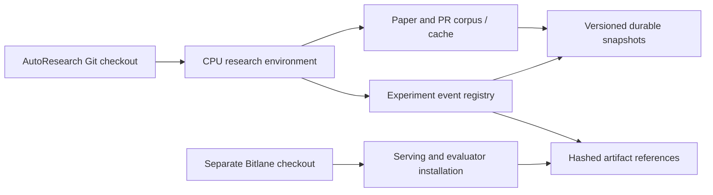
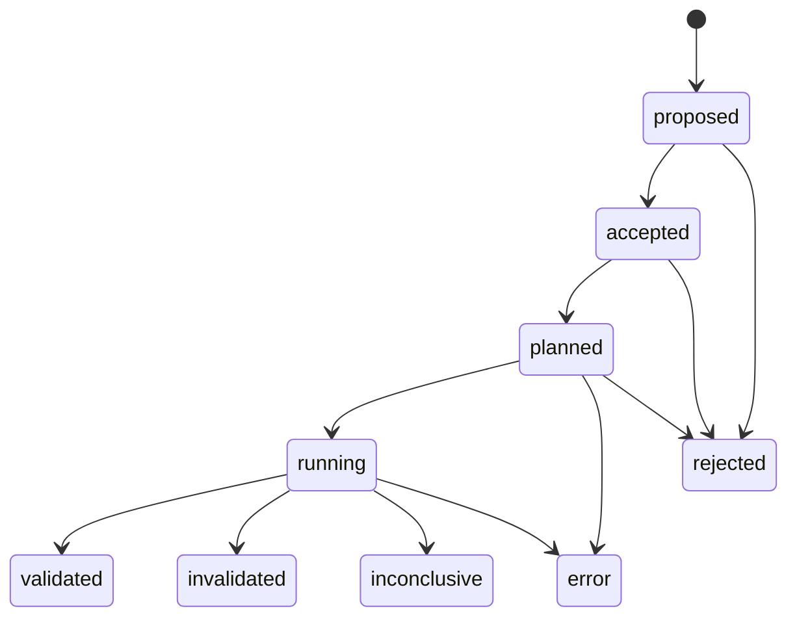

# Portable research and experiment state

## Boundaries



Code is replaceable from Git. Corpus, API cache, experiment state, and raw evidence
are separate durable state. Bitlane remains its own serving component; installing
research tooling must not start GPU services or change a serving image.

## Current delivery: Git bundle until GitHub push is authenticated

The foundation branch is committed locally but GitHub push credentials are unavailable. The approved private S3 bucket therefore carries a thin Git bundle plus a manifest under `autoresearch/code/`. Fetch the manifest and its named bundle using your AWS profile or the B200 instance role. Verify its SHA-256 before Git import; `base_commit` identifies the prerequisite already available in the public repository.

```bash
GIT_LFS_SKIP_SMUDGE=1 git clone --no-checkout https://github.com/shreyesss/AutoResearch-Inference.git
cd AutoResearch-Inference
aws s3 cp s3://autoresearch-641134885443-us-east-1/autoresearch/code/LATEST.json /tmp/research-release.json
# Download the bundle_key listed in /tmp/research-release.json to /tmp/research.bundle.
# Verify bundle_sha256 using sha256sum (Linux) or shasum -a 256 (macOS).
git bundle verify /tmp/research.bundle
git fetch /tmp/research.bundle refs/heads/infra/research-foundation:refs/heads/infra/research-foundation
GIT_LFS_SKIP_SMUDGE=1 git checkout infra/research-foundation
scripts/bootstrap-node.sh --storage --agents
```

Once GitHub publishing is available, normal clone/check-out replaces the bundle step. The bundle is code history; the corpus and experiment databases are restored separately. Do not restore into an initialized/nonempty research directory.

## Bootstrap a node

Use a checked-out AutoResearch revision that contains `scripts/bootstrap-node.sh`:

```bash
git clone git@github.com:shreyesss/AutoResearch-Inference.git
# Check out the reviewed branch/tag containing the foundation tooling.
cd AutoResearch-Inference
./scripts/bootstrap-node.sh \
  --state-root "$HOME/.local/share/inference-autoresearch" \
  --venv-root "$HOME/.local/share/autoresearch/venv" \
  --dry-run
```

Remove `--dry-run` to install the CPU-side package. Python 3.11+ and Git must
already be available. The script deliberately does not install system packages.
For optional `web-research` dependencies, use `--research-extras` and Python 3.12+.
Core local corpus/registry code does not require the heavy research dependency.
Use `--agents` for the pinned DiscoveryRSI agent dependency and `--storage` for
the S3 client. After activation, `researchctl --help` exposes the research and
registry commands. Pass `--state-dir` to `researchctl` when overriding its default
`~/.local/share/inference-autoresearch` state location.

Before a branch is published, clone that branch from a local Git checkout:

```bash
git clone --branch infra/research-foundation /path/to/local/AutoResearch-Inference /tmp/research-bootstrap-check
```

Git clone copies committed content only; uncommitted edits are not part of that
bootstrap check. This document does not assert that the branch has been pushed.

To clone Bitlane as well, supply the actual repository URL explicitly:

```bash
./scripts/bootstrap-node.sh \
  --bitlane-repo "$BITLANE_REPO_URL" \
  --bitlane-dir "$HOME/workspace/bitlane" \
  --bitlane-ref "$BITLANE_COMMIT"
```

`BITLANE_REPO_URL` and `BITLANE_COMMIT` are operator inputs, not defaults. A new
clone can be pinned to a commit; an existing clone is neither pulled nor reset.
A supplied ref must already match that checkout. This script does not install
Bitlane's serving dependencies; follow its versioned deployment instructions.

The bootstrap prints activation and `AUTORESEARCH_STATE_ROOT` commands. Keep
state and the virtualenv outside both code checkouts. The script validates
resolved paths, including symlinks, and rejects nested/overlapping locations.
Use SSH agents or credential helpers; do not embed tokens in Git URLs. The
script does not read, copy, source, or commit `.env` files.

## Independent experiment registry

The callable API is `ideation.experiments.ExperimentRegistry(state_root)`.
Its database is:

```text
<state-root>/experiments/experiments.sqlite3
```

The existing hypothesis memory remains intact. `hypothesis_id` is the exact ID
from that memory, and `baseline_id` identifies the immutable deployment baseline.
No writes back to old hypothesis ledgers occur. The operator must establish those
references; this registry does not validate an external memory database exists.
Use provenance to attach hardware, model/image/commit identities, workload,
source citations, originating run, and any predecessor attempt IDs.

An experiment is one attempt at one baseline and one scope:

- `component`: isolated kernel/operator/component measurement.
- `native`: integration and critical-path/actual-request diagnostics.
- `service`: client-visible serving objective and its guards.

**A validated component attempt never validates a native or service attempt.**
For example, C25's H200 sampler timings cannot become a B200 service win through
metadata migration. Create separate linked attempts with their own evidence.



Terminal attempts cannot restart. A retry or revised conclusion gets a new
experiment ID and explicit provenance linking the previous attempt. All original
events remain. `error` means execution failed; it is not evidence that the
mechanism is invalid. Selection acceptance also is not experimental validation.

### Python example: an explicit unknown and a cheap pilot

This example records a plan, not a historical measurement:

```python
from ideation.experiments import ExperimentRegistry

registry = ExperimentRegistry("/path/to/durable-state")
record = registry.create(
    "C25-native-pilot-new", "hypothesis:existing-memory-id", "baseline:pinned-id", "native",
    provenance={"code_commit": "PIN_ME", "hardware": "H200", "source_run": "C25-component"},
    roi={
        "metric": "ITL", "unit": "ms", "baseline_value": None,
        "expected_relative_gain": None, "min_relative_gain": 0.02,
        "assumptions": ["Sampler savings must be exposed on the critical path"],
        "unknowns": ["Measure useful output progress and native critical-path saving"],
    },
    evaluation_plan={
        "workload": "pinned Mooncake cohort", "budget_gpu_hours": 1,
        "measurement": "Critical-path saving per useful output token",
        "stop_rule": "Do not escalate if the service gain cannot plausibly exceed 2%",
    },
    event_id="create-C25-native-pilot-new",
)
registry.transition(record["id"], "accepted", note="Bounded uncertainty-resolving pilot approved",
                    expected_status="proposed", event_id="review-C25-native-pilot-new")
registry.transition(record["id"], "planned", note="Evaluator and baseline pinned")
# Record 'running' only when an actual attempt starts; this API does not run it.
registry.export("/path/to/durable-state/exports/experiments.json")
registry.close()
```

`min_relative_gain` is a task-specified fraction: `0.02` means 2%, and zero is
allowed when appropriate. It is not a global hardcoded gate. Unknown estimates
are allowed with named unknowns and an evaluation plan. There is no novelty
requirement. The registry checks metadata completeness, not the scientific
quality of an ROI estimate or whether a proposed plan deserves compute.

### API contract

- `create(experiment_id, hypothesis_id, baseline_id, scope, *, provenance, actor="operator", roi=None, evaluation_plan=None, event_id=None)`
- `transition(experiment_id, status, *, note, actor="operator", artifacts=(), metrics=None, event_id=None, expected_status=None, roi=None, evaluation_plan=None)`
- `get(experiment_id)` returns the current projection and every immutable event.
- `list(*, status=None, hypothesis_id=None, baseline_id=None, scope=None)` filters projections.
- `export(path=None)` returns a consistent JSON snapshot and optionally writes it atomically.
- `close()` releases the SQLite connection.

Accepting/planning requires an explicit ROI and nonempty evaluation plan. A null
`baseline_value` or `expected_relative_gain` requires `unknowns`. Measured values
must be finite. `validated`/`invalidated` require artifact references.

For each artifact, pass either a local filename or `{"uri": "s3://...", "sha256": "..."}`.
Local files are hashed; remote digests are labeled `caller_supplied_unverified`.
The registry does not fetch remote evidence, fabricate results, independently
validate numerical claims, or infer a service verdict from a component result.
Metrics are evaluator-reported data retained without reinterpretation.

`event_id` supports retry-safe calls: identical retries do not append events,
while reuse with different content raises an error. If omitted, it is derived
from the content. `expected_status` provides optimistic concurrency protection.
SQLite transactions serialize simultaneous writers on one node; append-only
triggers prevent accidental SQL updates/deletions. These are integrity controls,
not protection from a privileged user modifying the database file.

## Durable snapshots and recovery

Do not Git-commit mutable corpus databases or raw experimental logs. Git stores
code, configs and reviewed reports; durable storage holds state snapshots and
raw evidence, referenced by hashes. Cloud publishing requires the user's bucket
approval and the configured snapshot tool. Bootstrap creates no bucket and
configures no timers.

A live SQLite file may have committed data in its WAL. Use SQLite's backup API
for a consistent database snapshot; copying only `experiments.sqlite3` is unsafe:

```python
import sqlite3
source = sqlite3.connect("/state/experiments/experiments.sqlite3")
backup = sqlite3.connect("/snapshots/experiments.sqlite3")
source.backup(backup)
backup.close()
source.close()
```

To restore that database, stop registry writers and restore the **verified backup**
to a fresh state directory's `experiments/experiments.sqlite3`; then open the
registry. Retain the old state directory. JSON export is a readable audit artifact,
not currently an automatic historical-import command. Explicitly imported past
outcomes must preserve scope, original evidence URI/hash, and the fact that an
outcome is historical rather than a newly executed test. Never reconstruct a
missing outcome from an agent's narrative alone.

Do not share an active SQLite database between machines via S3 or a network
filesystem. Use one authoritative writer per state lineage, immutable snapshots,
and a controlled restore on a replacement node. Multi-node reconciliation is a
separate operation; snapshot publishing is not database synchronization.

### Import the retained C24/C25 outcomes explicitly

Preview checks every retained receipt and local artifact checksum before opening
mutable state:

```bash
python scripts/import_recovered_experiments.py \
  --source ideation/runs/h200-overnight-001 \
  --state-dir "$HOME/.local/share/inference-autoresearch"
```

Add `--apply` to append the verified historical records. The exact mappings are
C25 component-002 `validated`, C24 short-operation probe `inconclusive`, and C25
native-003 `error`. Importing does not rerun any GPU work and never creates a
service win. Each imported event retains its original memory event ID, test ID,
timestamp, scope, source receipt hash, and checked evidence hash. Baseline IDs
here derive from the retained hardware/image fields and are explicitly labeled
as incomplete runtime attestations.

The import uses `ExperimentRegistry.import_historical(...)`, an explicit path
that records one historical final event rather than fabricating past approvals,
launches, or ROI estimates. Repeated identical imports are idempotent; changed
content for an existing original event fails. The generic API expects the caller
to authenticate the receipt; this script additionally checks the known mappings
and retained artifact sizes/SHA-256. C26 remains a source applicability rejection
in `APPLICABILITY_REVIEW.md`, not an invented measured component outcome.

## `researchctl` command reference

Set `IDEATION_STATE_DIR` (or compatibility alias `AUTORESEARCH_STATE_ROOT`) or
pass `--state-dir` **before** the command. The default is
`~/.local/share/inference-autoresearch`. Every CLI operation holds a local writer
lock, including schema-opening reads. Library callers must coordinate with that
same writer policy if mixing direct API and CLI access.

```bash
researchctl init
researchctl plan --repo vllm-project/vllm --query 'speculative decoding' --recent-days 30
researchctl import-corpus --source /retained/corpus.sqlite
researchctl import-corpus --source /retained/feed-openings.jsonl.gz
researchctl search 'sampler speculation' --after 2026-01-01 --limit 20
researchctl show github:vllm-project/vllm:61869 --history
researchctl refresh
researchctl run --question 'Reduce exposed draft latency on H200' --source-id arxiv:2610.20175
researchctl run --question 'Inspect cached sampler evidence' --offline
researchctl run --question 'Propose a bounded pilot' --reason --brief /path/task-brief.json
researchctl status
```

`--repo` overrides the configured repository list for that invocation; repeat it
for multiple repos. `--query` appends arXiv queries. `--recent-days` changes ranking
recency preference and the initial GitHub window for that invocation; it does not
erase prior corpus contents or reset established archive checkpoints. `plan` is
offline. `refresh` makes bounded API calls and preserves its config/receipt before
a local snapshot, including failures. `run` refreshes by default, builds an
explainable shortlist, selects up to `--deep-count` sources (default 3), fetches a
bounded primary-source dossier, and snapshots local research state. `--source-id`
is repeatable. `--offline` skips refresh and permits only cached reads; it cannot
be combined with `--reason`. Model reasoning is explicitly enabled by `--reason`
and requires a task brief and the optional agent dependency. No CLI research
command launches GPU work.

An explicit `--env-file /path/providers.env` uses the provider allowlist without
variable interpolation. Unrelated secrets are not exported. Provider loading also
occurs for refresh/run through the configured provider file locations. Credential
files are never copied into research state. Error output suppresses provider
exception text because request URLs can contain credentials.

### Local snapshot round trip before any S3 approval

```bash
researchctl snapshot --namespace research
researchctl push --local-remote /durable-test-remote --manifest-id FIRST_ID
# On a fresh replacement state root:
researchctl --state-dir /new-state pull --local-remote /durable-test-remote
researchctl --state-dir /new-state restore --manifest-id FIRST_ID
```

On subsequent publications, take a new snapshot and pass
`push --expected-head PREVIOUSLY_PUBLISHED_OR_RESTORED_ID`. The ID must match the
local lineage record and the remote head. Merely pulling a remote archive never
advances writer lineage: stale nodes cannot silently replace newly published
state. Restore requires an empty/absent namespace directory and does not merge
into active state. Repeat the operations with `--namespace experiments/registry`
for the independent registry.

`--bucket NAME [--profile PROFILE] [--region REGION]` selects S3 instead of
`--local-remote`. Publishing to S3 is an explicit action after approval. By default,
`init`, `refresh`, `run`, and `snapshot` only write local snapshots; optional
automatic publication must be configured explicitly as described below. `bucket-plan`
prints proposed API arguments and cost assumptions without contacting AWS.

### Corpus migration limits

SQLite sources open read-only. Documents and metadata remain decoded correctly;
material revisions and graph/checkpoint evidence are retained. Newer local
projections win by normalized source timestamp and then fetched timestamp.
Conflicting checkpoints are archived under `imported:` keys; they do not overwrite
active local collectors. Derived mentions/links from superseded source documents
are not added to the current graph; their original document revisions survive.
Normalized `.jsonl` and `.jsonl.gz` feeds are also supported. Importing does not
prove that a prior collection was complete.

### Enable automatic publication after approval

After the first manual publication has established the correct local lineage,
configure the approved remote:

```bash
researchctl remote configure \
  --bucket YOUR_APPROVED_BUCKET \
  --profile YOUR_AWS_PROFILE --region us-east-1 --prefix autoresearch \
  --auto-publish
researchctl remote show
```

For an offline test remote, replace the bucket/profile options with
`--local-remote /separate/durable-directory`. Configuring a remote performs **no
external actions**. It writes only nonsecret bucket/profile/region/prefix or local
path settings to `<state-dir>/remote.json`. Omit `--auto-publish` to keep publication
manual; `researchctl remote disable` stops automatic publication while preserving
the remote settings.

When enabled, subsequent snapshots from `refresh`, online `run`, corpus imports and
experiment mutations also publish their namespace. A standalone `snapshot` does
the same. Offline `init` and `run --offline` retain local snapshots and skip
automatic publication, even when configured. Each publication uses this writer's last successfully published or
restored lineage; it never adopts a remote head to bypass a conflict. Publication
failure returns a nonzero command status with the retained local manifest ID and
writes `publication-failure.json`. Local state and snapshot chunks remain intact.
The failed writer must resolve credentials/connectivity or explicitly reconcile
with the current remote state. No unsafe overwrite or automatic conflict reset
occurs.

Remote configuration lives outside both namespace snapshots. A replacement node
must explicitly configure its remote after restoring the desired state; restoring
a corpus alone does not unexpectedly enable cloud writes.

### Portable retained experiment evidence

New transitions and historical imports automatically retain small local evidence
files in `<state-dir>/experiments/artifacts/<sha256>.<extension>`. Retention is
limited to **16 MiB per file** and JSON/JSONL, Markdown, CSV, text, and YAML.
Credential/secret/key/token filenames and `.aws`/`.ssh` paths are rejected.
Large profiles, binary files, and remote references remain explicitly marked as
requiring separate external retention; this operation never downloads a remote
URI or bulk-copies a profile directory.

To materialize already recorded local references without changing historical
events:

```bash
researchctl experiment retain-artifacts
# Or one attempt:
researchctl experiment retain-artifacts --id recovered-C25-component-002
```

The command snapshots the experiment namespace and publishes it if configured.
Original event receipts, original absolute URIs, hashes, and timestamps remain
unchanged. An independent append-only `artifact_copies` index stores the
content-addressed state-relative path. `experiment get` adds a `resolved_artifacts`
projection with `state_relative_path`, `resolved_local_file`, and retention status.
On a replacement node these paths resolve against its own state directory, and
SHA-256 is checked before reporting `retained_verified`. A missing/corrupted copy
is reported explicitly. This verifies retained bytes, not the scientific claim
or any remote object's contents.

If artifact retention fails after an experiment event commits, the CLI still
snapshots the committed journal and attempts configured publication. It returns a
nonzero result containing the snapshot/publication receipt and sanitized failure
type. Inspect the existing attempt before retrying; the event was not rolled back.
