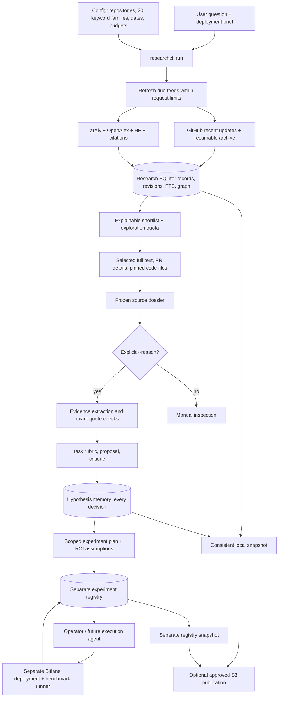
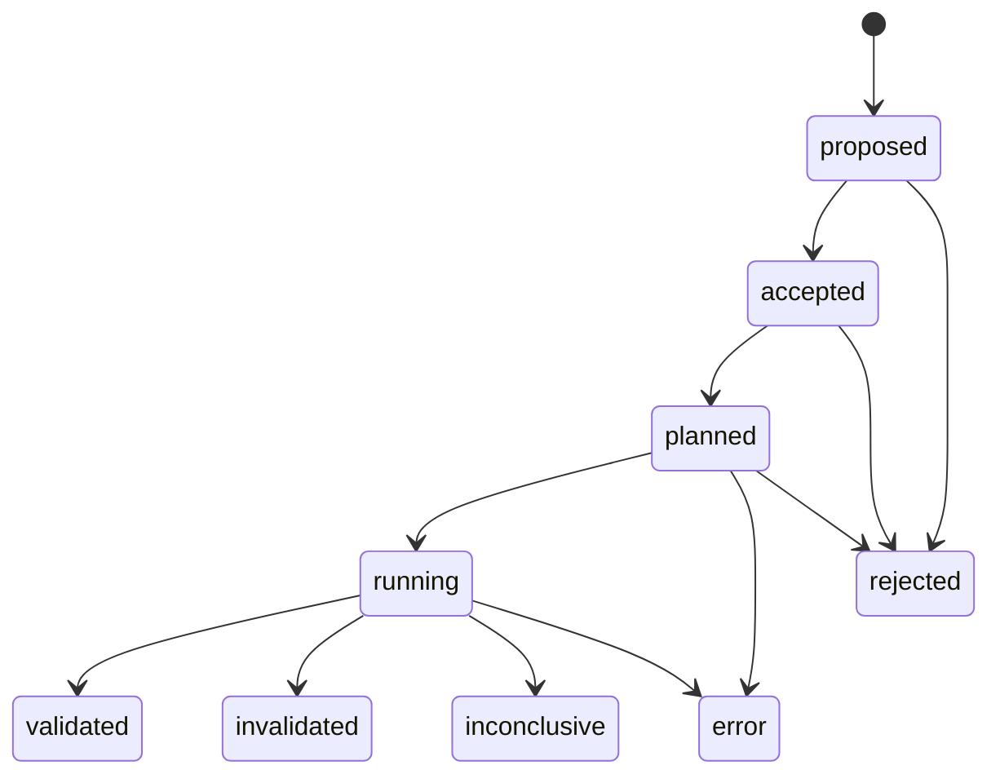

# Research foundation

Implementation: 22 October 2026. This is the CPU-side discovery, evidence, hypothesis and state layer. Serving and GPU experiment execution remain separate in Bitlane and the existing benchmark adapters.

## What runs



This is a small Python command pipeline. There is no permanently running agent, graph server, vector database, or GPU requirement. The optional reasoning stage uses the existing authenticated agent CLI through separate bounded model invocations. DiscoveryRSI provides candidate/episode/replay records; it does not supply an autonomous research laboratory. The existing Fathom connector remains an optional tool; the default pipeline does not start a Fathom server.

## Three independent components

| Component | Authoritative state | Contract |
|---|---|---|
| Source library | `research/corpus.sqlite` | Opening records, paper metadata/text, pinned code, observed revisions, citation/reference edges, ingestion cursors |
| Hypothesis formulation | `research/hypotheses.sqlite` | Immutable hypotheses, baseline/policy snapshots, exact evidence, accepted/deferred/rejected decisions and lineage |
| Experiment tracker | `experiments/experiments.sqlite3` | One attempt per baseline and scope; append-only transitions, ROI assumptions, plan, artifact hashes and attributed outcome |

Code and small configuration live in Git. Mutable research state lives outside the checkout. Immutable source dossiers and receipts live under `research/records/` and are included in backups. Raw duplicate downloads, model weights, virtual environments, credentials and bulk GPU traces are not included by default.

The existing hypothesis ledger retains its historical test records for compatibility. New execution attempts use the separate experiment registry and reference a hypothesis ID. There is no hidden two-way synchronization between the two databases and no automatic promotion from a component result to a service result.

## Start on a new node

```bash
git clone https://github.com/shreyesss/AutoResearch-Inference.git
cd AutoResearch-Inference
# Use main for current code; the S3 bundle is a recovery fallback.
git checkout infra/research-foundation
scripts/bootstrap-node.sh --storage --agents
source "$HOME/.local/share/autoresearch/venv/bin/activate"
export AUTORESEARCH_STATE_ROOT="$HOME/.local/share/inference-autoresearch"
researchctl init
researchctl plan
```

The initial delivery uses a private S3 Git bundle because GitHub push authentication is unavailable; follow the bundle instructions in [portable setup](PORTABLE_SETUP.md) before checkout. For an existing corpus, **restore before `init`**, because restore refuses to overwrite initialized state. See [portable setup](PORTABLE_SETUP.md). To clone Bitlane alongside this repo, pass `--bitlane-repo <canonical-url> --bitlane-ref <commit>` to bootstrap. The URL must be supplied; the deployment release directory is not a canonical Git remote. Bootstrap does not install or launch Bitlane services.

Credentials stay in a local file or normal provider environment:

```bash
researchctl --env-file /path/to/private/providers.env refresh
```

Only supported provider keys are loaded. AWS uses its normal credential chain or an explicit profile. Credential values are not written to manifests or passed in Git URLs. Do not put credentials in user briefs or source documents: filename exclusions cannot detect arbitrary secret text.

## Discovery controls

Edit the resolved config at `$AUTORESEARCH_STATE_ROOT/research/config.json`. The initial template is [discovery.json](../ideation/config/discovery.json), with all 20 families from [keyword-guide.json](../ideation/config/keyword-guide.json).

| Setting | Default / meaning |
|---|---|
| `repositories` | vLLM, SGLang, FlashInfer, DeepEP, DeepGEMM, DeepInfer, Mooncake, Speculators and the two distinct TreeSpark repos |
| `github_initial_days` | `null`: start a historical opening-record backfill |
| `github_recent_lane`, `github_recent_days` | Concurrent recent-updates lane, initially 7 days |
| `recency_days` | 120-day paper discovery window and ranking decay; older stored papers retained |
| `refresh_hours` | 24 hours before completed tasks are due again; partial backfills resume earlier |
| `failure_retry_minutes` | 30-minute cooldown for failed tasks |
| `budgets.github_pages` | 8 logical page calls per run, typically at most 100 opening records/page |
| `budgets.paper_requests` | 8 logical searches/resolutions per run; citation calls share the budget |
| `budgets.citation_requests` | 2 reserved logical requests by default |
| `budgets.results_per_query` | 20; arXiv retains pagination; OpenAlex/HF are bounded searches |
| `ranking_weights` | Lexical 70, recency 30; configurable, total 100 |
| `exploration_fraction` | 20% of shortlist slots, reproducible daily sampling outside top keyword scores |

The budget rotates work across repositories and query families. **It does not search every family every day under every budget.** Inspect receipts and increase the budget or invocation frequency if coverage is insufficient. All dates retain their meaning: GitHub updated time is not publication time; paper publication and revision dates are separate. A recent-window completion is not full-history completion.

GitHub opening records contain title, full opening body, state, dates, URL, labels and basic metadata. Comments, review threads, diffs and per-PR file details are retrieved selectively during a deep read. Historical pagination and recent updates have independent cursors. Rate-limit failures preserve progress. Without a GitHub token, the public API limit can be reached quickly; the last response allowance is included in feed receipts.

The response cache preserves successful responses across runs and restoration. Failed calls do not become successful source records. Provider retries can create additional HTTP attempts beyond the logical-call counts. Paid Serper calls are not used by default discovery/deep reading; the existing optional search tool retains its local 20/day and 2,000-total attempt budgets. These budgets are local accounting, not the provider's account balance.

### Local inspection

```bash
researchctl search 'speculation tpot' --after 2026-09-01 --limit 10
researchctl show github:vllm-project/vllm:62541 --history
researchctl status
researchctl plan --repo vllm-project/vllm --query 'all:"adaptive speculation"'
```

FTS search uses BM25 with title/body/tag weights 5/1/2 and literal query expansion. The discovery shortlist is a different heuristic: lexical weight × `min(matched_families/4, 1)` plus recency weight × `exp(-age_days/recency_days)`. Its bounded pool combines newest records, family FTS results and a sample of older IDs. These are retrieval scores, **not estimated speedups, compatibility guarantees or probability of success**. The run question drives local candidate selection; explicit `--source-id` gives exact control.

Canonical arXiv/HF/OpenAlex identities deduplicate mirrors using explicit identifiers, never title similarity alone. The two papers called TreeSpark remain distinct. Full paper revision histories are only preserved when observed; this is not a complete mirror of every historical arXiv revision.

## Deep reading and hypothesis generation

```bash
researchctl run \
  --question 'When does a load-adaptive draft tree beat fixed DSpark k5?' \
  --source-id arxiv:2610.20175 --source-id arxiv:2609.22098 \
  --deep-count 2 --max-http-calls 12
```

The command first refreshes due configured feeds, then reads selected primary sources. It fetches arXiv HTML with PDF fallback, selected PR details, citation links and linked repository READMEs pinned to a commit. **A README is implementation discovery, not a verified kernel path.** Put exact `{repo, ref, path}` entries in a brief's `code_sources` to read the actual implementation files; `ref` must be a full commit hash. A bounded dossier records omissions, failures, read depth and source hashes.

Citation edges can point to papers not yet downloaded. Those IDs are explicitly unresolved and queued for future retrieval. Figures, tables embedded as images, OCR, unrestricted crawling, full codebase understanding and independent reproduction are not provided automatically.

Add `--reason --brief /path/to/task.json` for the existing evidence → rubric → proposal → critique sequence. The brief must specify the current baseline, objective, workload and constraints. The run keeps the rubric, prompts, evidence packet, review and every proposal. Model calls are opt-in; discovery does not call a model. `--offline` skips discovery and allows only cached deep reads; it cannot be combined with `--reason`, whose task-directed lookups can need network access.

### Adaptation to the task

```json
{
  "name": "Reduce long-output serving ITL",
  "count": 2,
  "target": {"gpu": "H200", "workload": "Pinned Mooncake + agent-75 manifests"},
  "baseline": {"image_digest": "REPLACE_WITH_RUNNING_IMAGE", "topology": "DP4/EP4 per group", "draft": "DSpark k5"},
  "instructions": "Improve our current implementation. Known methods and upstream ports are welcome. Estimate removable time, call frequency, accepted progress, overlap and engineering effort. If ROI is unknown, propose a cheap diagnostic. Do not infer service benefit from a component-only gain.",
  "selection": {"require_novelty": false},
  "constraints": ["No GPU execution in research", "Use existing evals unless they cannot expose the mechanism"]
}
```

This is a template, not a verified deployment snapshot. Replace placeholders and pin workload/image/source identities before qualifying an experiment. Novelty is mechanically disabled when `require_novelty:false`; publication novelty is not a default gate. The task generates the weights, evidence requirements and threshold. Unknown required facts defer a proposal; unsupported claims reject it. All decisions remain in memory.

ROI should explain the service path:

`exposed time saved ≈ component time saved × calls per service iteration × non-overlapped fraction`

Convert to the objective using accepted tokens/progress and measured baseline iteration time. This is a conditional estimate, not an end-to-end measurement. Keep queueing, TTFT, output-length mix and tail guards explicit. A component gain does not establish an SLA-capacity gain. See [adaptive policy](../ideation/docs/ADAPTIVE_POLICY_AND_MEMORY.md) and [ROI guidance](../ideation/docs/HYPOTHESIS_ROI.md).

## Experiment state



Each attempt pins `hypothesis_id`, `baseline_id` and `scope` (`component`, `native`, `service`). Acceptance/planning requires an ROI record and evaluation plan. Numerical estimates may be null if unknowns and a bounded diagnostic are explicit. The minimum useful gain belongs to the task, not a global fixed percentage. Terminal measured outcomes require artifact references; local files are hashed, while supplied remote hashes remain explicitly unverified. Eligible text artifacts up to 16 MiB are also retained by hash inside experiment state, so moving nodes does not leave only broken absolute paths. Larger/binary artifacts require explicit external archival. `researchctl experiment retain-artifacts` recovers eligible files referenced by older records without rewriting their events.

```bash
researchctl experiment create --record experiment.json
researchctl experiment transition C025-native-004 --record transition.json
researchctl experiment list --scope service
researchctl experiment get C025-native-004
researchctl experiment export --output /tmp/experiment-journal.json
```

The registry records evaluator assertions; it does not certify their scientific validity or execute workloads. Retrying an interrupted attempt creates a new ID. Historical imports retain source event time and do not invent intermediate approvals or retrospective ROI. C26's source applicability rejection is preserved as research evidence, not a failed GPU measurement.

## Durability and concurrency

Every mutating research run writes a local snapshot; experiment transitions snapshot their own namespace. After approved provisioning, `researchctl remote configure --bucket BUCKET --profile PROFILE --auto-publish` enables publication after these snapshots. Publication failures leave the local snapshot intact and return a nonzero exit. `init` and `run --offline` remain offline. SQLite online backup includes committed WAL data. The CLI serializes writers so corpus, memory and cache can be captured together. Legacy tools that bypass the CLI lock must not write during a snapshot.

Snapshots use compressed content-addressed chunks, immutable manifests and SHA-256 verification. Publication advances a remote head conditionally; a stale writer cannot overwrite another writer's head. Pulling merely downloads a snapshot. Restoring adopts it into a new state directory. There is **one authoritative writer per lineage**; this is not multi-master database replication.

```bash
# Offline durability rehearsal, no AWS needed:
researchctl snapshot
researchctl push --local-remote /path/to/backup
researchctl --state-dir /path/to/fresh-state pull --local-remote /path/to/backup
researchctl --state-dir /path/to/fresh-state restore --manifest-id MANIFEST_ID

# After approved cloud provisioning, use --bucket instead of --local-remote.
# A subsequent push also supplies --expected-head PREVIOUSLY_PUBLISHED_ID.
```

Detailed format, selection, cost and the concrete bucket plan: [storage](../ideation/docs/STORAGE.md). No automatic garbage collection is enabled: immutable history continues growing. Large benchmark outputs should use separate, explicitly selected artifact snapshots. Local snapshot existence is not cloud durability until push succeeds.

## Scheduling, tests and limits

`run` refreshes due tasks automatically. An optional cron/systemd invocation of `researchctl refresh` can run periodically. **No scheduled job is installed by bootstrap.** A single authoritative writer should own that schedule; do not have every GPU node independently refresh and publish the same corpus.

```bash
.venv/bin/python -m pytest ideation/tests -q
scripts/bootstrap-node.sh --dry-run
```

The legacy GPU harness has separate environment-dependent tests requiring pinned AIPerf/tokenizer/model fixtures. Its historical results and protocols remain intact; this refactor does not make that harness portable merely by installing research dependencies. The current verification report records live API, cache, migration and restore results separately from mocked tests.
