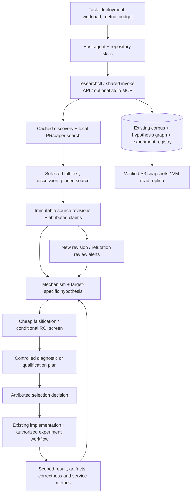

# Research that reaches an experiment

## Architecture

One host coding/research agent chooses questions, reads evidence, authors hypotheses and critiques their applicability. Skills guide that work. Python tools provide retrieval, persistence, checks and arithmetic. The optional MCP server exposes those same tools; it is not another reasoning agent or a persistent autonomous researcher.



## What changed

- **Evidence claims are separate records.** An exact excerpt must occur in a retained source revision. Its stored-text offsets, source hash and attribution survive subsequent source edits. A numeric author result also needs its original baseline, conditions, units and supporting excerpt. Quote matching checks provenance, not whether the interpretation is scientifically correct.
- **Hypotheses state a mechanism and a falsifier.** A target forecast is optional. If provided, it needs explicit bounds, units, method, workload, baseline, assumptions and uncertainty. A paper's speedup does not automatically become our expected speedup.
- **Screening is attached to the hypothesis.** Missing target timing/provenance returns `insufficient_evidence`. The existing exposed-time calculation uses accepted output progress, calls and overlap. It cannot infer tail ITL, TTFT or E2E from component arithmetic.
- **Plans distinguish diagnosis from qualification.** An unresolved screen can motivate a tightly bounded diagnostic. It cannot qualify a serving improvement. A review-ready plan needs exact source/image/model/workload pins, baseline consistency, correctness checks, paired runs, separate profiling, metric definitions, tail guards and budgets.
- **Decisions remain attributable and revisitable.** Accepted means selected, not experimentally validated. Rejections and deferrals need reasons and reopening conditions. Supporting and refuting claims, source changes and independent experiment outcomes appear in the cold-start dossier.
- **Research runs remain bounded.** Query/taxonomy versions change paper discovery cursor identity. The command journal records redacted normalized queries, config hash, code commit and dirty-worktree status. It reports unknown provider billing as unknown.

The host still judges mechanisms, transfer conditions and evaluator coverage. Structural checks cannot guarantee good scientific judgment. Novelty is **off by default**; task benefit, feasibility, evidence and the cheapest falsifier guide selection. Existing configurable rubric/ROI tools remain available.

## Use from chat or CLI

```bash
researchctl doctor
researchctl expand --question 'Reduce exposed DSpark draft cost under high load'
researchctl pr-search 'draft K=0' --repo vllm-project/vllm --after 2026-09-01 --limit 20
researchctl show github:vllm-project/vllm:53426 --history
researchctl investigate --question 'Which mechanism transfers to our deployment?' \
  --source-id github:vllm-project/vllm:53426 --deep-count 1 --max-http-calls 8
researchctl claim record --record claim.json
researchctl hypothesis propose --record proposal.json
researchctl screen HYPOTHESIS_ID --record screen.json
researchctl eval-plan HYPOTHESIS_ID --record plan.json
researchctl decide HYPOTHESIS_ID --record decision.json
researchctl hypothesis show HYPOTHESIS_ID
researchctl changes --cursor 0 --limit 100
```

`search` supports `--repo`, `--kind`, `--offset`, and `--date-field`; timestamps are inclusive `after`, exclusive `before`. `investigate` deepens selected sources without a general feed refresh. `run` includes configured discovery refresh. Neither enables model reasoning unless `--reason --brief ...` is supplied. Successful optional model evidence packets are also retained as typed claims; only exact source/excerpt matches become typed hypothesis links. Legacy selection remains distinct from the new evaluation-plan gate.

Use global `--local-only` for local snapshots without automatic publication on these research mutations. `changes` returns a cursor; save it after consuming the page. Source-change alerts request review, not automatic retraction or acceptance.

An executable offline example, using a clearly marked synthetic source:

```bash
python scripts/demo_research_flow.py --state-dir /tmp/research-demo-FRESH
```

The example deliberately ends deferred: evidence about another setup does not supply a target trace or exact deployment pins. [Fixture JSON](../ideation/examples/evidence_fixture.json) shows claim/proposal contracts. [Plan checks](../ideation/ideation/eval_plan.py) define required fields. [Tests](../ideation/tests/test_research_flow.py) include a fully pinned **synthetic** diagnostic manifest, rejection cases and cold-start replay.

## MCP: a thin optional transport

Install `pip install -e 'ideation[mcp]'` with Python 3.11+. The server uses the [official Python SDK](https://github.com/modelcontextprotocol/python-sdk), pinned to 2.3.0. Launch:

```bash
research-mcp --state-dir "$HOME/.local/share/inference-autoresearch"
# Explicitly enable provider retrieval and configured S3 publication if wanted:
research-mcp --state-dir "$HOME/.local/share/inference-autoresearch" --allow-network --publish
```

Fourteen tools cover doctor, local search, source inspection, expansion, discovery, investigation, claim/hypothesis recording, dossier reading, evidence linking, screening, plan checks, decisions and changes. All use the same writer lock and command journal as CLI. Tool responses are structured JSON. Default server mode is local; live retrieval requires `--allow-network`. The server exposes no GPU execution, shell execution, Git write or implicit LLM tool. MCP client installation/configuration is a separate integration; this change tested the server and stdio protocol, not a configured chat client.

Provider REST APIs remain the cached, durable retrieval layer. Additional external MCP providers can be useful search sources, but their responses must still become retained evidence before supporting a decision. There is no mandatory external MCP dependency.

## State and implementation handoff

Existing `research/corpus.sqlite` stores revisions; `research/hypotheses.sqlite` gains additive typed indexes over its immutable graph. The independent `experiments/experiments.sqlite3` stores attempts/outcomes. No parallel source or hypothesis database was introduced. Snapshot/restore covers the new graph tables through existing SQLite backup machinery. New runs and credentials stay outside Git; code, skills, tests and concise inspection reports stay in Git.

For implementation, the agent first resolves blocked pins and source applicability, prepares the smallest candidate patch against the control commit, and records an evaluation plan. Assess agent-75 and Mooncake stimulus/observable coverage before adding custom evaluation. Use a bounded probe only for an actual gap, e.g. same-request K transitions or accepted tokens per step. Preserve existing scored service workloads; capture profiler traces separately. Record component, native and service outcomes at their actual scope.

## Verified and unfinished

See the [real-source demonstration](verification/refined-research-20261022/REPORT.md) and [integration assessment](../research/INTEGRATION_GAP_ANALYSIS.md).

Implemented: typed claims and decisions, conditional screens, checked handoffs, optional MCP, source-change review, configurable discovery and durable state integration. Remaining limits: no automated numerical entailment proof; no verified provider billing ledger; no guarantee of exhaustive discovery; no newly autonomous custom-evaluator designer; no measured serving improvement from this infrastructure work. `costs` explicitly reports unsupported billing accounting. Experiments still require the existing execution workflow and actual target access.
