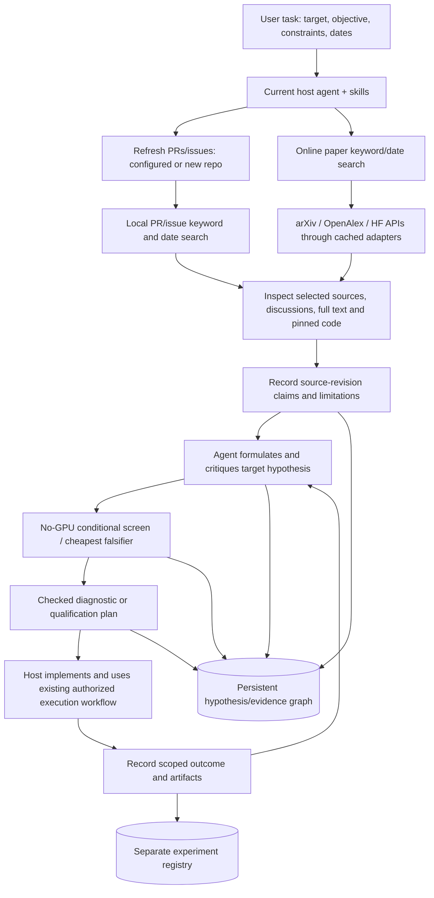

# Exact system design: inference research to implementation

**Implementation audit: 22 October 2026.** This document describes the running code, its intended use, and its limits. The supplied research pack is design input. Its complete aspirational architecture has not been implemented.

## 1. The simple model

**One host chat/coding agent, three tool groups, three persistent stores.**

The host agent interprets your task, selects searches, reads sources, reasons about mechanisms and writes proposals. Repository skills guide it. Python tools retrieve and retain evidence, validate record structure, calculate conditional estimates and prepare reproducible handoffs. MCP exposes those same tools to a compatible client. It does not add another researcher.

| Tool group | Job | Persistent output |
|---|---|---|
| **PR / issue research** | Refresh configured or newly specified repositories; search retained opening records; inspect selected discussions/diffs/code | Sources, revisions, repository cursors and retrieval receipts |
| **Online paper discovery + deep research** | Search live arXiv/OpenAlex/HF by keywords and dates, then read selected original text, references and code | Sources, query provenance, source dossiers and attributed evidence claims |
| **Hypothesis / experiment preparation** | Formulate a target-specific change, challenge it, estimate headroom, specify the cheapest falsifier and controlled evaluation | Hypotheses, support/refutation links, screenings, plans, decisions and separately recorded outcomes |



**Default operating pattern:** refresh relevant PRs/issues → search papers online → inspect promising evidence → synthesize hypotheses → screen → design evaluation → implement/test when the execution prerequisites are met. A local paper search is a useful recall step; it is not a substitute for online discovery.

## 2. The interfaces actually implemented

All CLI examples assume the installed `researchctl` environment. The optional server is `research-mcp --allow-network`; add `--publish` to allow its mutations to use configured S3 publication.

| Need | CLI | MCP | Actual behavior |
|---|---|---|---|
| Refresh watched repositories | `refresh --only github` | `refresh_repositories()` | Online, bounded, resumable opening-record update; no paper calls |
| Refresh a newly named repository | `refresh --only github --repo owner/repo` | `refresh_repositories(repositories=["owner/repo"])` | Starts/resumes that repository's cursor; override applies to this invocation |
| Search PRs/issues already collected | `pr-search` / `search --kind issue` | `search_local` | SQLite FTS; no provider calls |
| **Search papers online** | `paper-search QUERY --provider arxiv --provider openalex --after DATE --before DATE` | **`search_papers(query, providers, after, before, limit)`** | Calls live providers through response caches; stores returned evidence and query receipt |
| Refresh configured paper feeds | `refresh --only papers` | `discover(dry_run=False)` refreshes all configured feeds, not papers only | Bounded taxonomy/seed/user-query rotation; CLI can isolate papers |
| Preview configured discovery | `plan` | `discover(dry_run=True)` | Offline plan; no search has run |
| Plan adaptive query rounds | `expand --question ... --plan FILE` | `expand_queries(..., plan=...)` | Host-authored semantic queries, observations, explicit relaxations and repeat detection; lexical fallback without a plan |
| Read source/revisions | `show ID --history` / `--claims` | `source_show` | Stored source text, revisions or linked claims |
| Investigate selected sources | `investigate --source-id ... --question ...` | `investigate(..., offline=False)` | Bounded primary-text/discussion/code retrieval; no automatic proof of applicability |
| Persist source claim | `claim record --record claim.json` | `record_claim` | Exact excerpt in pinned source revision required |
| Persist hypothesis | `hypothesis propose --record proposal.json` | `record_hypothesis` | Target, mechanism, change, falsifier, baseline and evidence links |
| Read complete hypothesis dossier | `hypothesis show ID` | `hypothesis_show` | Claims, screens, plans, decisions, review alerts and registry attempts |
| Link contrary/supporting evidence | `link-evidence` | `link_evidence` | Append relationship and rationale |
| Screen expected benefit | `screen ID --record screen.json` | `screen` | Conditional arithmetic with target provenance; no GPU |
| Check evaluation plan | `eval-plan ID --record plan.json` | `plan_experiment` | Structural completeness and consistency checks |
| Record decision | `decide ID --record decision.json` | `record_decision` | Attributed selection with reopening condition |
| Find observed source changes | `changes --cursor ...` | `changes_since` | Revision changes and affected hypotheses; caller retains cursor |
| Record experiment attempts/results | `experiment create/transition/show/list` | Not exposed as MCP tools | Separate scoped execution journal; does not launch tests |

MCP has **19 tools**, including `recall_hypotheses`, `command_history` and `checkpoint`. `doctor` provides local health/credential-presence checks. Both CLI and MCP local search expose date-field selection (`created_at`, `updated_at`, `merged_at`, `fetched_at`) and `any`/`all` term matching. Source inspection can select a retained revision hash.

### What “arXiv/OpenAlex MCP tools” means here

**Implemented:** our MCP server's `search_papers` tool can perform online arXiv and OpenAlex searches with provider, keyword and date parameters. Underneath it calls our cached REST clients. This is a real MCP tool interface, tested over stdio, with durable source retention.

**Not implemented/configured:** separate third-party arXiv and OpenAlex MCP servers, or registration of this server in your chat client's configuration. In these sessions the host has operated `researchctl` through its terminal tools. Installing an MCP package is not the same as connecting a client to it. Direct provider APIs and MCP transport can coexist; no external provider MCP is required for the implemented online search.

## 3. PR/issue refresh semantics

Opening records are updated, not downloaded once and forgotten. `refresh` uses repository checkpoints and GitHub's issues endpoint, which returns both issues and PR opening records. Configured recent/archive lanes let recent updates be collected alongside historical backfill. Completed passes advance a watermark with overlap; incomplete passes retain pagination. Refresh honors freshness and rate-limit cooldowns. `--force` bypasses the normal freshness decision, not GitHub permission/rate limits.

```bash
# Update configured GitHub repositories only.
researchctl refresh --only github

# A repository first named in chat: fetch bounded opening records now.
researchctl refresh --only github --repo deepseek-ai/DeepSpec

# Inspect matching retained PRs using explicit update-date bounds.
researchctl pr-search 'dspark tree' --repo deepseek-ai/DeepSpec \
  --after 2026-09-01 --before 2026-10-23
```

A new repository does **not** need a completed full-history download before research starts. Initial coverage depends on configuration; the current all-history archive starts from older records while the recent lane covers recent updates. The receipt exposes partial coverage. Repeating refresh resumes work.

`--repo` does **not** permanently add a repository to the watchlist. To keep refreshing it on future default runs, the agent must explicitly add it to the state config's `repositories` list. That remains a configuration edit, not a dedicated “add repo” command. MCP refresh now offers the same per-invocation repo selection as CLI.

Opening records contain title/body/URL/state/timestamps/labels/basic metadata. Detailed merge/head state, comments, reviews, changed-file patches and pinned implementation files are retrieved selectively during investigation; they are not all guaranteed by opening-record completion. Local search covers only retained text. Arbitrary live GitHub code search and exhaustive online GitHub issue-search partitioning are not exposed by this MCP.

The current detached **backfill** worker is an operational helper for completing GitHub opening history. It is not required to use refresh, and it does not search papers or formulate hypotheses.

## 4. Online paper discovery semantics

```bash
researchctl paper-search 'recurrent speculative decoding' \
  --provider arxiv --provider openalex \
  --after 2026-09-01 --before 2026-10-23 --limit 20
```

- Dates mean paper publication/submission, with inclusive `after` and exclusive `before`. arXiv/OpenAlex receive provider filters and results are checked locally. HF is filtered after its bounded search.
- Limit is **1–20 per provider**. Direct search returns a bounded relevance-ranked page; it is not an exhaustive historical crawl. The separate arXiv feed collector supports resumable pagination. OpenAlex/HF feed searches remain bounded.
- Results are retained in the source database with revision hashes, provider ranks, query provenance and a dated run receipt. Repeated identical requests can use cached provider responses. “Online-capable” does not promise a network round trip on every cache hit.
- arXiv/HF/OpenAlex mirrors retain distinct source records. Explicit arXiv/DOI identity can join them; title similarity alone does not establish identity.
- Partial provider failure is reported. Missing hits are not evidence that a paper or technique does not exist.
- Direct paper search is independent of the background GitHub job and does not require the user to download papers beforehand.

Configured feed discovery adds broad searches, taxonomy rotation, user queries, exact supplied seeds and bounded citation expansion. Current defaults are 20 families, 120-day recency, eight paper-search calls and two citation calls per refresh. These are configuration values, not universal research policy. `refresh_hours: 24` is a freshness interval checked on invocation, **not a scheduler**.

**Evidence that online discovery works:** four mechanism-oriented queries retrieved all five original supplied examples, without titles/IDs in the queries. The additional calibrated TreeSpark was missed by those queries and was previously seed-retained. See [the exact recall audit](verification/paper-discovery-20261022/REPORT.md). This is a small contextual retrieval check, not proof of high recall on unknown future papers.

## 5. Search scoring is not hypothesis grading

There are three distinct rankings:

1. **Local text search:** FTS/BM25 relevance with stable timestamp/ID tie breaks. Literal tokens/quoted phrases and aliases are supported; CLI's default multi-token match is OR. Do not assume arbitrary Boolean syntax is interpreted as a query language.
2. **Online paper search:** each provider's own relevance order. Results retain provider/rank; there is no validated cross-provider semantic reranker.
3. **Configured discovery shortlist:** default `70 × min(matched_families/4, 1) + 30 × exp(-age_days/recency_days)`, plus exploration slots. This lexical term counts matched **families**, not model compatibility or demonstrated ROI. The pool combines recent records, FTS hits per family and a daily reproducible sample. Default exploration share is 20%.

The host should inspect mechanism, workload, hardware applicability, code maturity, counterevidence and uncertainty before proposing an experiment. The lexical shortlist does not perform that scientific review.

## 6. What deep research and hypothesis generation actually do

### Default: the current host agent reasons

The agent expands queries, runs online discovery, recalls existing hypotheses, selects sources and calls `investigate`. That tool can fetch available original full text, selected PR details, citation links and selected repository files pinned to commits. It records omissions/errors and read depth. It does not automatically read every appendix or inspect an entire repository. The agent reads relevant passages and authors claims/proposals.

`record_claim` verifies that a short exact quote occurs in a retained revision. Source text offsets and hashes are preserved. This checks provenance, **not entailment**. Author-reported performance remains attributed to its original conditions. Exact quotations do not certify experimental controls, architecture compatibility or reproducibility.

`record_hypothesis` stores the agent's proposed change, causal mechanism, falsifier, target-profile version, baseline and linked supporting/refuting/background claims. A numeric target prediction is optional; when present its schema requires assumptions, units, bounds, workload/baseline and method provenance. The schema cannot prove that its assumptions are correct.

### Optional: bounded model-assisted workflow

`run` normally refreshes feeds, shortlists and deepens selected evidence. `investigate` deepens selected sources without refreshing unrelated feeds. Neither invokes an extra model unless `--reason --brief task.json` is supplied. That optional path runs evidence extraction, task-derived rubric generation, proposal/critique and persistence using the existing agent CLI. It is a bounded workflow; the current composition uses one hypothesis round. It is not a continuously running autonomous research lab.

DiscoveryRSI supplies optional candidate/episode/replay infrastructure in the legacy model-assisted path. GPT-Researcher and Fathom are optional integrations; the new online paper search and MCP path do not automatically route through their research engines. The core consists of our small adapters, persistence and validation modules plus the host's reasoning.

### Adaptive rubric versus fixed integrity checks

The task brief controls objective, baseline, constraints, allowed changes and selection requirements. **Novelty is off by default.** Known methods can be useful if absent from our deployment. Model-generated rubric weights are task-derived and retained, rather than a universal fixed novelty score.

Fixed checks concern provenance, required fields, consistent baselines, experiment pins and uncertainty. They do not automatically determine scientific merit. Host-authored MCP proposals are not automatically passed through a hidden model critic. Optional model critique is still model judgment, not independent experimental validation.

## 7. Screening, implementation and evaluation

`screen` is currently a **no-GPU analytical tool**, not a general simulator or profiler. It uses supplied component savings, calls per iteration, exposed fraction after overlap, baseline iteration duration and accepted/committed output progress. It can calculate conditional iteration and amortized time-per-token bounds. It does not infer p99 ITL, TTFT, E2E or goodput from those numbers.

Missing target provenance returns insufficient evidence and a deferred conclusion. A negative optimistic bound can reject spending under the stated assumptions. Unknown benefit can motivate a bounded diagnostic. CPU source audits, replay scripts and correctness tests are tasks the host can implement/run; they are not all available as generic one-click screen tools.

The serving evaluation-plan checker requires pinned baseline/candidate/workload, metric definitions, correctness oracle, paired runs, separate profiling, budgets and stop rules. A separate CPU diagnostic path requires pinned probe code, hashed inputs, an observable, support/refute/inconclusive branches and zero GPU budget; it does not demand missing GPU pins or invented ROI. Both paths require existing-evaluator coverage rationale and retain scientific validity as unverified. Simulation or agent-estimate provenance cannot qualify a serving plan. See [evaluation gating](EVALUATION_GATING.md). These checks establish completeness and consistency, not scientific merit or execution authorization.

`accepted` means selected with an attributed reason, not measured improvement. The preferred typed decision path requires a review-ready evaluation plan for acceptance. Older proposal/selection entry points remain for compatibility and do not enforce every new handoff check; legacy accepted records must be reviewed before execution.

The separate experiment registry preserves component/native/service attempts, transitions, outcomes and artifact hashes. The agent/operator records results after actual execution using existing benchmark infrastructure. The registry does not independently certify those measurements, and no component win automatically promotes to a service win. Automatic custom-evaluator generation, image deployment, benchmark execution and robust result interpretation are not newly implemented by this research layer.

## 8. Memory and durability

Default state root: `~/.local/share/inference-autoresearch/`.

| Store | Contents |
|---|---|
| `research/corpus.sqlite` | Source documents/revisions, FTS, ingestion checkpoints, retrieval/source links |
| `research/hypotheses.sqlite` | Immutable hypothesis/baseline/policy nodes, evidence claims, support/refutation, screens, plans and decision events |
| `experiments/experiments.sqlite3` | Independent execution attempts and scoped outcomes |
| `commands.sqlite`, `research/records/` | Redacted command provenance, run receipts, dossiers and retained artifacts |

This is a relational graph in SQLite, not a separate knowledge-graph service. New source revisions can flag affected hypotheses for review. Rejected/deferred/accepted and tested outcomes remain distinguishable. Reopening is explicit; no background agent automatically re-reasons over all old hypotheses.

S3 stores verified snapshots/blobs; it is not a live multi-writer database. One authoritative writer and verified VM read replicas avoid silently merging conflicting SQLite state. Git stores code, skills and compact reports. Large/raw artifacts have separate retention limits; not every downloaded byte or profiler trace is automatically backed up. Local mutations are durable before publication; a successful local command or snapshot does not prove the latest VM replica has arrived.

The common writer lock covers CLI/MCP operations, including schema-opening reads. It provides consistency but can make chat tools wait behind backfill/snapshot work. Interactive `--defer-snapshot` commits local research and receipts while postponing bulk backup until an explicit checkpoint; pending state is visible, and failed checkpoints retain it. It cannot preempt a backfill lock already held. Default publication behavior is unchanged. Verified provider billing/cost reconciliation and general paid-model budget accounting are incomplete; logical request caps are not a billing cap. See [adaptive chat operation](CHAT_RESEARCH_WORKFLOW.md).

## 9. Your TreeSpark handover in this system

The handover is a **user-supplied plan and evidence lead**. It does not by itself establish checkpoint architecture facts, code compatibility or completed tests.

1. Use the exact target identity and frozen-weight constraints as the task brief. Recall previous H200/B200 failures and decisions.
2. Refresh the selected serving/DSpark/TreeSpark repositories and search online for the mechanisms and contrary results; retain exact identities for the two different TreeSpark papers.
3. Investigate source/config/code evidence. Preserve colleague Qwen results as externally supplied, not reproduced target measurements.
4. Record distinct hypotheses for verifier feasibility, fixed tree, selection overhead, calibration and load adaptation. Keep their prerequisites/dependencies explicit.
5. Gate implementation on exact target/checkpoint/runtime evidence and correctness design. Do not substitute Qwen throughput, block depth or calibrated coefficients as our expected V4.1 performance.
6. Assess whether existing Mooncake and agent-75 workloads exercise the intended condition. Add only the specific missing probe/counters, then prepare the pinned evaluation plan.
7. The execution agent/host must still implement and test the verifier and candidate changes. Persist actual results and failures by scope.

This research system can support the handover through evidence and experiment planning. It has **not implemented or benchmarked a V4.1 TreeSpark verifier** through this documentation task.

## 10. What remains missing

| Requested capability | Honest status |
|---|---|
| Online arXiv/OpenAlex keyword/date tools | Implemented in CLI and our MCP server; live retrieval checked |
| New-repository PR/issue refresh | Implemented CLI and MCP; partial/resumable, explicit watchlist persistence still a config edit |
| Chat client connected to MCP | Not configured in this work; host uses CLI |
| Separate external provider MCP servers | Not installed; our MCP wraps cached provider APIs |
| Continuous autonomous paper discovery | Not installed; on-command discovery exists |
| Deep research that reliably finds all important work | Not demonstrated; bounded retrieval, selected-source reading and host/model judgment |
| Autonomous scientific grading/ROI certainty | Not implemented; adaptive judgments plus fixed integrity checks |
| General CPU simulation, GPU profiling or custom-eval designer | No generic implementation in this research tool layer |
| Automatic experiment execution / shipping images | Existing execution systems are separate; research MCP does not do this |
| Multi-writer state / semantic vector search | Not implemented or required for current single-writer operation |
| Persistent experiment/hypothesis history | Implemented, with scoped evidence and explicit retention limitations |

## 11. Implementation map and verification

- [CLI composition and lock](../ideation/ideation/foundation.py), [MCP tool surface](../ideation/ideation/mcp_server.py)
- [Online paper tool](../ideation/ideation/paper_search.py), [cached provider/evidence tools](../ideation/ideation/evidence.py)
- [Incremental collectors and shortlist](../ideation/ideation/discovery.py), [selected-source investigation](../ideation/ideation/deep_dive.py)
- [Typed research records](../ideation/ideation/research_flow.py), [task policy](../ideation/ideation/policy.py), [conditional screening](../ideation/ideation/controls.py)
- [Evaluation-plan checker](../ideation/ideation/eval_plan.py), [experiment registry](../ideation/ideation/experiments.py), [durable storage](../ideation/ideation/storage.py)
- [Real keyword-retrieval audit](verification/paper-discovery-20261022/REPORT.md), [evidence-to-plan/VM delivery audit](verification/refined-research-20261022/REPORT.md)

The repo-selective MCP refresh and source-selection controls added with this document are covered by mocked routing/network-boundary tests. No new live repository crawl or GPU experiment was launched for this design audit. Historical verification reports retain the test counts and commits from their own dates.

Current verification: **211 research tests passed** and bootstrap `--dry-run --mcp` passed after the refresh-control addition.
