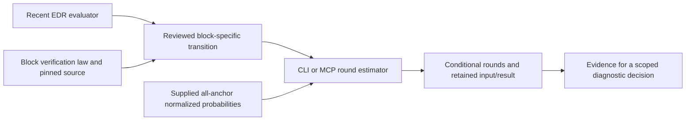

# Checkpoint32 — a surviving sampler proposal and a usable evaluator

The CPU-only discovery loop remains active. This batch produced **one deferred
optimization proposal and one reusable evaluation tool**. Neither is a measured
serving improvement. The earlier [candidate map](CANDIDATE_MAP_30.md) remains
relevant; FV86 below is an additional conditional opportunity.

## 1. FV86: avoid residual scans when the final prefix already passes

In the pinned c455 probabilistic block verifier, each passing prefix replaces the
accepted length. The last valid draft token uses its cumulative ratio directly;
it does not need the interior residual-vocabulary reductions. If that unchanged
terminal test passes, earlier tests cannot change the final accepted length.

The proposed change computes that terminal predicate after cumulative ratios,
then skips interior residual reads for eligible complete passes. Failed requests
keep the existing parallel scans. Proposal probabilities, actual AV lengths,
original indexed RNG and `<=`, target outputs and bonus recovery remain unchanged.
All draft IDs, accepted counts and full-pass LSE stores must still be written.
Flags must use the correct current request/state mapping and be freshly initialized.

This survived an independent pinned-source review. It is distinct from round42's
rejected floating-point interior-bound shortcut and C025's draft sampler change.
The donor's strict comparison and general lazy scan cannot be transplanted blindly.

**What still decides whether it is useful:** actual joint admitted-length/full-valid
completion frequency, exposed residual-stage cost, added flag cost and native
parity. A maximum of2,068,480 logical input bytes avoided for an eligible five-draft
request is an arithmetic bound, not measured HBM traffic or ITL savings. Existing
Mooncake/agent-p75 workloads remain the eventual service comparison; a stage
timeline and joint counter are additional mechanism diagnostics.

[Mechanism and experiment](round86/REPORT.md) ·
[Independent review](round86/INDEPENDENT_REVIEW.md)

## 2. Cross-paper synthesis rescued the offline block evaluator

Round85 identified a useful evaluator inside the recent EDR training paper, but
its ordinary-rejection transition did not match our block verifier. We tested
whether discarded off-output-path probabilities were indispensable. Matched-input
controls found no counterexample. The original block-verification paper then
supplied the law needed to derive the appropriate target-output-conditioned
transition.

At a potential round start, let P_j and Q_j be cumulative probabilities of the
realized output prefix under target and proposal. Block posterior survival is
`a_j=min(1,Q_1/P_1,...,Q_j/P_j)`. It differs from ordinary rejection's product of
per-token minima. Correction/bonus probabilities give a round-boundary law; the
EDR occupancy method can then sum expected round starts.

Complete rational forward enumeration agreed on240 positive-support conditional
outputs and30 zero-support cases. Independent review checked the derivation and
an additional ternary case. These are finite mathematical controls under ideal
fixed-block assumptions—not native DSpark execution or proof of AV compatibility.

[Derivation, assumptions and falsification attempt](round87/REPORT.md) ·
[Independent review](round87/INDEPENDENT_REVIEW.md)

## 3. The agent can now use that arithmetic directly

`researchctl round-estimate --record INPUT.json`, or MCP `estimate_rounds(inputs)`,
accepts explicit fixed-B ordinary/block laws and returns conditional expected
rounds and round-start probabilities. It retains the input, its hash, result and
command history. It does not collect model probabilities or automatically change
any hypothesis status.

The required data covers **every potential anchor**, not merely starts visited
by one baseline rollout. Scalar probabilities do not certify normalization or
sampling provenance. AV, EOS, native floating-point/RNG effects and serving costs
remain outside its contract. No synthetic result is reported as workload gain.

Verification:408 research tests and29 subtests passed; bootstrap dry run passed;
240 comparisons against complete rational forward enumeration agreed within
`8.9e-16`. The independent reviewer ran160 additional rational Bellman comparisons
and23 focused CLI/MCP checks. Actual CLI examples returned1.5 versus1.75
conditional rounds for block versus ordinary; the native baseline already uses
block verification, so this is a control rather than a new speedup.

A short discovery-skill routing note explains the tool's limits. The skill
validator was unavailable because PyYAML is missing; no validator pass is claimed.

[Tool contract and runnable input](../../OFFLINE_ROUND_ESTIMATE.md) ·
[Implementation verification](round89/REPORT.md) ·
[Independent code review](round89/INDEPENDENT_REVIEW.md)

## Yield and durability

Rounds86/87 reused the prior search's PR and paper leads: zero new broad provider
queries, one explicitly fetched foundational fulltext, one deferred optimization
identity and one evaluator refinement. Round89 turns that refinement into a
CLI/MCP capability. **Zero implementation promotions, GPU experiments or measured
service wins.** Source support, mathematical validity, execution readiness and
service value remain distinct outcomes.

Reviewed reports and code are delivered in Git. Earlier serialized canonical
imports completed through80;81→82/83→84/85→86 is a separate active retention
chain at this checkpoint.87 retention is prepared for review. These facts do not
claim fresh S3 publication or VM restoration. Root retention checks are in
[82/83 review](retention-32/8283_REVIEW.md) and
[84/85/86 review](retention-32/848586_REVIEW.md).

The next active branches examine a recent communication-observability paper and
runtime scheduling mechanisms against the exact MegaMoE path and prior inventory.
They may produce corrections or rejections; no acceptance quota is imposed.
See [copy and frozen-packet hashes](source-copy-manifest-32.json).
