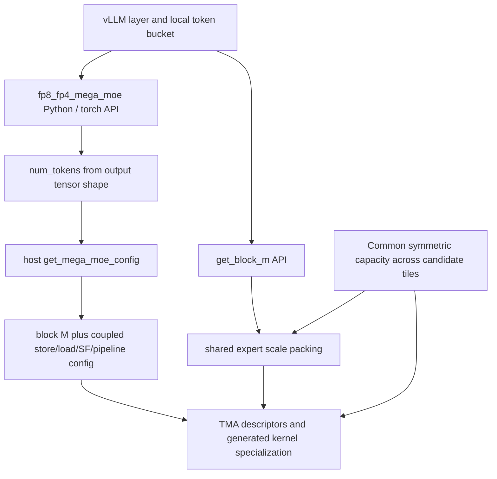

# M01 second-round parameter-flow audit

CPU/source only. No modifications to serving code, GPU launches, compilation, measurements or numerical validation. Round-one verdict remains advance to bounded source/CPU diagnostic. This audit narrows the implementation design and removes an unnecessarily broad buffer-size concern.

## Pins and inspected path

vLLM `c4557869393db4d75c483d92edd02a5125500883`; default vendored DeepGEMM `a7a927731b109fdfec770df7c2a5be5d7e2216b5`. Deployment override/binary identity remains unknown. This note targets the ordinary `fp8_fp4_mega_moe` path, not the separate NVFP4 API or unqualified situ variant. Exact target activation/shared-expert resolution still needs to be frozen.

Three additional immutable device headers downloaded and hashed in `source-manifest.json`. Existing host/API source files retained under `../../moe/sources/dg*`.

## Exact flow

- vLLM `deep_gemm_mega_moe.py:652` queries block M independently; lines792–836 use it to prepare fused shared-expert input scales when scaled shared experts are enabled.
- DeepGEMM Python `mega/__init__.py:176` and torch schema `csrc/apis/mega_moe.hpp:661` have **no block-M override parameter**. Kernel API derives local token count from `y.size(0)`.
- Host implementation `sm100_fp8_fp4_mega_moe.hpp:48` independently calls `get_mega_moe_config`. That function derives block M and companion parameters. Generated JIT source embeds the complete selected configuration; TMA descriptors also depend on it.
- Therefore patching only the Python getter changes scale packing but does not change the launched kernel. Patching only the launch config can mismatch shared-expert scales. Either error is correctness-relevant.

## Existing buffer capacity already spans tile choices

`csrc/apis/mega_moe.hpp:111–160` computes ring capacity as the maximum over all global candidate block sizes and aligns it to LCM1920; SF ring capacity also takes the maximum across candidates. `layout/mega_moe.cuh` lays out peer-visible buffers using the common capacity and shape fields, not the selected block M.

Consequently, a choice among already covered legal block sizes does **not inherently** require a second symmetric buffer or a resized allocation. Keep identical capacity/layout fields across peers. This positive source result refines the earlier general layout concern; it does not certify arbitrary parameter combinations.

## Global candidate list is not a legal-tactic list

Global layout values are `{8,16,32,64,96,128,192,240}`. The ordinary MXFP8FP4 host heuristic currently chooses `{16,32,64,128,192,240}`.

Executed `tile_constraints.py` checks selected device static assertions using host-derived store sizes. Block8 fails the kernel's multiple-of16 requirement. Block96 gets storeM32 while half-block warpgroup rows are48, failing divisibility. This rejects treating the global layout list as eight ready-made tactics. The six other values pass these selected arithmetic checks only; shared-memory pipeline capacity, full compiler invariants, target shapes and actual correctness remain untested. No legal-performance ranking follows from these calculations.

## Can ranks use different block M?

Source gives a plausible basis, with explicit limits:

- Remote dispatch communicates expert counts and source token/top-k indices; input pulls address source tokens independent of sender block size.
- Destination ranks pack their own ring/SF buffers using their local block M.
- Combine writes use original destination token and top-k indices. Peer-completion markers communicate grid identities.
- Upstream `tests/test_mega_moe.py:80–87` seeds randomness by rank and can use different local token counts, which can select different heuristic block sizes. This is intended coverage in test source; the test was **not executed here**, and it does not prove arbitrary explicit overrides.

Thus 'all ranks must use the identical block M' is not established by this source and should not become a rigid gate. Common symmetric layout, model dimensions, process group, SM/barrier participation and per-rank packer/kernel consistency are the actual observed couplings. A future mixed-tile correctness comparison must still include empty/skewed ranks, graph replay, shared experts, ring wrap and repeated calls before performance work. Do not assume this conclusion transfers to NVFP4 or other communication backends.

## Minimal coherent future patch design

1. Expose one explicit optional configuration/override through both getter and actual compute API, retaining default behavior.
2. Resolve the fixed choice by immutable layer identity and captured token bucket; pass the same selected value to shared SF preparation and all host config derivations.
3. Recompute the dependent store sizes, SF tile, pipeline depth, TMA descriptors and generated specialization from that choice. Do not mutate a single template literal after derivation.
4. Keep the existing common-capacity buffer; validate all layout/static constraints. Include the choice in configuration provenance and graph capture identity.
5. Start with fixed per-layer/bucket choices. Runtime histogram-conditioned switching remains a separate integration problem: actual histograms arrive inside the fused work and selecting a new JIT/graph branch is not a scalar flag.

This is a source design, not an implemented patch. No choice can be declared profitable until real physical receive distributions and matched timing are available. Current logical pre-EPLB recorder does not supply those receive distributions. No new GPU traces may be collected under current authorization.

## Decision change

The legal-configuration question is more tractable than initially stated: common buffer sizing deliberately supports multiple tiles, and rank-local tiling is structurally plausible. The main mandatory correctness coupling is **single-source configuration shared by scale preparation and kernel launch**. The original hypothesis survives as a bounded source/CPU candidate, with dynamic runtime selection deprioritized behind a strong fixed table. No new hypothesis is counted and no speedup is predicted.
