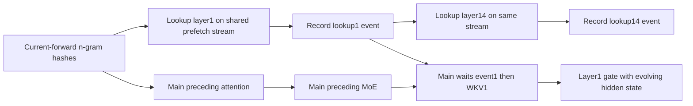

# Round26 — A01 Engram WKV dependency refinement

## Identity and decision

**A01 stays deferred; no new hypothesis identity or service/implementation promotion.** Existing ID `hypothesis:36794075a7034c3f1ff100e73c1d8436a4606397c8e07766ed5388ef64b16646`; immutable baseline `baseline:80ba6154b79544d9d3c2e657ac363fb6e9aef12047e66f73d2b91d7d0caa0c88`. Exact prior node, decisions and baseline are retained. That original baseline is an unlinked historical profile; this source refinement does not silently attest the planned two-TP1/DP4/EP4 deployment or alter its identity.

The useful new finding is a queue-order trap: **appending early WKV to the existing shared prefetch stream after all lookups are queued can force layer1 WKV to wait behind layer14 lookup.** Moving WKV before layer14 avoids that queue dependency but delays the later lookup. Neither ordering creates a free overlap win.

## Source facts and real opportunity

At pinned vLLMc455786, Engram WKV takes n-gram lookup rows and fixed weights. Its inputs do not include the evolving hidden state; the subsequent fused gating operation does. `Engram.forward` still computes WKV after `_ready_rows`/`wkv_input` becomes available. Therefore WKV can, in dependency terms, be moved earlier while gating stays at its original point.

Exact Flash-1017 config has Engram layers **1 and14**, hidden5120, hc_mult4, max_ngram4, heads8, head_dim256. Thus each of **two** WKV projections is6144→25600. No40-layer or five-draft-step multiplier applies. Target decode invokes these layers for its current target rows; actual row counts and cost remain unmeasured. This work exists independently of temperature/top_p, unlike round25's inactive sampling-copy premise.

Saved quantization config specifies dynamic FP8, block32×32, UE8M0; the model's nonignored linear dispatch selects static MXFP8 weights/dynamic MXFP8 activations. For the named FlashInfer CuTeDSL backend, source processing stores FP8 weights column-major[K,N] with swizzled scales; BF16 lookup rows are quantized before GEMM unless a compatible QuantizedActivation is supplied. **Installed backend/version/actual processed tensor layout are not attested.** This branch does not change precision, packed lookup semantics or EG01's separate representation gates.

## Producer/event/consumer DAG

The model creates one shared prefetch stream, passes it to both layers, and prepares every layer's embeddings before decoder execution. For the ordinary shared-host path, each layer records its own lookup-done event; the main stream waits only for that event. The current queue is conceptually:

The exact decoder injection also finalizes the prior residual/mHC state before gating. WKV itself does not need that state. A conservative proposed overlap window ends **before** the preceding persistent MegaMoE begins, preserving the prior donor's resource-fence constraint.

Three schedules must be distinguished:

1. **Late append on current prefetch stream:** WKV1 is queued after lookup14. Its event1 dependency does not override stream FIFO. Waiting for projection before MegaMoE can add an unrelated lookup14 delay.
2. **Insert WKV1 before lookup14:** projection can overlap preceding attention, but serial lookup14 readiness moves later. Layer14's eventual stall must be included.
3. **Separate projection stream waiting only on event1:** removes that FIFO dependency, but now attention, later lookup and WKV may contend concurrently. It needs explicit buffer/stream ownership and a projection-done fence before MegaMoE; it is not yet an implementation recommendation.

For large lookups `_start_prefetch` chooses inline main-stream execution using the **DP-wide maximum** token count. That branch changes the DAG and cannot be treated as ordinary background prefetch. For private DP-sharded tables, EngramBatch stages/exchanges all layers and exposes packed inputs; this uses a different producer/collective path. Do not move an all-to-all to a new stream or change rank order by analogy. Shared-host dp_size1 makes EngramBatch ineligible, but shared-memory capacity fallback must be attested.

## Workspace, result lifetime and graph gates

- Staged input must remain unchanged until projection finishes reading it, including scale buffers if EG01 is later combined.
- The projected result must survive until that layer's gate consumes it; a later WKV or next forward cannot overwrite it early.
- `WorkspaceManager` partitions scratch by ubatch/lane, **not automatically by CUDA stream**. Its persistent-resource documentation explicitly requires nonoverlap or stream-aware keys. Simply entering a CUDA stream does not reserve an independent scratch owner.
- The vLLM CuTeDSL WKV wrapper forwards `out=None` to external FlashInfer. Its internal runner/scratch/version and overlapping-call safety are unverified. This audit does **not** prove that this GEMM uses the common workspace, nor that its allocation conflicts; it identifies required inspection rather than inventing an alias.
- A dedicated lane/output buffer would need warmup/capture allocation and independent lifetime proof. Existing eager capture boundaries and replay-stream decisions must be respected. No graph or CUDA event execution was performed.
- Layer1 and14 WKV may share a stream or scratch only if actual execution lifetimes do not overlap. MegaMoE fencing is a resource constraint in addition to data dependencies.

## CPU diagnostic — topology only

`schedule_probe.py/json` models queues with **dimensionless, invented durations**, not measured microseconds. With attention6, lookup1=2, lookup14=10, WKV4 and MoE5: current gate-ready time15; late shared-stream append21; separate projection stream11. If attention doubles under contention, that separate-stream schedule becomes17 and loses. Inserting WKV before lookup14 delays lookup14 by4 in this serial model.

1,024 parameter combinations check only that the projected result is ready before consumption and positive saving cannot exceed the WKV duration. Four interval controls illustrate scratch alias, staging overwrite, result overwrite and safe post-consumption reuse. These are symbolic necessary conditions, **not GPU tests, runtime schedule validation, or proof of a benefit**.

The existing optimistic bound remains conditional: saving≤sum over the two layers of legal exposed WKV overlap, minus scheduling/quantization overhead and all interference or delayed-lookup cost. Divide by measured committed progress, not nominalk5. No GPU timing, bandwidth roofline or endpoint gain is estimated.

## Next bounded evidence and evaluation

Before any patch: attest shared versus private table route, exact WKV backend/version/weights layout, existing streams/capture segments, and scratch ownership. Use saved traces if available to establish WKV exposed time and legal attention window. No additional literature query is useful until these source/runtime questions change the design; existing A01 primary sources remain the conceptual basis.

Future separately authorized tests must compare stock, lookahead with preserved representation, and only then any EG01 combination. Check repeated forwards, 130→1→129 rows, dummy/idle ranks, graph/eager transitions, late lookup14, and exact output equivalence. Use existing agent-p75 and Mooncake for service metrics; an event/lifetime trace is additional instrumentation because endpoint benchmarks cannot prove buffer ownership. Count attention/MoE slowdown and later-layer stalls, not just overlap on a timeline. No new SLA threshold or promotion criterion is invented here.
