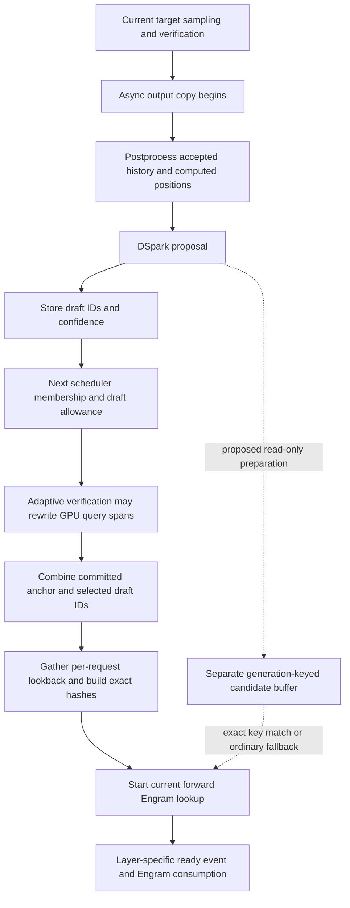

# Round55 — earlier exact Engram staging across decode steps

## Decision: park the component; zero new hypothesis identities

Two real dated arXiv queries returned30 paper identities. Selective reading of **Janus** supplied a useful transferable principle: predict storage demand early, but validate against exact demand and fetch misses before consumption. A source audit then narrowed that principle to **preparing target Engram rows after the native DSpark proposal, before the next target forward**. This is not a direct Janus port and is not speculative tree decoding.

The current source has no examined cross-step, request-keyed prepared-row handoff. However, simply moving its current `prepare_embeddings` call is unsafe: its hashes, flattened output rows, stream events and DP collective shape belong to the next scheduled batch. A new bounded per-request/tuple handoff could avoid those assumptions, but its possible saving is only residual lookup wait after already-present prefetch, less early hashing, validation, gather/copy, wasted rows and contention. We have no exact trace showing that wait or the usable after-draft gap. **Retain the design question and its rejection of a naïve move; do not create another deferred card on this evidence alone.** Existing A01/EG01/EG02 remain unchanged.

No GPU, CUDA/native import, model/tokenizer execution, serving change, canonical mutation, cloud operation or Git edit occurred. The only executable target analysis is AST parsing and source call-site ordering, not execution of target functions.

## Search and adaptation

- Prior compact recall covered all143 typed identities over two pages with matching inventory hash `b853e0257fd229abc6b9c785d7f5fd0326af8f8902047a99947be4f900d6b63c`. The source memory was copied using read-only SQLite backup into this isolated state. Literal recall `overlap synchronization` returned zero because it is a literal phrase, not semantic OR; this did not establish absence. Full inventory plus bounded campaign report searches were then used.
- Query1: Aug1–Oct22 inclusive, LLM/language-model + inference/serving + overlap/synchronization.15 bounded abstracts. Many results concern browser/mobile/NPU/LoRA/training or previously mined Herschel. Janus exact corrective reads deserved a fulltext look.
- Query2: retained dates, narrowed to GPU+decode and added pipeline vocabulary.15 more abstracts, including Spexis, PipeSwift and OasisKV. No result was silently upgraded from abstract to verified implementation. See all30 classifications in `paper-dispositions.json`.
- One `investigate` call read pinned [Janus2609.36938v1](https://arxiv.org/html/2609.36938v1), one HTTP cache miss, no repository auto-fetch or model reasoning. Sections4.1–4.2, implementation/evaluation and limitations were read selectively from retained full text. Source retrieval alone is not proof the entire paper was read.
- Three production `Store.search` calls on a canonical **mode=ro** connection searched Engram+prefetch, Engram+speculative and Engram+lookahead. Correct `kind=pr` yielded16/20/1 bounded hits; the second is capped, not exhaustive. Three selected opening records were imported through the production isolated importer. Existing PR bodies and pinned target implementation supply triangulation; no new donor diff was fetched because none is being proposed as an implementation port.
- Total new online discovery: two arXiv search calls and one fulltext read. No Serper, OpenAlex or paid model calls. Opening-record reuse does not assert current PR head, CI or merge state.

## Paper mechanism and what does not transfer

Janus uses the target layer's indexer on earlier hidden states to predict sparse KV selections, overlaps SSD reads, then fetches the exact selection's missing entries before sparse attention. Section4.2 explicitly writes the corrective set as exact selection minus predicted union. It does not train a new predictor. Its primary workload is **append prefill**, where SSD reads dominate; reported decode TPOT differences are about3% and not the improvement target. The paper says decode largely reuses data loaded in append prefill.

Therefore:

- Its SSD/append-prefill speedups do not estimate our host Engram lookup or long-output ITL.
- We do not adopt its approximate earlier-hidden-state indexer, different storage architecture, prediction-distance heuristic or parallel partitioning.
- The reusable component is **early read-only preparation plus exact identity validation and corrective fallback**. Native DSpark candidate IDs are already available at the end of proposal; those IDs can in principle predict the next target's input rows without changing target sampling. They do not establish next batch membership, truncation, packed order or request lifetime.
- OasisKV's approximate sparse attention is not an exact-output substitute; SwiftQK's TP communication removal has no corresponding TP1 reduction. Spexis/PipeSwift require separate parallelism/runtime changes and cannot be cited as an already-compatible c455 overlap port.

## Pinned source dependency audit

Source: `callgideon/vllm@c4557869393db4d75c483d92edd02a5125500883`. Target profile remains Flash1017 revision1bae0e…, TP1/DP4/EP4 DSpark5; these are planned/source facts, not live attestation.

The diagram expresses dependencies from inspected code; it does not show measured durations or prove that every arrow causes a device wait.

### Current work already present

`model_runner.sample_tokens` starts `AsyncOutput` before `postprocess_sampled` and `speculator.propose` (2202,2241,2263). Thus generic overlap of token copying with drafting is already implemented. `postprocess_sampled` updates GPU token history and counts before proposal. After proposal, draft IDs and confidences are recorded (2281+).

`nvidia/model.py` hashes the full current batch once at forward entry (1009+) and calls `EngramBatch.prepare_embeddings` or each layer's `prepare_embeddings` before decoder layers (1023+). `common/engram.py` already starts background host lookup on a side stream, keeps hash storage alive, records a per-layer completion event and waits only at that layer. Large DP-wide row counts can force inline lookup because background work would interfere with persistent kernels. This is not synchronous lookup at every layer waiting to be newly optimized.

Retained PR56512 describes this existing prefetch/shared-host work; its GB200 TP4 opening table is nearly neutral in decode. That is opposing evidence only, not our measured exposure. PR44028 adds WKV and MoE fencing in SGLang; the corresponding **A01 WKV lookahead** is already deferred and deeply audited. It does not establish cross-step row staging. PR39666's history-update bookkeeping reinforces that speculative verify commits must update the history correctly; this opening body is not a c455 implementation proof.

### Why a direct call move fails

1. **Input identity is finalized later.** `prepare_inputs` consumes scheduler draft allowances, compacts/reallocates draft spans on GPU when adaptive verification is active, creates positions, and combines sampled anchors and draft IDs (1423–1496). A flat prediction from the previous batch is not the actual next input buffer.
2. **History is per request and per position.** `nvidia/model_state.py` gathers lookback using current `idx_mapping`, `query_start_loc`, positions and committed `all_token_ids`. The hash additionally includes token-map/image-dead handling. A table indexed only by old request slot or draft position can reuse the wrong n-gram after completion, slot reuse, budget truncation, reorder or a prefill/decode transition.
3. **Existing staging is a flat mutable resource.** `Engram.prepare_embeddings` writes `staged_rows[:n]`; its completion event refers to that producer. It is not a validated cache keyed by request generation and exact ordered hash tuple. Reusing the same row count does not prove content identity. For example, predicted rows[A,B] and actual rows[B,A] have equal shape but a positional handoff is wrong.
4. **Collectives cannot be opportunistic.** `EngramBatch` selects peer/all-to-all paths from group slot metadata; private sharded paths require matching ranks. Moving only a ready rank's collective to a prior step can change order or cardinality. A first design would have to exclude those routes and retain the existing shared-host, no-Engram-collective path after actual eligibility proof.
5. **Graph/event lifetime must be redesigned, not assumed.** A proposed early buffer must remain valid until its exact consumer, avoid overwriting a previous graph's input, preserve current inline/background choice and not re-record an event before the intended wait. Current raw draft buffers and reusable flat staging are not ownership certificates.

These block a naïve move, not every possible keyed cache design. A separate bounded generation-tagged buffer with exact tuple matching could preserve values and fallback, but adds machinery and gathering that are not justified by the current evidence. A fallback cannot undo an incorrect speculative write to live request history; prediction must remain read-only and separate.

## Prior comparison and disposition

| Existing work | Difference here | Decision |
|---|---|---|
| A01, `hypothesis:36794075…ef64b16646` | WKV projection lookahead within a forward, after existing row lookup; here only earlier cross-step row staging | Do not recount or claim A01's donor improvement. |
| EG01, `hypothesis:12c1c851…25f0ec8b05` | Packed FP8 staging removes dequant/requant; here representation remains baseline | No additive percentage or shared numerical proof. |
| EG02, `hypothesis:f677b614…0d0deebd3e` | Repeated-row cache/dedup; early staging may need an analogous key/fallback mechanism but relies on temporal lookahead rather than observed hits | Preserve as adjacent parked component, not a new cache card. |
| Asynchronous draft cache H01 | Changes overlap of speculation and target; here native proposal and target remain unchanged | No proposed extra speculative engine or tree verifier. |
| Existing async output copy | Already starts before native proposal | Excluded as implemented. |

## Exposed-time bound and fastest falsifier

Let L be the eligible lookup duration, s its current start, c the consuming layer's arrival without that lookup wait, and a a legal earlier producer start. Current exposed wait is `W=max(0,s+L-c)`. With unchanged resources and exact hit, optimistic removable wait is at most `min(W,max(0,s-a))`; real overhead, missed predictions, extra copy/gather and contention subtract from this. This is a one-wait upper bound, **not a sum of all layers/ranks or an ITL prediction**. For a round, use the union on the critical path and divide by unchanged committed progress only after measuring both. All L/s/c/a and hit frequencies are unknown here.

The fastest no-GPU falsifier is an actual host-visible scheduler/input-state replay, if retained exact traces become available: reproduce each next input request generation, committed anchor/history, draft allowance and final packed row order; reject any predicted-buffer lookup keyed only by shape/old slot. Test reorder, completion+slot reuse, mixed prefill, rejection/bonus progress, adaptive draft truncation, graph padding, image sentinel and idle-rank cases. Require exact tuple match and ordinary fallback on every mismatch; do not execute collectives in this CPU diagnostic. A metadata-only replay cannot certify GPU adaptive spans or event lifetime. Those remain explicit later native gates.

The recent local trace inventory found no exact representative Flash1017/c455 execution-token trace. Forced-token H200 outputs and prompt prefix hashes cannot populate this diagnostic honestly. No synthetic hit rate or gap duration was manufactured. Source ordering already falsifies the simple flat-buffer move; a new surrogate benchmark would not answer exposure.

If future evidence shows material residual lookup wait and a usable legal early window, standard agent75/Mooncake serving comparisons remain sufficient for TTFT/ITL/E2E/goodput. Add narrowly scoped wait/lookup and handoff-hit instrumentation, keeping quality and token/progress guards. A new serving workload is not justified merely to make prefetch look good.

## Tool-use failures retained

Initial expand observation omitted provider/reason fields and failed; original plan retained, corrected plan ran. A canonical replica recall still waited on the writer lock; only this child command was interrupted before acquisition, then a read-only SQLite backup supplied isolated recall. System Python could not read the WAL-backed isolated corpus; repo Python succeeded. First PR search used wrong `kind=pull_request` and returned zero; corrected `kind=pr` results replace no scientific conclusion, and the failed receipt remains. Initial AST ordering matched dummy-run/PP calls before the actual sample function and then a wrong self-qualified alias; the final probe constrains sample_tokens and the real local alias. These are research-tool mistakes, not target execution failures. All final conclusions use retained corrected outputs.

## Durability

Queries, sources/revisions, PR imports and invocation history are retained in isolated state. Snapshot/publication explicitly deferred; no new S3 coverage claimed. Frozen top-level receipt/source manifest excludes mutable SQLite/cache. Thirty paper identities and all bounded negative dispositions remain available for later production import. Independent review is requested; no implementation or hypothesis selection is implied.
