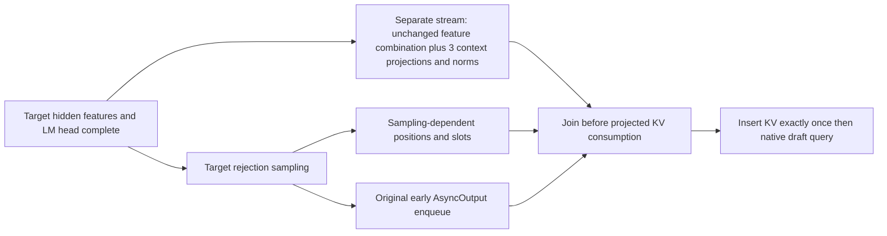

# Round 59 — split target-only DSpark context math from sampling-dependent publication

## Decision and scope

**One new deferred hypothesis: CF59. No GPU work, implementation, native numerical validation, or service acceptance.** Two other components remain screened leads. This is a source-backed proposal to overlap existing work, not a predicted measured gain.

- Isolated identity: `hypothesis:f11b4ac30a88d38e295c1a9001afe052315832b69a37e16e2952bbb382e336cf`.
- Existing exact planned baseline: `baseline:d4640b183a115b67c1e0365e34d22349c5a72fa9df780ec71c41b16f7a543279`.
- Target: `deepseek-ai/DeepSeek-V4.1-Flash-1017@1bae0e1088993b9b82de08f59de5be5a34e42170`, `callgideon/vllm@c4557869393db4d75c483d92edd02a5125500883`; planned eight B200, two TP1/DP4/EP4 groups, DSpark5, temperature1/top_p1. This is a pinned planned profile, not live backend/configuration attestation.
- Typed proposal, five exact-revision claims, screening and deferred decisions were executed with normal `researchctl` commands in `state/`, using a readonly copy of prior memory. Canonical state and S3 were not changed.

## Adaptive discovery, including negative yield

The initial question was fixed per-step CPU/GPU overhead, not another speculative token-selection policy. Full compact prior recall covers 143 records in two pages (`prior-all-01-v3.json`, `prior-all-02-v3.json`), alongside earlier reports. All three dated queries used actual `expand` and `paper-search` tools with August 1 inclusive–October 23 exclusive 2026 filters.

| Pass | Why this query | Result and next decision |
|---|---|---|
| 1: LLM serving + CPU/host/control-plane/synchronization overhead | Look for per-step exposed host gaps | 12 hits mostly fleet orchestration. Avoid treating routing/control-plane matches as decode-step evidence. |
| 2: LLM decode + CPU/host | Remove the misleading control-plane anchor | 20 hits; many prior offload/cache families. Read BIMScript fulltext selectively. |
| 3: GPU-resident/driven, launch overhead, persistent kernels | Check adjacent device-driven execution literature | 12 hits, mostly training/hardware prerequisites or prior families; no second paper selected. Stop broadening. |

There are **44 returned query-hit references and 43 unique papers**. `paper-dispositions.json` preserves every returned hit, exact query ID/revision and read depth. Only BIMScript was read in fulltext for this lane; other exclusions are abstract-level screens, not judgments on the entire paper.

[BIMScript, arXiv:2608.21447v1](https://arxiv.org/abs/2608.21447v1) describes a complete decoding-step graph for a much smaller scene decoder, covering work beyond the model graph. Its implementation uses batch1 argmax/type-FSM logic, and nucleus/batched paths fall back. Its reported timing does not transfer to Flash1017. The reusable principle was to inspect the **whole post-model step**, not assume an existing model CUDA graph captures sampling/state preparation. Grammar tolerance, model size, stop polling every16 steps and its throughput numbers are not adopted.

This prompted readonly local PR searches. The new search explanation showed truncation explicitly: `sampling graph` had 99 matches and returned20; `async output`92/15; `output copy`34/15; `persistent scheduler`197/15. `driver lock` returned both of two matches. These are bounded pages, not complete corpus absence claims. Root independently surfaced PR61869 via a different paginated query; neither path is claimed as sole origin.

## Primary donor and correction to prior screening

[vLLM PR61869](https://github.com/vllm-project/vllm/pull/61869), observed head `9a1541d118524bffb13f66d87481def3d3428556` in `yaoyaoding/vllm`, was open/unmerged at retrieval and stacked on61868. All25 changed-file records were returned and retained. This is a broad specialized decoder bundle; its aggregate reported speedup is not CF59 evidence.

Earlier round25/39 opening-record screens associated this PR with C025 Markov sampling. **That was too broad as a whole-PR disposition.** The actual diff also includes a post-forward graph and a target-only context projection fork. Prior H200 H02/R2 cards cite61869 but explicitly exclude graph capture and port Markov fusion only. Same citation does not establish same intervention. CF59 differs from:

- C025: reduces sampler work; CF59 overlaps unchanged context math with sampling.
- PJ01: removes dead query output columns from context projection; CF59 preserves each operation and changes scheduling.
- Round48: reuses input activation quantization; it reduces context work rather than overlapping it.
- TR01: trims eligible context rows, with distinct prefix/cache gates.
- Generic asynchronous scheduling or the earlier Herschel metadata relocation: different producer/consumer dependency.

These can interact. Reducing context duration with PJ01/round48 or sampling duration with C025 reduces the remaining overlap window. Gains cannot be added.

## Exact current dependency and proposed split

Current pinned native DSpark context method in [`dspark.py`](https://github.com/callgideon/vllm/blob/c4557869393db4d75c483d92edd02a5125500883/vllm/models/deepseek_v41/nvidia/dspark.py) performs, for each of three **different** layer weights:

1. `attn.fused_wqa_wkv(main_x)`.
2. Slice KV columns and apply that layer's `kv_norm`.
3. Insert through `_insert_context_kv`, including positions and slot mapping.

Target hidden features are available before rejection sampling finishes. Feature combination and project/normalize depend on those features and frozen weights, not sampled token counts. Position/query/context-slot preparation depends on rejection results. The native DSpark `prepare_context_anchor` hook is a no-op; do not count it as extra work removed or overlapped. Generic donor comments about an anchor are not native DSpark execution evidence.

The donor splits `project_context_kv` from `store_projected_context_kv`, owns a persistent BF16 buffer `[3, min(6*max_reqs,max_tokens),512]`, forks target feature work on a side stream, and joins before dependent preparation. The main combination projection is ReplicatedLinear, and context `fused_wqa_wkv` has `disable_tp=True`; the planned TP1 fork need not add EP/DP collectives. Subsequent native draft DP agreement and expert collective order must remain unchanged.

The proposed fork begins **after the target LM head**, avoiding an assumption that concurrent head and context operators have independent scratch. It preserves early output release. New staging is required; simply moving an existing method containing cache writes earlier is unsafe.

### Concrete donor limitations that must not be inherited silently

1. **Target FULL is insufficient.** Donor post-forward graph eligibility checks the target static FULL output, but the DFlash non-FULL proposal still calls the ordinary context precompute without `projected=`. Its projected buffer is consumed in the draft FULL preparation. An eligible target step followed by non-FULL draft can therefore repeat projection. A port must bind both modes or provide an explicit eager projected-buffer consumer; otherwise fall back before forking.
2. **Keep the existing row partition and padded matrix sizes.** Native FULL prefix plus eager tail partitions the current target span; it is not whole historical context and not two copies of the whole span. Altering M/padding can select different GEMM tactics and change numerical results. Request-global offsets, masked slots and empty ranks need explicit handling.
3. **Preserve token release.** Current `AsyncOutput` is deliberately created before postprocess and draft proposal. The donor graph wraps sampler+postprocess+preparation+side-stream join before constructing AsyncOutput. Directly copying that order can delay streamed tokens. CF59 joins after the original output enqueue and before dependent KV consumption.
4. **Ownership matters.** Persistent projected output must not be overwritten by another generation or request before insertion. PyTorch/FlashInfer/DeepGEMM scratch and capture lifetime have not been certified. Existing target/draft workspace lanes do not prove every external library allocation is independent.
5. **No arithmetic substitution.** Preserve per-layer weights, norm, RoPE, quantization and cache insertion operations. Staging copies and concurrent execution still require native output/distribution checks. This is not a license to alter target probabilities or stochastic RNG progression.

## Other components retained, not promoted

### Whole post-forward graph

The donor rejects adaptive verification, custom rejection sampler, watermarking, NAN checks, sampling masks, PP/CP, batch-sharded sampling, LoRA, KV/aux connector and fast-prefill configurations. Runtime checks additionally constrain FULL static output, no prefill/grammar/structured output, k+1 scheduled tokens, draft count, chunk limit and logits processing. It copies dynamic buffers, keys captures by addresses/shapes/strides/dtypes, warms once then captures, and permits up to32 graph keys. The extra pool is not covered by startup profiling. Output-copy stream ordering prevents overwriting static sampled output while D2H reads it.

This is a separately gated experimental control, **not a second new hypothesis or default activation**. Actual adaptive-verification configuration is not live-attested here. The graph's eligibility guards and delayed-copy order preclude a blanket port.

### CUDA event pooling

[SGLang39960](https://github.com/sgl-project/sglang/pull/39960), head `29121642c75599b77e1f061beb155622381b25d6`, prewarms64 non-timing events and replaces eager stream waits with record/wait/recycle. Donor context was GB300 GLM5.2 NIXL/UCX eager prefill with reported driver-lock stalls. That is not evidence our B200 decode has those stalls. Existing captured FULL waits may already avoid the repeated host work. An AsyncOutput completion event observed by a later host synchronization cannot inherit the helper's immediate recycle lifetime. Retain as a lead requiring an actual compatible trace; zero new card.

## CPU diagnostics actually executed

- `control_probe.py/json`: extracted the real event-pool helper AST and ran five fake-stream branches, plus a lexical AST check that the current AsyncOutput precedes postprocess/proposal. No CUDA imports, driver calls or concurrency proof.
- `context_dependency_probe.py/json`: extracted the current native context method and donor project/store bodies. Symbolic replay for all-live, one-masked and no-slot/profile cases preserves per-layer insert arguments. Negative controls detect overwriting a generation-owned projected buffer before insertion and overlapping prefix/tail intervals that duplicate row11.

These establish limited dependency/ownership falsifiers, **not numerical equivalence, valid CUDA scheduling, native timing, cache correctness or performance**. CPU result remains inconclusive for deployment.

## Exposed-cost bound and evaluation

Let C be the current exposed target-only context combination/projection/norm duration, S the legal target rejection-sampling interval after the LM head, and H added launch/staging/join/contention cost. An optimistic noncontending saving is bounded by `min(C,S) − H`. Both C and S are unknown. Kernel overlap may reduce either kernel's throughput; a timeline alone is not a measured win. Extra BF16 storage and copy traffic must be counted.

Do not use the pinned StepTimingCollector dummy forward/drafter sum as post-forward evidence: the dummy path skips actual `sample_tokens`. Root's separate bounded S3 scan examined9,481 key metadata records and eight small manifests without recovering a compatible exact-pin sample/context trace; that is not proof no embedded trace exists elsewhere. We retain unknown exposure and do not extrapolate donor aggregate percentages.

Fastest next actions are non-GPU source/retained-trace checks: paired target/draft mode coverage, padded partition equality, persistent buffer generation and external workspace ownership. If no legal interval or staging ownership exists, stop. Native execution requires separate authorization.

Future controls, with frozen target/draft weights, seeds, workload and environment:

| Arm | Purpose |
|---|---|
| A current | Baseline unchanged native serial path |
| B context overlap only | Isolate CF59; preserve original AsyncOutput release, unchanged math and row partition |
| C post-forward graph only, if separately eligible | Isolate launch/capture effects and copy-release delay |
| D combined, after independent correctness | Measure interaction; never subtract bundle speed as CF59 gain |

First native gates: exact greedy output/cache traces, then proper stochastic distribution and proposal/acceptance/RNG checks, graph/eager/mixed/empty-rank/request-cancel/repeated-generation coverage, and persistent-buffer/scratch hazards. Record real model-end, sampling, output-copy enqueue/completion, projection start/end, join, insert and draft-query events.

**Existing agent-p75 and Mooncake remain the service evaluators.** Compare long-output ITL with separate tail guards, TTFT, completed tokens/requests, accepted/committed progression, errors and goodput under matched loads. Internal diagnostics are additional observability because these blackbox workloads cannot prove KV lifetime or actual overlap; no new synthetic service benchmark is justified merely by this proposal. Report client release timing as well as round duration. No fixed performance threshold or SLA has been invented here.

## Rubric and stop/reopen decision

| Dimension | Finding |
|---|---|
| Source grounding | Exact target method, full donor diff, selective paper mechanism |
| Existing implementation delta | Target-only context fork absent; ordinary model/query graphs already present |
| Compatibility | Conditional on paired graph modes, padded row partition, scratch and generation ownership |
| Correctness | Intended unchanged arithmetic; native equivalence/distribution/lifetime unresolved |
| Target relevance | Executed native context family; actual selected backend and exposed window unknown |
| ROI | Unknown S,C,H; no percentage or service forecast |
| Evaluation | Existing service workloads plus necessary internal correctness/timing observations |
| Disposition | Deferred; no claim that this will improve serving |

Reopen only when the source/lifetime guards can be specified and actual compatible exposure is available, or separately authorized native measurement is justified. Park if staging/contended execution or copy-release costs erase the interval. The goal is evidence of improvement to this deployment, not novelty.

## Tool-use failures and integrity

The first explicit source-export helper omitted `Store` commit, so normal import correctly reported zero documents and exact-revision claim creation failed. The retained attempt1 contains those receipts. The corrected export committed five sources; then a local orchestration wrapper assumed an unwrapped CLI response and raised KeyError after a successful claim. v3 reads the real `record` envelope and completed five claims, proposal, screen and decisions. These were orchestration mistakes, not evidence failures or provider outages; no validation was weakened and no canonical write occurred. First attempts remain preserved.

All online receipts, returned-paper dispositions, source documents/revisions/edges, exact PR heads/diffs, Python diagnostics, typed command receipts, prior recall and source hashes are retained. Mutable isolated SQLite/cache files are excluded from the frozen manifest; JSON exports preserve searchable source/revision inputs for later reviewed retention. Deferred snapshots mean local retained state only, **not S3 publication**.
