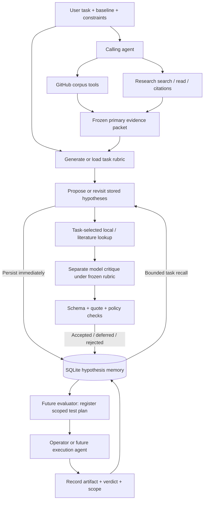
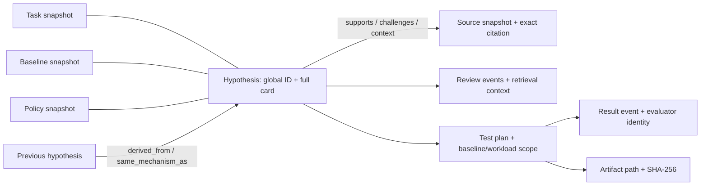

# Task-derived selection and persistent hypothesis memory

Implemented October 20, 2026. Preferred interface: `python -m ideation tool …` on the VM in `/home/ubuntu/shreyas/skunk-work/ideation`, using `.venv-research/bin/python`.

## What controls a decision

The task brief supplies the objective, current baseline, workload, constraints and optional selection settings. A model generates a small rubric **before seeing candidate proposals**. Its criteria, weights, required conditions, score threshold, evidence requirements and retrieval choices are saved as `rubric.json`. The content hash identifies the policy used for every decision. These are prioritization judgments, not calibrated probabilities or predicted gains.

There is no fixed novelty weight, fixed 65-point threshold, mandatory paper citation or prohibition on flags/ports. The task determines those choices. Known techniques can be valuable if they improve the current deployment. An unknown baseline inclusion can motivate a cheap inspection; it must not become a fabricated claim that the feature is absent.

Set this in your brief to explicitly disable novelty selection:

```json
{
  "instructions": "Improve our current serving cost/throughput frontier. Known methods, flags and upstream ports are welcome. Check what is already implemented.",
  "selection": {"require_novelty": false}
}
```

Without an explicit setting, the rubric generator follows natural-language instructions and defaults to no novelty. Enabling it requires an exact quote of the user's novelty request; this remains a model interpretation you can inspect. `require_novelty:false` is a mechanical override. `true` explicitly requests novelty. The validator prevents a criterion categorized as novelty from scoring or vetoing when disabled. It cannot prove that a model has not hidden a biased judgment inside another criterion: rationale review still matters.

Generate, inspect or edit, and then reuse a rubric:

```bash
.venv-research/bin/python -m ideation tool hypothesis.rubric --args '{"brief":"config/b200.json","output":"runs/my-policy"}'
.venv-research/bin/python -m ideation tool hypothesis.run --args '{"brief":"config/b200.json","packet":"runs/my-evidence/packet.json","policy":"runs/my-policy/rubric.json","output":"runs/my-hypotheses","rounds":1}'
```

Omit `policy` to generate one at run start. Keep original run directories immutable; editing a separate policy copy and running again produces a different policy hash. `research.plan` also accepts `require_novelty` and preserves it in its generated brief.

### Filtering

| Check | Result |
|---|---|
| Broken card schema, nonexistent quote, generated discovery cited as primary evidence | Rejected; structural/integrity failure |
| Reviewer finds factual claims unsupported or a required task condition fails | Rejected under that policy; still not experimentally invalidated |
| Missing required evidence, unknown required judgment, incomplete discriminating test | Deferred; preserve the specific gap |
| Score below this task's threshold | Deferred for priority, not disproved |
| Checks pass and priority meets threshold | Accepted for experiment design; untested |
| Same mechanism already exists in memory | Link it; do not automatically reject it |
| Existing algorithm, feature activation or upstream implementation | Allowed; evaluate usefulness relative to the baseline |

Weighted score is `sum(weight × criterion_score / 5)`, with task weights totaling 100. Each criterion gets pass/fail/unknown, score 0–5 and a rationale. Mandatory unknowns defer; high scores cannot cancel mandatory failures. Quotes, alternatives and explicit support/reject/inconclusive experiment criteria remain integrity/testability contracts.

## Execution architecture



DeepResearch is a collection of retrieval/evidence tools selected by the calling agent. The hypothesis runner is a small Python sequence, not a persistent autonomous agent. Default new run: one rubric call plus one proposal and one critique per round (1–3 rounds). Passing an existing rubric saves that call. Revisit skips proposal generation. Evidence extraction is a separate tool call. Proposal and critique use separate prompts with the same configured model; they are not independent experts.

Local GitHub search makes no network/model calls. Rubric-selected literature retrieval uses existing caches. Model reasoning stages are fresh runs. The graph does not autonomously trigger retrieval or experiments. There is no new orchestration service, graph server or training loop.

## Memory: durable facts and explicit links

Authoritative VM file:

`/home/ubuntu/shreyas/skunk-work/ideation/data/hypotheses.sqlite`

This is separate from `data/corpus.sqlite` and the response cache. SQLite transactions and append-only triggers protect the ledger from accidental in-place changes. It is persistent across agent sessions; it is not a backup against filesystem loss. Back up the SQLite database using SQLite's backup interface, including the corpus separately if needed. Do not copy a running WAL database as a lone main file.



Every schema-valid proposal is registered before lookup or critique. If either fails, the proposal remains `proposed`. Global IDs derive from run path plus local candidate ID. A modified card is a new hypothesis with ancestry; it cannot silently replace an existing card. Rejections, revisions, evidence and new policies remain queryable.

Three independent state dimensions:

1. **Selection:** proposed, accepted, deferred, rejected, superseded.
2. **Test:** planned, running, completed, error.
3. **Reported outcome:** validated, invalidated, inconclusive, error, **within a declared test scope**.

The same idea can help one workload and fail another. Conflicting validated/invalidated repeats in the same scope show `conflicting`; the latest result does not overwrite the earlier one. An execution error is not a hypothesis invalidation. Artifact hashing checks integrity, not scientific validity. `validated` means evaluator-reported support within that test, never universal truth.

The ledger stores full records. Generation receives bounded task-relevant recall, not the entire database. Inspect missing history through query/get/graph tools. Recall is a simple lexical/baseline heuristic, not semantic search or a learned causal memory.

## Tools for inspection and future agents

```bash
.venv-research/bin/python -m ideation tool hypothesis.stats --args '{}'
.venv-research/bin/python -m ideation tool hypothesis.memory --args '{"text":"GEMM","limit":10}'
.venv-research/bin/python -m ideation tool hypothesis.memory --args '{"status":"rejected","limit":10}'
.venv-research/bin/python -m ideation tool hypothesis.get --args '{"hypothesis_id":"hypothesis:..."}'
.venv-research/bin/python -m ideation tool hypothesis.graph --args '{"hypothesis_id":"hypothesis:..."}'
```

`hypothesis.run` accepts `revisit:["hypothesis:..."]` for 1–5 existing full cards in one round, retaining the mechanism while reviewing under the new task/evidence/policy. New records link to the originals. Legacy partial leads must first become a proper full proposal; they are not silently upgraded.

Future evaluator interface:

1. `hypothesis.plan_test(hypothesis_id, plan, scope, actor)` stores the evaluation contract and returns a test ID. Include control, treatment, metrics, acceptance/rejection/inconclusive rules, correctness, budget and artifact expectations in `plan`; include exact baseline, workload, hardware and conditions in `scope`. `plan.request_id` makes retries idempotent; a new ID creates an intentional repeat.
2. `hypothesis.start_test(test_id, actor)` records execution start; does not launch anything.
3. `hypothesis.test_result(test_id, verdict, artifact, note, actor)` records the supplied result, scope and artifact hash. Cannot overwrite a completed result; register a repeat test for new evidence.

Plan and scope are extensible JSON objects; the ledger currently requires nonempty objects, not a domain-specific evaluation schema. Future evaluator agents must validate their measurement contract and execution permissions. No GPU executor, automatic metric judging, autonomous evaluation agent or artifact content validation has been built in this change. The older `hypothesis.outcome` is a compatibility adapter for unscoped historical workflows; prefer explicit test planning.

## Migration and live verification

`hypothesis.import_runs` imports historical histories, proposal files, legacy revision stages, partial rejected leads/comparators and the old JSONL. It is idempotent. Old decisions retain old policies; migration does not re-review or relabel them as current decisions. Unsupported legacy details remain explicitly unknown.

Initial VM migration: **93 records**, including revisions and partial leads, **274 events**, zero tests, zero import errors. This does not mean 93 distinct full hypotheses. A later live revisit adds a new record.

Live example: [generated task rubric](../runs/deployment-policy-001/rubric.json) and [revisit decision](../runs/deployment-revisit-001/decision.md). The old low-M GEMM proposal was rejected solely on novelty. Re-evaluation under the deployment-improvement task accepted it for test design at **70/100**, retaining its baseline/eligibility questions. This proves the new selection/memory path executes; it does not prove the proposed optimization works.

Software verification: **49 tests pass** on the VM, including policy changes, failed-critic persistence, migration idempotency, append-only history, scoped/contradictory outcomes and bounded recall. [Exact verification snapshot](adaptive-memory-verification.json).
