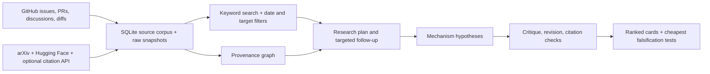

# Component plan and prototype boundaries

**Current component boundaries:** [Three tools, one research session](THREE_TOOLS.md) separates GitHub access, literature/evidence, and hypothesis generation. [Recent research](RECENT_RESEARCH.md) explains the October 2026 source review and selected reuse. The design below describes the earlier two-track prototype that remains available through the legacy commands.

## Outcome

Given a target model, GPU/topology, workload, operating region and date window, retrieve the relevant engineering changes and produce distinct hypotheses with enough evidence to choose a cheap experiment. Success is useful experiment selection, not the number of scraped pages or agent steps.

## Track 1 decisions

| Component | Implemented behavior | Next improvement only when justified |
|---|---|---|
| Enumeration | GitHub repository REST feeds, state=all, opaque Link cursors | Add more repositories via `--repo`; shard only if throughput requires it |
| Freshness | Separate recent-change cursor; resumable historical pass; hourly timer | Expose freshness lag per collection and alert on repeated failed ticks |
| Coverage | Issue/PR bodies, labels, states, timestamps; all issue/inline-review comment feeds | Exhaustive formal reviews/diffs only if research needs justify request/storage cost |
| PR provenance | Base/head/ref/SHA, merge state, merge SHA; selected diffs/reviews | Commit ancestry check against the actual deployed SHA, not date inference |
| Storage | SQLite WAL, FTS5, raw compressed response snapshots, hashes, checkpoints | PostgreSQL only for concurrent writers or a multi-user product |
| Retrieval | BM25, title weighting, phrase/literal terms, configurable alias groups | Embeddings/reranker only after a measured recall failure on a labeled set |
| Filters | created/updated/merged/fetched dates; type/state; intersected GPU/model/metric mentions | Add model aliases and architecture labels from verified model cards |
| Operations | Advisory writer lock, page commits before checkpoints, rate-limit reporting | ETag revalidation, periodic deletion reconciliation, compact old raw revisions |

Created date answers “new work”; updated date answers “recent discussion”; merged date answers “recent integrations”. These are deliberately separate. PRs targeting experimental branches must remain distinguishable from main, and merged does not mean present in the deployed image.

Search stores comments as separate records with their own timestamps and a parent relation. UI filtering applies to the matched record, not implicitly to the parent PR. The graph and source inspector expose that parent. Tags are evidence mentions; `Blackwell` expands B200 discovery but does not prove the benchmark used a B200.

## Track 2 decisions

1. **Brief:** target workload, model revision, hardware topology, metric/SLO, current active stack, measured source pin, prior decisions, source-research versus deployment-optimization scope. Unknowns remain explicit.
2. **Discovery plan:** a small number of mechanism questions. Each has corpus, literature and counterevidence queries. Search broadly enough to find transferable work beyond the exact model name.
3. **Evidence collection:** current issue/PR discussion, changed code, arXiv/HF papers, selected full text, explicit references, optional forward/back citations, and exact-SHA source files. No PDF extraction claim when only an abstract/HTML excerpt was read.
4. **Provenance graph:** source → entity mention; source → explicit reference; HF paper ↔ arXiv identity; diff/comment → parent PR; paper → bibliographic citation; hypothesis → attributed support/challenge. Claims remain interpretations, separate from observed links. Two hops over explicit references/identities expand evidence packs.
5. **Idea generation:** investigate mechanism transfers, limiting assumptions, contradictions and operating-region transitions. Generate more candidates than the requested shortlist. Specify added behavior, not a renamed configuration flag.
6. **Novelty and deduplication:** compare nearest paper/code and prior local decisions. Distinguish original mechanism, substantial adaptation, unchanged port and activation. Missing target traces affect confidence and test design; they do not universally block ideation.
7. **Critique:** value, mechanism, evidence, integration, correctness, experiment, cost, distinctness and research contribution. Demand a strong static/existing comparator for adaptive policies. Revise or replace; preserve substantive objections.
8. **Output:** structured cards, ranked decision, comparators, rejected leads, unresolved gaps, source snapshot, review, validation and run manifest. Retain partial outputs on time/provider failure. Do not fill quotas with invented novelty.

The graph is initially an evidence graph in SQLite, not an LLM-generated map of asserted scientific truths. A graph database does not improve evidence quality by itself. LightRAG is a candidate for later semantic retrieval; adoption requires an evaluation advantage over this baseline and retained source provenance.

## API and execution budget

- GitHub uses the VM's existing authenticated CLI credentials. Tokens stay outside data/artifacts.
- arXiv is spaced by at least about three seconds per client; HF uses its current paper search endpoint. Avoid repeated corpus-scale calls to literature services.
- Semantic Scholar supplies optional citation metadata, with explicit rate-limit failures. It is not required for direct reference traversal.
- Codex is the working agent runtime, using the existing model configuration. GPT Researcher is optional wider web discovery with separate provider setup.
- Agent stages share a wall-time deadline and limited discovery rounds; source HTTP calls also have timeouts. This is a practical bound, not a hard real-time deadline across all network retries.
- No automatic GPU tests or serving-code modifications. The next human decision is which falsification experiment to run.

## Acceptance checklist

| Check | How to verify |
|---|---|
| The three supplied GitHub examples can be found | `scripts/evaluate_retrieval.py` reports rank and state/base branch |
| Experimental-branch PR is not represented as merged main | Inspect #62073 base/head/state in source metadata |
| Interrupted collection resumes without data loss | Unit test failure between pages; cursor saved only after document commit |
| Large collections exceed page-number API limit | Live pagination failure fixed with opaque cursors; regression test included |
| Date/filter combinations change results correctly | Unit tests and live search API smoke |
| Paper discovery and full text are real | Run manifest records fetched IDs, errors and full-text sources |
| Hypothesis citations cannot use nonexistent excerpts | Unit test and real run caught two bad excerpts and repaired them |
| Corpus is refreshed after this session | Enabled timer + lingering user service; logs/checkpoints expose progress |
| A complete corpus is not claimed prematurely | Status reports per-feed backfill/complete checkpoints |
| Novelty is not asserted from an attractive title | Prior-art fields, critique, separate novelty levels and retained shortfall |

## Next measured iteration

Build a 30–50 question retrieval set covering scheduling, speculation, MoE/communication, attention/KV, quantization, host overhead, rejected PRs and known negative evidence. Label relevant discussion/diffs and date constraints. Measure recall@20, reciprocal rank, source freshness and wrong-branch errors. Then compare lexical retrieval against a hybrid/reranked or LightRAG variant.

For ideation, review cards for concrete behavior, correct applicability, substantive distinction, counterevidence and cost of the first test. Track duplicate rate and how often cheap experiments change the decision. Do not optimize for report length or a model-assigned novelty score. Establish baseline source/active-backend evidence and expand actual implementation reads before treating the first shortlist as ready for code work.
