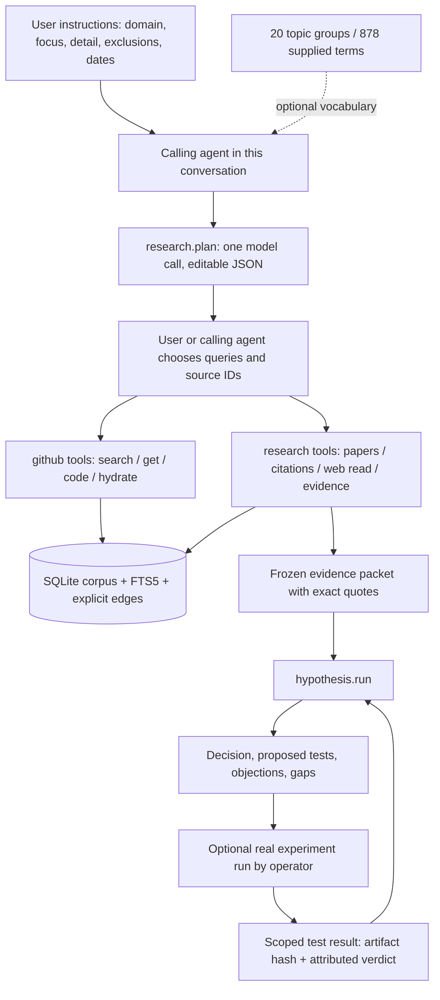
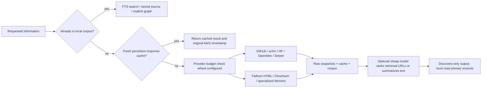

# Implemented architecture and operating guide

This describes the deployed system, not the original wishlist. The authoritative corpus is on `sofia-gpu-mumbai` under `/home/ubuntu/shreyas/skunk-work/ideation/data/`. Local `data/` is a different prototype snapshot. Code, docs and selected run artifacts are synced; the corpus is not copied with every code change.

## 1. Control plane: one calling agent, three tool families

**The calling agent does the orchestration.** It chooses tools, inspects results, changes queries, reads sources and decides what deserves hypothesis generation. `research.plan` produces a plan; it does not autonomously run every query. `scripts/search_plan.py` is a small deterministic executor for an edited plan; default execution is local GitHub search. `--papers` and `--web` opt into the plan's bounded external queries. `scripts/run_selected.py` invokes evidence then hypothesis generation on explicitly selected source IDs. There is no agent swarm, task queue, workflow server or persistent autonomous research process.

The collector and UI are the only background services. Collector scheduling is hourly; research is on demand. The older `research` CLI and GPT Researcher adapter remain for legacy runs, but the new three-tool interface is the supported path documented here. The optional GPT Researcher backend has not completed a provider-backed run and does not inherit this cache policy.

User instructions control focus, granularity, dates, repositories, exclusions and requested hypothesis count. The vocabulary guides retrieval, not rigid tagging or a mandatory sweep. Its model/hardware names are user-supplied search terms, not verified applicability assertions. Arbitrary domain terms are accepted; the hypothesis rubric is now derived from the task; its evidence requirements and scoring are saved before proposals. It is not validated as a universal scientific discovery engine.

## 2. Retrieval and cost control

| Operation | Policy |
|---|---|
| Local GitHub queries | No API call, no model call |
| GitHub on-demand API reads/hydration | 15-minute successful-response cache, scoped by token hash |
| Collector pagination / incremental refresh | Intentionally fresh; resumes checkpoint instead of restarting the archive |
| arXiv/HF/OpenAlex searches | 24 hours |
| Serper normalized query | 7 days; one cached top-ten result set reused for smaller requested limits |
| General pages / unversioned paper reads | 7 days |
| Versioned arXiv HTML/PDF / exact-SHA source | 10 years; explicit refresh available for paper reads |
| OpenAlex work/citation reads | 7 days; Semantic Scholar uses HTTP cache, currently 24 hours |
| Cheap helper output | 30 days; keyed by model, backend, prompt and source hashes |
| Missing HTTP source, 404/410 | Five-minute negative cache to avoid repeated failed HTML probes |
| Evidence extraction / proposal / critique | Fresh calls for each new run; intentional reasoning is not silently replayed |

Cache: `data/cache/index.sqlite`, with per-key file locks to coalesce simultaneous identical misses. Budgets use atomic SQLite transactions. Cache hits expose `hit`, key, original `fetched_at` and expiry where returned. Original downloaded bytes/results remain under `data/raw/`. Paper metadata can be indexed again on a cache hit; corpus indexing time alone must not be interpreted as a new network fetch. Failed network/model calls are not successful cache entries. No automatic stale-on-error fallback. General HTTP ETag revalidation is not implemented.

Policy is editable in `config/retrieval.json`. Serper defaults: **20 attempts per rolling 24 hours, 2,000 attempts total**, leaving a nominal 500-request reserve from the user's stated 2,500. This ledger counts attempts from this installation, including failures. It cannot know account usage elsewhere or guarantee remaining provider credits. It is never reset monthly automatically. Fathom search retries are disabled; the budget is reserved immediately before its actual Serper HTTP request. Repeated queries served by either cache spend no request. `refresh:true` bypasses cached results and still respects the budget.

`research.triage` / `research.web_query` use **gpt-5.6-luna** by default, overrideable per triage call or in policy. At deployment the working backend is existing Codex CLI authentication; there is no `OPENAI_API_KEY`. An explicit OpenAI Responses API backend is implemented but not live-tested here. It uses bounded output and no search tools. The CLI helper has a 120-second timeout and bounded source input; the API output-token cap does not apply to CLI billing. Account cost is not measured by the local attempt counter.

The helper ranks URLs present in retrieved text and summarizes that text; invented selected URLs are rejected. It cannot discover current URLs from model memory. Direct URL reads need no Serper request and no model. OpenAI-hosted web search would have its own tool fees; it is not configured as a purported free substitute. Official references: [Luna model](https://developers.openai.com/api/docs/models/gpt-5.6-luna), [web search](https://developers.openai.com/api/docs/guides/tools-web-search).

## 3. Search semantics: exact current behavior

- SQLite FTS5 BM25, column weights: **title 5, body 1, tags 2**, ID excluded. Lower rank values are better. Scores are comparable within a query, not across different queries.
- Short curated aliases expand terms such as `b200` to Blackwell and `tpot` to ITL/decode-latency phrases. The complete 878-term guide is not silently OR-expanded.
- `match=all` intersects query groups; `match=any` unions them. Quote multiword phrases. Terms are escaped as literal FTS input; GitHub query operators are not supported in local search.
- `after` is inclusive, `before` exclusive. Choose `created_at`, `updated_at`, `merged_at` or `fetched_at`. Dates filter eligibility; **there is no learned freshness score or exponential age bonus**. Equal BM25 ranks tie-break by update date. `sort=newest` orders by the chosen date instead.
- Repository, type, state, and tags filter before LIMIT. A B200 mention may occur in a comparison or an unsupported-platform report. Retrieval rank is not applicability or truth.
- No embeddings, neural reranker, synonym mining, learned relevance model or measured retrieval recall. The helper can assist inspection, but does not change FTS ranking silently.

## 4. Adaptive selection and durable memory

See [task-derived policy and memory](ADAPTIVE_POLICY_AND_MEMORY.md) for the full flow, state model, configuration and tool examples.

A run generates or loads a rubric before proposing. Criteria, weights, threshold, mandatory requirements, evidence needs and retrieval choices derive from the task and are frozen under a content hash. Novelty defaults off; `selection.require_novelty:false` explicitly disables it. Known methods, flags and upstream ports are allowed. Improvement means value relative to the actual baseline, with missing baseline inclusion resolved by a cheap check rather than invented facts.

Per new run: one rubric call unless supplied, then one proposal and one separate critique call per round. Revisit skips generation and reviews a stored card under a new policy. Calls use the configured model, not independent experts. Exact quotes and primary-source integrity remain checked. Mandatory failures reject, required unknowns defer, and sufficient priority accepts for experiment design. Scores are uncalibrated judgments.

Every schema-valid proposal is written immediately to `data/hypotheses.sqlite`, before retrieval/critique. Append-only records link task, baseline, policy, source snapshots, ancestry, reviews, test plans, scoped outcomes and artifact hashes. Matching mechanisms are linked, not blacklisted. Historical rejections remain history when a policy changes. Graph traversal and bounded recall feed future sessions; SQLite is the only memory service.

Selection and experimental truth are separate. Test results are attributed reports scoped to workload/baseline; conflicting repeats remain visible. No GPU executor or automatic outcome judge is implemented. DiscoveryRSI still supplies `ToolRegistry`, `Candidate`, `Episode` and `ReplayBuffer`; policy and lifecycle adapters are local code. Fathom supplies fetchers/Serper, PyAlex supplies OpenAlex, and PaperQA remains optional and unverified against a paid provider.

## 5. What this proves and does not prove

Live checks establish search/download/cache operation and an end-to-end evidence/proposal/critique path. The system has not demonstrated novel optimization discovery, calibrated critic reliability, exhaustive prior-art coverage, complete comment ingestion, or measured B200 improvements. Text extraction can miss figures, tables and code. Evidence model inputs are excerpts even when full snapshots are saved. Cross-engine source inspection and deployment applicability still need the calling agent's engineering judgment.

To use it well: ask for a narrow mechanism, inspect a few real hits, read their actual implementation and competing work, then ask for an inexpensive experiment that could disprove the idea. Keep the run's gaps visible.
