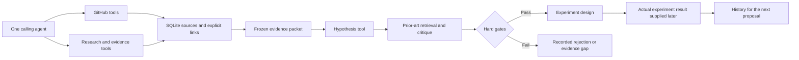

# Three tools, one research session

Implementation and source review: 20 October 2026. This is the preferred interface for new work. The older `research` command remains available for replaying the earlier prototype.

## Outcome

Produce a small set of evidence-grounded optimization proposals with a concrete code change, competing explanation, comparator, and cheap falsification experiment. A proposal may be useful without being scientifically unprecedented. No speedup is reported until an experiment supplies it.



The caller owns search decisions. There is no workflow server, autonomous worker pool, graph database, or GPU execution dependency. The hypothesis tool generates or loads a task rubric, then makes two sequential model calls per new proposal round: propose and critique. One round is the default; up to three may be requested. Provider failures and missing evidence remain visible.

## 1. GitHub tools

Reuse the existing SQLite/FTS5 corpus and resumable collector. Search supports literal keywords/phrases, aliases, dates, issue/PR type, state and intersected tags. Repository filtering happens before result limiting.

| Tool | Result |
|---|---|
| `github.search` | Body/metadata records from the selected repository with lexical ranking |
| `github.get` | Opening record, stored children, hydration checkpoint |
| `github.hydrate` | Selected discussion, reviews and available patches; observes ingestion lock |
| `github.code` | Exact 40-character SHA source file |
| `github.status` | Counts and per-feed collection checkpoints |

Date meanings stay distinct: created, updated, merged, fetched. Mentioning B200 is not proof of a B200 measurement. A merged PR is not proof the deployed image contains it. Historical completeness, especially the repository comment boundary, still requires the separate collector audit; these tools do not repair that backfill.

## 2. DeepResearch as search/evidence tools

The agent starts with a mechanism question, searches directly, follows explicit references or citations, reads methods/evaluation, seeks counterevidence, and stops when it can answer or name the missing evidence. A fixed list of searches alone is not called a completed deep investigation.

| Tool | Provider and contract |
|---|---|
| `research.search` | Existing arXiv/HF APIs; optional PyAlex/OpenAlex. Publication dates are separate from GitHub dates. |
| `research.read` | Primary-source HTML; arXiv PDF fallback via pypdf. Raw content hash retained. |
| `research.expand` | Explicit arXiv references in a downloaded source |
| `research.citations` | OpenAlex forward/backward traversal; Semantic Scholar for arXiv IDs |
| `research.get`, `research.graph` | Stored source text and attributed links |
| `research.evidence` | Existing authenticated agent extracts claims; exact quote checks produce a frozen packet |
| `research.paperqa` | Optional PaperQA `Docs` evidence/answer API over selected source files |
| `research.providers` | Installed packages and credential presence, never secret values |
| `research.web_read` | Cloned Fathom HTML/browser/PDF fetchers; stores extracted text and raw result hash |
| `research.web_search`, `research.web_query` | Cached Fathom Serper search / cached read plus cheap helper; discovery context only |
| `research.fathom_status` | Checkout revision, runtime presence and credential presence |
| `research.topics`, `research.plan` | User vocabulary and natural-language instructions → editable bounded query plan; no automatic search |
| `research.triage`, `research.cache_status` | Cheap URL ranking from retrieved results; persisted cache and provider budgets |

An evidence claim records source, exact quote, supporting/challenging/context role, conditions, reported result, transfer inference and limitations. Evidence packets preserve full source snapshots; model input uses bounded excerpts. Quote validation verifies text existence, not scientific entailment. arXiv/HF/full-text copies of one paper count as one source identity.

The graph stores explicit hyperlinks, paper identities, bibliographic relationships and document parents in SQLite. It does not infer causal truth from co-occurrence. Hypothesis parents, reviews, policies, baseline snapshots, scoped tests and results are linked in a separate append-only SQLite memory graph. See [adaptive policy and memory](ADAPTIVE_POLICY_AND_MEMORY.md).

### Provider boundaries

- Working default: existing agent authentication + arXiv/HF + stored GitHub corpus.
- PyAlex is installed. The supplied OpenAlex key is configured; live search and forward/backward citation traversal passed. See [provider verification](FATHOM_INTEGRATION.md).
- Fathom is cloned and its CPU fetchers are imported directly in an isolated environment. Serper is configured and live-tested. Page query uses the cached read plus gpt-5.6-luna helper through existing Codex login; the separate OpenAI API backend is unverified without a key. Search results and generated page answers cannot become primary evidence. See [architecture and cache policy](SYSTEM_ARCHITECTURE.md).
- Semantic Scholar public requests may be throttled; a failed traversal is not an empty citation graph.
- PaperQA is an optional adapter with a pinned package and explicit settings file. It requires model/embedding credentials. It has not been run against a paid provider in this deployment.
- PDF text extraction does not interpret plots, recover scanned text, or guarantee table/equation fidelity. Large documents exceeding the existing 8 MB fetch limit are rejected explicitly.
- HF date filtering applies after a bounded search, so it is not exhaustive date-window retrieval.

### Selected paper reading through `researchctl investigate` / MCP `investigate`

For selected papers, the reader prefers the existing arXiv path. When no arXiv identity is available, it can read the first eligible HTTPS `pdf_url` whose retained metadata location explicitly has `is_oa: true`. OpenAlex `locations` are retained by search; `best_oa_location` and `primary_location` are also recognized when present. This uses the same cached fetcher, shared HTTP budget, PDF parser and 8 MB limit. A response must have a PDF signature and a PDF or `application/octet-stream` content type, and yield sufficient parsed text; an abstract/login HTML page is not promoted to full text. Page-number markers do not count as extracted evidence.

No DOI resolver or landing-page PDF discovery runs implicitly. A DOI-only record with `pdf_url: null`, including a Zenodo DOI, returns `no_supported_oa_pdf_locator`. Publication dates remain source dates; an unversioned PDF's revision date is unknown, and its source record hash, location, retrieval hash and original update date are retained separately.

Both interfaces return `fulltext_coverage` counts and a `reads` entry for each selected paper: `completed`, `skipped` (missing locator, full-text limit or HTTP budget), or `failed` (fetch/extraction). `dossier_ready` can mean the original abstract is available; it does not certify a full-paper read. Offline calls may reuse cached PDF bytes at zero HTTP cost; an uncached locator is explicitly skipped under the zero HTTP budget. These receipts do not interpret figures or establish scientific validity.

## 3. Hypothesis tool

Reuse DiscoveryRSI's `Candidate`, `Episode`, `ReplayBuffer`, and `ToolRegistry` from commit `8f7214865548bc9b48170aa844e205341d24c4b9`. Domain contracts and validation are small local adapters. We do not use the public loop's unconditional best-candidate selection.

Each hypothesis contains:

1. One concise scientific/engineering statement, followed by the specific behavior to change.
2. The observed bottleneck or an explicit statement that it has not been measured.
3. Mechanism, code surface, applicability and predicted direction of effect.
4. Competing explanations and tests that distinguish them.
5. Scientific, implementation and workload novelty separately; nearest prior art and specific difference.
6. Control, treatment, metrics, correctness, cost, held-out workload and support/reject/inconclusive rules.
7. Exact source citations, parent IDs, operation and revision reason.

The task-derived rubric selects bounded additional local/literature retrieval, without a date cutoff on existing implementations. The critic receives the frozen rubric, sources and memory. No publication-novelty veto applies unless requested. Activations, known techniques and ports are allowed if useful for this deployment. Missing baseline inclusion needs a check, not a fictional absence claim.

### Adaptive gates, ranking and memory

[Full policy/memory guide](ADAPTIVE_POLICY_AND_MEMORY.md) documents configuration, diagrams, lifecycle and evaluator interfaces. `hypothesis.rubric` generates an editable policy; `hypothesis.run` accepts that policy or generates one. Criteria, weights, threshold and evidence needs vary by task. Integrity checks retain exact citations, primary sources and discriminating experiments. Required failures reject; required unknowns or insufficient priority defer. Acceptance means eligible for experiment design only.

Every proposal is registered before critique in `data/hypotheses.sqlite`. `hypothesis.memory/get/graph/stats` expose durable history. `hypothesis.import_runs` preserves historical decisions and revisions. `hypothesis.run` with `revisit` reconsiders existing cards under a new policy, retaining ancestry. A prior rejection or exact mechanism match is not a global ban.

`hypothesis.plan_test/start_test/test_result` register future evaluations and attributed, artifact-backed, scoped outcomes. They do not execute jobs or independently verify a scientific result. Rejection at selection is separate from experimental invalidation; contradictory retests remain visible. `hypothesis.outcome` remains a compatibility adapter.

## Invocation

On `sofia-gpu-mumbai`, from `/home/ubuntu/shreyas/skunk-work/ideation`:

```bash
.venv-research/bin/python -m ideation tools
.venv-research/bin/python -m ideation tool github.search \
  --args '{"query":"deepseek b200","match":"all","after":"2026-10-01","limit":5}'
.venv-research/bin/python -m ideation tool research.search \
  --args '{"query":"asynchronous speculative decoding","limit":3}'
.venv-research/bin/python -m ideation tool research.read \
  --args '{"url":"https://arxiv.org/abs/2603.03251"}'
.venv-research/bin/python -m ideation tool research.evidence --args @evidence-request.json
.venv-research/bin/python -m ideation tool hypothesis.run --args @hypothesis-request.json
```

Example `evidence-request.json`:

```json
{
  "question": "What supports or limits transferring asynchronous speculation to this serving workload?",
  "source_ids": ["github:vllm-project/vllm:36037", "fulltext:2603.03251"],
  "output": "runs/my-evidence",
  "timeout": 300
}
```

Example `hypothesis-request.json`:

```json
{
  "brief": "config/b200.json",
  "packet": "runs/my-evidence/packet.json",
  "output": "runs/my-hypotheses",
  "rounds": 1,
  "timeout": 600
}
```

A reproducible, small live demonstration:

```bash
.venv-research/bin/python -m scripts.demo_three_tools --output runs/three-tools-new
```

Every output directory must be new. The wall-time budget covers agent stages and is checked before retrieval; an in-flight HTTP request can overrun it. Set provider timeouts accordingly for strict external budgets.

## Practical evaluation

Track accepted experiments per research hour/dollar, duplicate rate, rejected unsupported claims, and whether cheap tests change the decision. Once experiments exist, track correctness-preserving SLO goodput, p95 TTFT/TPOT, quality, memory and cost against matched baselines.

A later historical backtest must freeze corpus availability and model knowledge, retain false positives, and compare mechanisms rather than keywords. This backtest and GPU evaluation are not implemented in this change. Passing software tests or reproducing a paper-inspired proposal does not establish a useful optimization.
