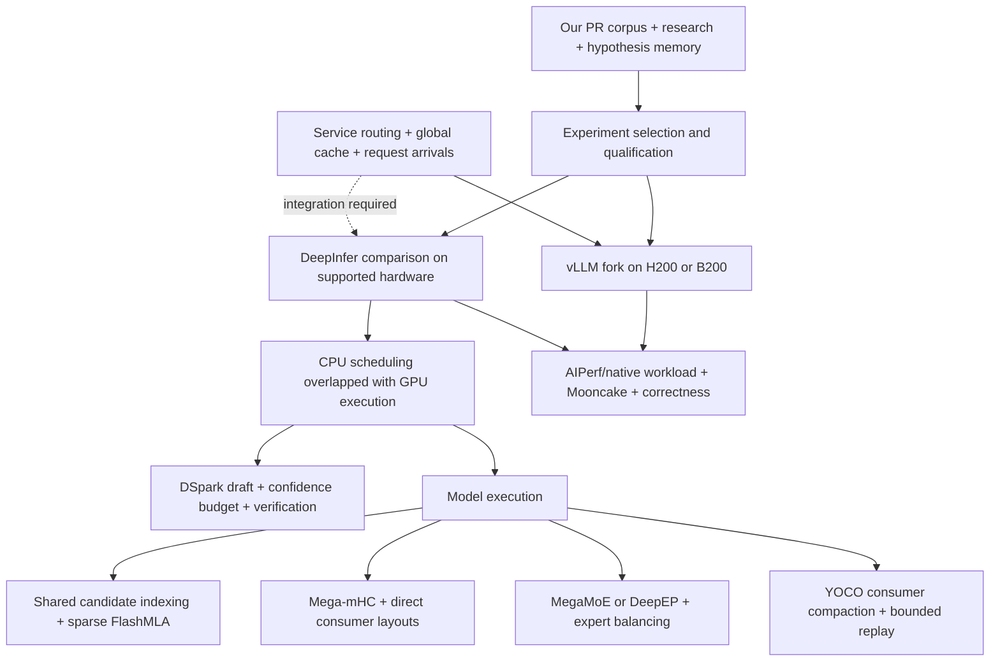

# DeepInfer versus our H200/B200 optimization program

Audit date: 2026-10-20. DeepInfer commit: **774ce244b87cc0eb8d4b94ab9f5de2ab22049f01**.

## Decision

**Subsequent evidence, 2026-10-21:** the C01 default grouped-Humming run onH200 produced a poor service outcome. The indexed arm remains untested in the inspected artifacts. The earlier recommendation below to put C01 first is superseded by a hold and component qualification requirement. See [C01 failure audit](../c01-h200-failure-audit-001/REPORT.md).

DeepInfer substantially overlaps our Blackwell engine work and gives us a stronger public reference implementation. It does not establish that our H200 deployment is optimized, replace our service evaluation, or demonstrate that all our proposed changes are already present in our installed vLLM. The existing hypothesis catalog was largely assembled from public PRs: it was never evidence of exclusive algorithms. No measured new speedup or original algorithm is established by this comparison.

Treat the release as an opportunity to import, compare and specialize. Do not invest in recreating mechanisms now available upstream. Remaining commercial/technical differentiation would need evidence: reproducible workload-specific Pareto gains, effective Hopper implementations, useful adaptation policies and reliable deployment integration. A research-agent wrapper alone does not establish it.

### Audit scope

- Read the engine, its deployment Q&A, benchmark scripts and pinned NVIDIA submodules. No repository code was imported or executed; no build, GPU benchmark or deployment was performed.
- Compared against all **33 consolidated families**, which preserve correspondence to **66 original cards**. [Full overlap ledger](OVERLAP.csv), [original crosswalk](../h200-cross-audit-comparison-001/CROSSWALK.csv).
- This is mechanism-level correspondence, not proof that an exact upstream PR was merged. Unresolved membership remains unresolved.
- Previous experiment records are unchanged. New proposals below are **proposed, untested**; they have not been entered as accepted/validated memory outcomes.

## 1. Match the deployment before interpreting performance

| Dimension | Our recorded deployment | DeepInfer evidence | Consequence |
|---|---|---|---|
| H200 | Eight H200s, two TP1/DP4/EP4 groups | Full NVIDIA engine targets SM100; current FlashMLA removed Hopper support | No drop-in H200 engine replacement |
| B200 | SM100-specific investigation; historical configured baseline | SM100 target | Useful engine comparator, subject to actual eight-GPU fit |
| Model | Launch checkpoint revision `2cba9e42aa026125f3ed06c6d98c1db82f7ca027` | Examples default to Flash-1017 | Freeze a common compatible model or label separate model lanes |
| Speculation | DSpark k5, adaptive verification off | Variable verification supported | A meaningful additional experiment, not an assumed win |
| Replay | Explicit `--no-swa-bounded-replay` | Decoder compaction available | Qualification opportunity; mathematical behavior can change |
| Service | vLLM HTTP service, routing and arrival-driven tests | Offline engine release; complete service components omitted | Kernel throughput is insufficient for a service claim |

Sources: [release boundary](https://github.com/deepseek-ai/DeepInfer/blob/774ce244b87cc0eb8d4b94ab9f5de2ab22049f01/README.md), [FlashMLA hardware boundary](https://github.com/deepseek-ai/FlashMLA/blob/2e5429fc5653bab6e081f09477126f731882a6a9/README.md), [our frozen runtime](../h200-fresh-research-001/baseline/runtime-inventory.json), [our dispatch evidence](../h200-fresh-research-001/baseline/dispatch-log-excerpts.txt).

## 2. Architecture and optimization mechanisms

The graph separates our research system from the execution engines. A better public engine changes the experiment baseline; it does not implement our evidence/memory workflow.

### A. Sparse indexing: reduce valid work and share it

The indexer limits block selection to valid lengths and invokes candidate-only paged scoring. This directly overlaps C08/C09; it is not just a keyword match. Final decoding still separates selection from physical KV-slot conversion, leaving a concrete C14 integration lead. [Indexer implementation](https://github.com/deepseek-ai/DeepInfer/blob/774ce244b87cc0eb8d4b94ab9f5de2ab22049f01/deepinfer/model_executor/models/v4_modules/index_attn.py#L204).

Cross-layer groups retain candidate indices and compatible scheduling metadata, invalidating dependent state when producers/layouts change. This reuse follows the checkpoint's sharing topology; arbitrary reuse across unrelated layers would change the model. [Cross-layer runtime](https://github.com/deepseek-ai/DeepInfer/blob/774ce244b87cc0eb8d4b94ab9f5de2ab22049f01/deepinfer/model_executor/models/v4_modules/cross_layer.py).

For our deployment, trace actual context lengths and candidate counts. C09 can be valuable in a long-context workload while barely moving the existing 8K synthetic frontier. A valid selector must preserve causal bounds, ties and page-reuse behavior.

### B. Attention: share planning and fuse surrounding work

Compatible layers share FlashMLA scheduler metadata keyed by compression, packed-KV, SWA and top-k configuration. That covers C02's underlying mechanism, while a safe vLLM port still requires matching metadata lifetimes. [Attention dispatch](https://github.com/deepseek-ai/DeepInfer/blob/774ce244b87cc0eb8d4b94ab9f5de2ab22049f01/deepinfer/model_executor/models/v4_modules/attn.py#L241).

FlashMLA combines attention with surrounding RoPE/cast operations; its general fused interface also accommodates Q normalization where the model uses it. Required weight permutations and changed KV layouts make this more than swapping a function pointer. Current native support is a Blackwell advantage, not a Hopper implementation. [Pinned FlashMLA](https://github.com/deepseek-ai/FlashMLA/blob/2e5429fc5653bab6e081f09477126f731882a6a9/README.md).

### C. MoE: optimize the entire data path

Within a compatible NVLink group, MegaMoE consumes prearranged symmetric buffers. FP8 activations/scales can already occupy the required consumer buffers; the fallback path uses dispatch, expert compute and combine, with shared-expert overlap. Accepted arithmetic combinations distinguish FP8×FP4 from BF16×BF16: FP4 weights do not imply FP4 activations. [MLP implementation](https://github.com/deepseek-ai/DeepInfer/blob/774ce244b87cc0eb8d4b94ab9f5de2ab22049f01/deepinfer/model_executor/models/v4_modules/mlp.py#L177).

This overlaps our B200 repacking/fusion goals. H200 C01/C13 still ask a different concrete question: can legal Humming schemas beat the installed Marlin path for both target and drafter expert geometries? An engine using different arithmetic is not a controlled answer.

The MegaMoE kernel combines EP dispatch, the first expert projection, SwiGLU, the second projection and EP combine while overlapping NVLink traffic with tensor-core work. The gain comes from reducing serialized transport/compute boundaries, not merely a faster matrix multiplication. Required symmetric memory and transformed weight layouts are part of the integration contract. [Pinned DeepGEMM interface](https://github.com/deepseek-ai/DeepGEMM/blob/1fc9c66975ee322d628b3288534ca0e9ce12a64d/README.md#L112).

EPLB adds physical replicas for hot logical experts and places them using historical per-step rank loads. Its objective accounts for the slowest rank, rather than only equalizing aggregate counts. [Balancing policy](https://github.com/deepseek-ai/DeepInfer/blob/774ce244b87cc0eb8d4b94ab9f5de2ab22049f01/deepinfer/model_executor/eplb/policy.py).

Our captured H200 backend has EPLB disabled. That makes it a worthwhile diagnostic lane, but replicas consume memory otherwise available to KV cache, and EP4 may have little useful skew. Measure before enabling.

### D. mHC: delay materialization and emit the next layout

Lazy state allows a fused kernel to combine adjacent mHC post/pre operations with normalization and optional casting. It can emit consumer-compatible scales directly. This reduces intermediate memory traffic and launches. Crucially, an Engram intervention takes the unfused path. [mHC implementation](https://github.com/deepseek-ai/DeepInfer/blob/774ce244b87cc0eb8d4b94ab9f5de2ab22049f01/deepinfer/model_executor/models/v4_modules/hc.py#L176).

C05/C21 are specifically Hopper shape/overlap investigations, not automatically superseded by a Blackwell implementation. D06's Engram boundary remains inspectable, but presence of an extra launch does not establish meaningful exposed latency or a safe fusion.

### E. Speculation: maximize accepted progress per unit time

The scheduler evaluates candidate query budgets using estimated useful tokens divided by predicted step duration. It includes profiled graph cost, a runtime correction and sampling cost. Confidence from different prior rounds is used deliberately to respect asynchronous scheduling and verification causality. [Budget controller](https://github.com/deepseek-ai/DeepInfer/blob/774ce244b87cc0eb8d4b94ab9f5de2ab22049f01/csrc/engine/mtp_varlen.hpp#L150).

GPU-side allocation remaps surviving requests, forms cumulative confidence along each draft prefix and assigns the remaining token budget with deterministic ties. New requests require distinct handling. [Allocation kernel/reference](https://github.com/deepseek-ai/DeepInfer/blob/774ce244b87cc0eb8d4b94ab9f5de2ab22049f01/deepinfer/model_executor/layers/tilelang_ops/schedule_mtp_varlen.py).

This is substantially richer than changing fixed draft length. We should reuse the principle and qualify an available implementation before writing a controller. Our EP4/H200 cost curve, burst arrivals and quality requirements are the actual experimental variables. Existing C03/C16/C17 concern different padding/budget/bucket issues; they are not proven fixed by this design.

### F. CPU/GPU overlap

The worker executes current model work before processing the preceding step's outputs. GPU remapping carries surviving sequence state across changing batches. This reduces synchronization on the CPU critical path. [Worker](https://github.com/deepseek-ai/DeepInfer/blob/774ce244b87cc0eb8d4b94ab9f5de2ab22049f01/deepinfer/worker/worker.py#L122), [batch remapping](https://github.com/deepseek-ai/DeepInfer/blob/774ce244b87cc0eb8d4b94ab9f5de2ab22049f01/csrc/engine/zos.cpp).

C04/C07 still need exposed-time traces in our installed engine. Faster CPU code has no service benefit if its work is already fully hidden behind GPU execution. “Zero overhead” is a design name, not a demonstrated zero-cost guarantee for our workload.

### G. Bounded replay and physical compaction

At the YOCO consumer boundary the engine gathers retained query rows, residual state and indices, while maintaining the information needed for shared KV computation. Actual compaction removes compute rather than merely masking outputs. [Compaction implementation](https://github.com/deepseek-ai/DeepInfer/blob/774ce244b87cc0eb8d4b94ab9f5de2ab22049f01/deepinfer/model_executor/models/v4_modules/yoco.py).

Bounded replay reconstructs approximate SWA state from a short suffix. This is especially relevant because our captured server explicitly disables it. Mask-versus-compact tests verify implementation agreement between those two modes; they do not establish equality with full-history inference. [Provided tests](https://github.com/deepseek-ai/DeepInfer/blob/774ce244b87cc0eb8d4b94ab9f5de2ab22049f01/examples/yoco/README.md), [replay semantics](https://github.com/deepseek-ai/DeepInfer/blob/774ce244b87cc0eb8d4b94ab9f5de2ab22049f01/doc/inference_deployment_qa.md#L175).

### H. Engram and service boundaries

Engram uses sharded lookup and specialized transport buffers, including a CPU storage path. This is not proof that our shared host-memory layout has the same NUMA or transfer characteristics. [Engram module](https://github.com/deepseek-ai/DeepInfer/blob/774ce244b87cc0eb8d4b94ab9f5de2ab22049f01/deepinfer/model_executor/models/v4_modules/engram.py), [transport allocation](https://github.com/deepseek-ai/DeepInfer/blob/774ce244b87cc0eb8d4b94ab9f5de2ab22049f01/deepinfer/model_executor/parallel_utils/userbuffer.py#L127).

The production description includes a global cache service, request balancing and time-budgeted prefill. Their complete infrastructure is not released. These are publicly described designs, so omission of their code is not evidence that our cache/routing ideas are novel. Their scale also differs from our two EP4 groups. [Production design](https://github.com/deepseek-ai/DeepInfer/blob/774ce244b87cc0eb8d4b94ab9f5de2ab22049f01/doc/inference_deployment_qa.md).

## 3. What changes in our backlog

| Family | Interpretation after this audit | Action |
|---|---|---|
| C02, C08, C09 | Matching high-level mechanisms implemented | Treat as adoption/porting opportunities; verify installed vLLM coverage |
| D05 and part of D06 | Strong Blackwell integration overlap | Compare the released path before recreating it |
| C01, C05, C12, C13, C19, C21 | Hopper implementation questions remain | Keep hardware-specific feasibility gates |
| C03, C04, C06, C07, C16–C18 | Related goals; exact vLLM behavior unresolved | Diagnose our code rather than infer inclusion from feature names |
| C10, C11, C15, C22 | Service/placement/capacity problems remain deployment-dependent | Keep only if measured symptoms justify them |
| C14 and Engram portion of D06 | Separate operations/fusion boundary visible in source | Profile and inspect semantic constraints before implementing |
| C20 | DeepEP use overlaps; exact triple-buffer patch not established | Separate backend activation from incremental patch benefit |
| C23 | Comparator scope grows | Add DeepInfer as a supported-hardware control, alongside SGLang |
| Q01–Q04 | Qualification requirements remain | Do not remove because another engine has tests |

No percentage of “IP covered” is defensible: these families mix algorithms, integration fixes, controls and correctness gates. [OVERLAP.csv](OVERLAP.csv) records all 33 separately with sources and uncertainty.

## 4. Revised experiment priorities

Priority is expected information per engineering effort, not a predicted speedup. All cards are proposed/untested. Existing IDs remain intact; N01–N06 are this report's new investigations, not production memory IDs.

### N01 — Establish a matched B200 engine control

**Question:** does integrated DeepInfer eliminate enough overhead that a vLLM port is unnecessary? First establish eight-GPU memory/topology/model eligibility. Compare stage timing at matched geometry, then service behavior only with a controlled compatible adapter. Keep 2×EP4 versus EP8 as separate topology arms. Do not silently compare a model update with an engine update.

**Evaluation:** existing native workload and Mooncake after endpoint compatibility; before that, offline results are diagnostic only. Record real accepted output tokens, TTFT, TPOT/ITL tails, errors, all GPU costs, warm/cold cache state and every service overhead. An offline gain alone cannot pass a service decision.

### N02 — Qualify bounded replay before broad kernel rewrites

**Hypothesis:** reducing consumer prefill work improves TTFT and load capacity for our prompt distribution. Inspect the installed vLLM flag/path first; a DeepInfer SM100 kernel is not an H200 implementation.

**Arms:** current full replay, qualified existing bounded mode, compact implementation if genuinely distinct. Keep checkpoint and sampling fixed. Extend prompt lengths only where the existing workload does not expose the effect.

**Why extra evaluation:** E1/Mooncake measure speed, not whether reconstructed state alters useful outputs. Add full-replay teacher-forced logprob/token comparisons, task quality, tool/JSON behavior and prefix-hit/miss boundary cases. A mask/compact equivalence test alone is insufficient. Reject on quality loss beyond the predeclared task allowance, even if throughput improves.

### N03 — Confidence-budgeted verification on EP4

**Hypothesis:** calibrated verification lengths avoid paying for low-value draft positions near costly graph boundaries. Compare fixed k5 with a supported variable-length implementation; calibrate using the actual target/drafter, hardware and batch sizes.

**Evaluation:** E1 plus bursty Mooncake; record proposed/verified/accepted tokens by position, graph-size distribution, draft and verification time, confidence calibration and per-request tails. Additional sampling-distribution and cancellation/new-sequence tests are required because speed clients cannot establish probabilistic correctness. Stop if controller overhead or calibration drift cancels useful progress.

### N04 — EP4 load skew and redundant experts

**Hypothesis:** a few overloaded ranks dominate MoE completion; limited expert replication reduces that exposed time more than its memory/maintenance cost.

**First gate:** gather per-expert counts and per-rank dispatch/compute/wait time with EPLB off. If no relevant skew is present, defer. Then compare supported EPLB off/on with a small legal redundancy grid, retaining backend and precision. Count lost KV capacity and periodic movement overhead.

**Evaluation:** existing two workloads suffice if they contain skew. Only add a domain-shift mix if stationary traces cannot test adaptation. Rank by SLO-qualified goodput/cost, not expert balance alone.

### N05 — C14 physical mapping fusion

**Hypothesis:** remove an exposed mapping launch/temporary after fast selection. Compare current chain, fast selector plus separate mapping, and fast selector plus fused mapping. Preserve logical-ID consumers; test order/ties/causality, block64, page reuse and changed-length graphs.

**Evaluation:** E1/Mooncake plus a focused native operator correctness/timing test. Add a long-context performance slice only if the trace shows this operation insignificant at current lengths. Reject if fast selection explains the gain and mapping fusion adds none.

### N06 — Engram/mHC boundary, initially B200

**Hypothesis:** reduce materialization around an exposed Engram intervention without changing embedding/gating or residual math. Inspect current #60938 and the installed implementation before new code. Scope H200 separately; removing an architecture guard is not a port.

**Evaluation:** operator equivalence across actual shapes and layout/lifetime cases, then existing workloads with a bounded profile. Extra end-to-end workload machinery is unnecessary unless existing traces never execute the eligible path. Reject if lookup transport dominates and saved launch time is hidden.

### Recommended order

- **H200:** keep C01 eligibility and C02/C03/C04 diagnosis first; move N02/N03 feasibility into the next tier; measure N04 skew cheaply. C05/C08/C09 remain shape-specific. C19/C21 remain large/experimental work.
- **B200:** establish N01 feasibility first; prioritize N02/N03 and determine what the current backend already shares with DeepInfer. N04 follows measured skew. N05/N06 follow exposed-time evidence.
- Stop recreating broad fusion/planning mechanisms when an adoptable upstream implementation suffices. Novelty is not an acceptance condition unless the task explicitly asks for it.

## 5. Why the published Pareto plot cannot decide our result

DeepInfer's displayed measurements use four SM100 GPUs for prefill and 64 for decode, not our eight-GPU service. Its examples also use a different default checkpoint. [Benchmark scope](https://github.com/deepseek-ai/DeepInfer/blob/774ce244b87cc0eb8d4b94ab9f5de2ab22049f01/README.md#L78).

The fixed-draft plotting helper scales steps by `1 + nextn × draft_acceptance`; acceptance is a supplied parameter and defaults to full acceptance. It explicitly excludes variable-length runs from this calculation. This is a useful controlled-engine representation, not measured acceptance for our request mix. [Plot accounting](https://github.com/deepseek-ai/DeepInfer/blob/774ce244b87cc0eb8d4b94ab9f5de2ab22049f01/examples/sweep/plot_pareto.py#L58).

Use the existing [evaluation reconciliation](../h200-cross-audit-comparison-001/EVALUATION_RECONCILIATION.md): within-host paired controls, identical load/cache semantics, actual rejection, all-rank telemetry and a frozen practical threshold. Include periodic maintenance in the service measurement. Use short profiles separately from throughput confirmation.

For a fixed prompt/output contract, report both SLO-passing requests/second and qualified output tokens/second. Compute cost per million qualified output tokens as `total_node_cost_per_hour / (3600 × qualified_output_tokens_per_second) × 1e6`. State how failures, late requests and incomplete outputs enter the denominator; do not count only successful survivors while hiding offered load. Input-heavy or varying-length workloads also need request/input accounting.

**Current empirical status:** no DeepInfer performance result on our hardware, no measured win from these new cards, and no basis to declare either engine superior. The audit narrows what to test and removes weak originality claims; it does not validate the hypotheses.
