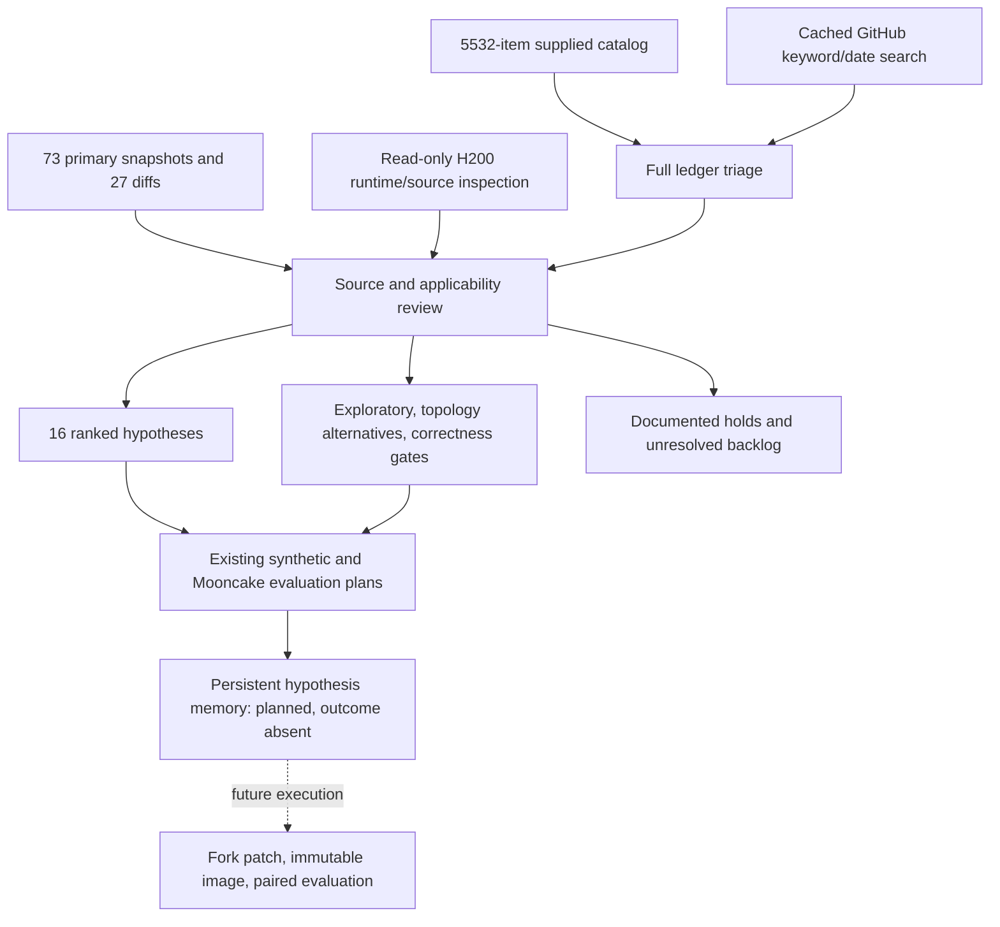

# H200 optimization audit — live DP4/EP4 deployment

## What was done

Reassessed the supplied 5,532-item multi-repository catalog against **217.18.55.219: eight H200s, two four-GPU TP1/DP4/EP4 groups, DSpark k5**. This is the runtime layout selected by the user after SSH inspection corrected the original TP4 assumption.

- Preserved all 5,532 unique catalog identities in [PR_DISPOSITIONS.csv](PR_DISPOSITIONS.csv), with explicit reasons and review depth.
- Refreshed 73 primary GitHub PR/issue snapshots using the existing cached GitHub tool; 27 include complete changed-file lists at retrieval. Sources and retrieval manifest are in [sources](sources/).
- Reopened Hopper-specific material previously unsuitable for B200; carried over generic source reviews only with explicit H200 eligibility checks.
- Captured actual GPU topology, container launch/digest, package versions, model dimensions and selected installed source files. [Baseline evidence](BASELINE.md).
- Produced **26 conditional experiment designs: 16 ranked live-layout hypotheses, 3 exploratory integrations, 3 alternative-topology designs and 4 correctness gates**, citing 49 distinct primary items. 48 of those items appear in the original catalog; the remaining dependency is supplemental evidence.
- Ran eight cached keyword/date queries against the 92,050-document controller corpus and used the existing hypothesis-memory API. This document count is not a PR count. [Search results](search-results.json). No new orchestration framework, persistent agent session, benchmark service, image build or GPU run was started.

**This is not a claim that all 5,532 implementations were deeply reviewed.** The full table is systematic triage; explicit candidate/negative overrides are source-reviewed. 293 Hopper-tagged rows still need primary review; other deferred rows remain unresolved. `catalog_low_relevance_unverified` is catalog triage, not proof of irrelevance. [Coverage counts](coverage.json) make this boundary auditable.

## First experiments, in order

| Priority | Experiment | Why relevant here | First condition to establish |
|---|---|---|---|
| 1 | [H01: Humming versus Marlin](experiments/H01.md) | Both containers explicitly select Marlin; Humming is installed. An alternative Hopper expert GEMM is a concrete, isolated comparison. | Humming supports the exact V4.1 MXFP4/EP path; keep BF16 activations and qualify numerical behavior. |
| 2 | [H02: remove DP drafter padding](experiments/H02.md) | DP4 and DSpark5 can turn target graph capacity into unnecessary draft rows. | Real versus padded request counts; verify equivalent fix is absent. |
| 3 | [H03: CPU metadata collectives](experiments/H03.md) | Every DP step can wait for small CPU synchronization before GPU dispatch. | Separate communication cost from rank arrival skew and show critical-path cost. |
| 4 | [H04: prefix/draft correctness](experiments/H04.md) | Prefix caching and DSpark are both on; warm hits can trigger draft validity or junction issues. | Observe group-level misses or acceptance collapse, then select the matching patch. |
| 5 | [H05: scheduler/cache scans](experiments/H05.md) | Long SWA tables and repeated unchanged prefix registration can create CPU work. | CPU samples show the specific scan/registration path matters at seq64. |
| 6 | [H06: small-token Hopper mHC](experiments/H06.md) | DSpark k5 at low per-rank load can land in the six-row shape targeted by the specialization. | Actual shape distribution and delayed 5120-wide kernel dispatch. |
| Conditional next | [H07: indexed Humming EP](experiments/H07.md) | The EP grouped/indexed distinction is relevant to this layout. | Qualify H01 first and verify all-to-all preparation compatibility. |
| Long-context lane | [H08: candidate-only Hopper indexer](experiments/H08.md) | Can avoid scoring unused compressed-context positions. | Trace has qualifying long contexts; candidate-only output matches reference. |
| Integration lane | [H09: Hopper DeepSelect + valid lengths](experiments/H09.md) | Installed selector is SM100-gated and still does full-width block selection. | Build/validate SM90 FP32 selector; isolate extension change from length-aware dispatch. |

All 16 live-layout families and their exact sources, controls, measurements, failure conditions and justified additions are in the [experiment index](EXPERIMENT_INDEX.md) and [ranked PR table](RANKED_PRS.csv). Ordering is an engineering inspection order, not an estimate of percentage gain. An applicability check can demote any candidate immediately.

## Important exclusions and corrections

- **Small-head FlashMLA:** TP1 retains 64 attention heads. The 8/16-head optimizations are not direct improvements for this layout. Kept under [T02](experiments/T02.md), requiring a different TP4 baseline.
- **Marlin padding:** width 2304 at TP1 is already 128-aligned. The 576→640 padding problem belongs to pure TP4. Kept under [T01](experiments/T01.md).
- **Engram/mHC fusion #60938:** TP1 matches, but the implementation explicitly gates Blackwell. Excluded from the H200 main shortlist.
- **Graph cap:**64×6=384 already fits 512. #62040 needs an observed missing rounded draft bucket, not a borrowed B200 seq128 argument.
- **Token budget:** the source DSpark reservation result at MBT512 does not prove a gain at our 16384. H13 is low priority until budget pressure is observed.
- **Hopper backend != compatible model path:** GLM/V3-style 656-byte KV kernels and block-FP8 MegaMoE do not automatically support this V4.1 MXFP4 deployment.
- **GB200 Engram thresholds:** copied thresholds are inappropriate for H200's host-memory path; measure NUMA locality and lookup crossover separately.
- **Adaptive verification and KV offload:** both are separate feature lanes; current adaptive-off or GPU-only KV behavior cannot benefit from their inactive code paths.

[Reviewed holds](REVIEWED_HOLDS.csv) contain explicit reasons and reopening conditions. Deferred items remain available in the corpus.

## Evaluation design

Keep the two established workloads:

1. **Native agent-f75** retains 8192/1024 tokens, 6144 shared-prefix tokens and its Zipf cache construction. Start H200 capacity discovery conservatively; do not transfer B200 concurrency or measured timing values.
2. **Mooncake** retains the frozen 600s median/burst/cache-heavy windows, timestamp-only speedups and the existing SLO scorer. At an arrival-limited load, compare latency; capacity requires testing a passing/failing arrival-rate bracket.

Kernel, routing and scheduler changes generally need these two plus mechanism counters. Add upstream numerical, stochastic, tool-role, prefix-boundary or lifecycle fixtures only where ordinary performance traffic cannot establish the relevant correctness claim. Long-context/SPEEDBench coverage uses existing clients and cached datasets when trace coverage is insufficient. [Protocol and reasons](PROTOCOL.md).

A launch integration issue must be fixed before execution: the native sweep helper currently hardcodes B200 launch/profile paths. Explicit H200 launch resolution and a dry-run target manifest are required. AIPerf's external-server/profile-path support provides the Mooncake route; it does not replace native agent-f75 semantics. No launcher or service was changed in this audit.

H200 price is unknown: use normalized node-seconds per qualified request or an explicitly supplied price. Do not carry over the B200$36/hour scenario.

## Runtime and outcome status

SSH works. At **12:27:33 UTC on 20 October 2026**, both containers were running and their recent logs still showed weight loading; host ports 8100/8101 refused connections. [Snapshot](evaluation/runtime-final-readiness.json). This is a point-in-time observation, not proof of an enduring fault. Serving readiness and successful traffic have not been established by this audit.

**No H200 benchmark was run, no patch was deployed, and no speedup is claimed.** All plans are conditional, with explicit mechanism and correctness gates. Memory registration records plans and ancestry, not validated outcomes; [receipts](memory-registration.json) identify the persisted hypotheses/tests.

## System used for this rerun

The calling agent authored and reviewed this audit using the existing retrieval/cache and memory components. No model-based `hypothesis.run` output or autonomous experiment execution is implied. Cached retrieval rank is BM25 text relevance with date filtering; experimental priority is the task-specific engineering policy in [PROTOCOL.md](PROTOCOL.md).
