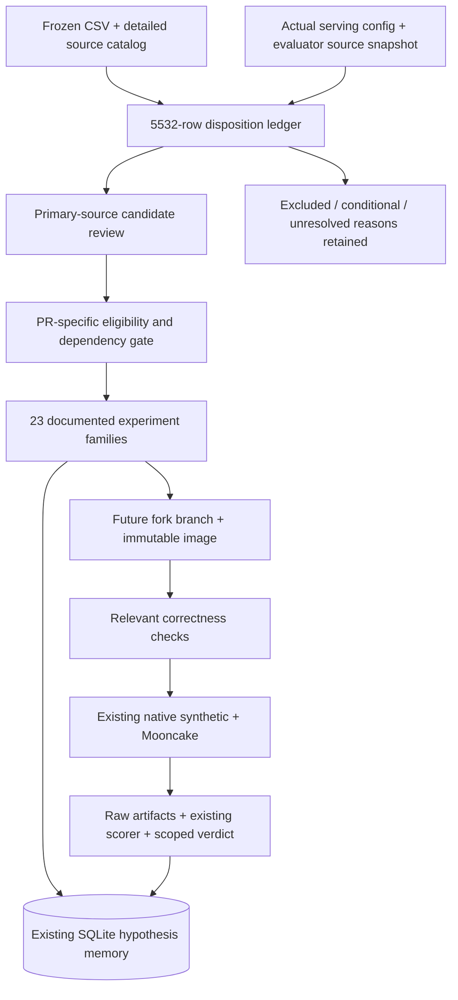

# PR catalog → eight-B200 experiment queue

Audit: October20,2026. Target: existing DeepSeek-V4.1-Flash serving, synthetic `agent-f75` and Mooncake replay. **No GPU experiments were run. These are conditional, source-grounded designs, not measured wins.**

## Start here

- [All5,532 item dispositions](PR_DISPOSITIONS.csv): original fields, new decision, individual reason, review depth, source lines, baseline-membership uncertainty and experiment link.
- [64 ranked candidate/dependency records](RANKED_PRS.csv): actionable inspection queue, including correctness prerequisites and conditional alternatives.
- [Experiment index](EXPERIMENT_INDEX.md):18 performance families and5 correctness/reliability gates, each with isolated arms, metrics and evaluation-gap reasoning.
- [Common execution/decision protocol](PROTOCOL.md): actual baseline, ranking policy, controlled comparisons, replication, SLO/cost definitions and fork/image workflow.
- [Existing evaluation source audit](evaluation/EVALUATION_CAPABILITIES.md): verified source references and commands;149 files snapshotted with hashes.
- [Evaluator reconciliation](evaluation/EVALUATOR_RECONCILIATION.md): accepted suggestions, corrections and evidence standards from the two evaluator notes.
- [Mechanism cards](evaluation/MECHANISM_CARDS.md): upstream inefficiency and source fix, separately from agent hypotheses and activation evidence for E01–E18/G01–G05.
- [Enhanced evaluation plan](evaluation/EVALUATION_PLAN.md): PR-specific activation/correctness gates, internal telemetry/profiling, AIPerf SPEED-Bench/MTP inventory, integration requirements and final cost–TTFT–TPOT evalset.
- [Machine-readable experiment designs](experiments.json), [coverage](coverage.json), [input hashes](input-manifest.json).

## What was actually reviewed

Both supplied Desktop files match the workspace copies byte-for-byte; frozen copies are under `inputs/`. There are5,532 unique repository/item identities across13 repositories. All rows receive a reproducible disposition. We retained4,209 existing vLLM opening records locally without new per-item API downloads, then performed bounded primary-source checks for the shortlist and upstream dependencies.

**94 catalog items received primary-source review:**64 candidate/dependency records and30 exclusions/holds. This is not5,532 independent code reviews. The remaining decisions explicitly distinguish inherited semantic catalog rationale and mechanical screening. In particular, the original catalog itself says1,532 rows were `auto`, not semantically classified; **1,089 remain deferred for primary-source review** after the current screening. Some auto rows were rescued into the shortlist; others were filtered for explicit platform/model scope. They remain recoverable with the rule and reason.

| Current disposition | Count | Meaning |
|---|---:|---|
| Reviewed conditional experiment |64| Source-grounded plan; runtime eligibility remains a gate |
| Reviewed exclusion or hold |30| Primary-source reason documented |
| Different hardware scope |1,556| Explicit incompatible platform scope; reopen on shared-path evidence |
| Named other-model path |364| No demonstrated shared implementation; rule-screened |
| Catalog exclusion retained |1,481| Original rationale retained, not independently re-proven |
| Conditional family backlog |486| Relevant source classification; requires per-patch inspection |
| Verify baseline membership |440| “Already in v0.32” does not answer what is in the actual image |
| Configuration/reference |22| Recipe evidence; not a cherry-pick |
| Deferred source review |1,089| Ambiguity preserved, not silently rejected |

Thus the deliverable is a complete **triage ledger** and an audited experiment shortlist. It is not an exhaustive claim that no useful PR remains in the backlog. In particular, general-purpose fixes can be missed by mechanical scope rules; inspect the deferred queue or reopen exclusions when profiling identifies the corresponding shared path.

## Baseline mismatch that changes the recommendations

The mined material assumes **B300 and v0.32.0**. Your inspected B200 serving repo pins a different image/source: `ac9126e…`, with source repo commit `2e6fa287…`. The current normal EP launcher chooses FlashMLA MegaAttention and DeepGEMM MegaMoE. It uses two DP4/EP4 replicas, TP1, API2, DSpark k5, adaptive verification off, host Engram, prefix caching and no HICache in the audited profile.

The profile is seq64 by default; reproducing the measured R7b baseline needs `lat-seqs-128`. Current max context is1,048,576, not the catalog's524,288. B300/SM103, different model dimensions, alternative backends, DP16 multi-node and enabled KV-tier results cannot be treated as direct B200 evidence.

The pinned source inspection found concrete motivation for #59468 and #62040: historical source retains K−1 draft-slot accounting and graph rounding/oversized-batch skip behavior. That still does not prove the current live host uses the unmodified pinned image. See [exact-SHA observations](spec-candidates/REVIEW.md).

## Performance inspection order

This ranks usefulness to the existing deployment, with no novelty requirement and no invented predicted speedups. Each row links to the full design and upstream evidence.

| Rank | Direction and primary PRs | Why test it here | Existing evaluation |
|---:|---|---|---|
|1|[Length-aware indexer](experiments/E01.md), [#61039](https://github.com/vllm-project/vllm/pull/61039)| Avoid work sized to maximum context when live contexts are shorter | E1 + E2; indexer counters |
|2|[Logical drafter rows](experiments/E02.md), [#58984](https://github.com/vllm-project/vllm/pull/58984)| Avoid target graph padding leaking into draft work; prove it occurs with adaptive OFF | E1 ragged/c sweep + E2 burst |
|3|[Graph bucket reachability](experiments/E03.md), [#62040](https://github.com/vllm-project/vllm/pull/62040) and config-only arm | k5 target/draft divisibility and cap512 may leave occupied shapes eager | Same loads, actual graph-mode counters |
|4|[CPU DP synchronization](experiments/E04.md), [#61767](https://github.com/vllm-project/vllm/pull/61767)| Reduce dispatch gaps if the current CPU collective is material; multi-node gains are not assumed | E1 + E2, CPU spans |
|5|[JIT readiness](experiments/E05.md), [#60468](https://github.com/vllm-project/vllm/pull/60468)| First-use stalls matter to cold/new-shape service; separate from warm throughput | Existing requests + lifecycle timestamps |
|6|[Top-k dispatch](experiments/E06.md), [#60802](https://github.com/vllm-project/vllm/pull/60802)| Select eligible DeepSelect route; actual shape and reference correctness gates | E1 shape sweep + E2 |
|7|[Scheduler budget](experiments/E07.md), [#59468](https://github.com/vllm-project/vllm/pull/59468)| Remove unnecessary reservations; benefit may be small at MBT16384 | E1 mixed load + E2 burst |
|8|[Packed activation chain](experiments/E08.md), [#57977](https://github.com/vllm-project/vllm/pull/57977)| Avoid repeated conversion/memory traffic if the dependency chain is active | E1 + E2; numerical checks |
|9|[B200 FlashMLA kernel](experiments/E09.md), [FlashMLA#227](https://github.com/deepseek-ai/FlashMLA/pull/227)| Explicit SM100/148SM optimization, with strict head/precision/layout gates | E1 + E2; upstream kernel reference |
|10|[Host Engram backing](experiments/E10.md), [#59849](https://github.com/vllm-project/vllm/pull/59849), [#62359](https://github.com/vllm-project/vllm/pull/62359)| Host tables are active; registration, sharing and NUMA capability must be measured | Existing prefill/cache-heavy loads + host counters |
|11–14|[Prefix groups](experiments/E11.md), [scheduler CPU](experiments/E12.md), [DP prefill alignment](experiments/E13.md), [final-rank affinity](experiments/E14.md)| Diagnose actual misses/stalls first; includes rescued `auto` PRs #51333/#51199/#61834/#52464 | Existing prefix/session/mixed loads and E2 |
|15–18|[Fusion](experiments/E15.md), [explicit KV-tier lane](experiments/E16.md), [long draft context/adaptive lane](experiments/E17.md), [alternative backends/precision](experiments/E18.md)| Larger integration or inactive-feature changes; gated alternatives, not first patches | E1/E2; targeted quality checks where needed |

Do the applicable **correctness gates before interpreting performance**: [G01 sampling](experiments/G01.md), [G02 graph/index/SWA safety](experiments/G02.md), [G03 persistent-kernel synchronization](experiments/G03.md), [G04 tool encoding](experiments/G04.md), [G05 API2/DP liveness](experiments/G05.md). Keep a correctness-qualified common control and test each performance delta independently.

## Corrections to the supplied classification

- **#62467 is conditional hardening:** its current body says shipped/default model configurations do not reach the reported problematic shape. It is not automatically a required current-path fix.
- **#58818 does not improve SM100 MegaAttention's planner path.** A B200 label or attention keyword is insufficient.
- **DeepGEMM#381 has incompatible model dimensions.** Do not transfer a benchmark for hidden7168/intermediate2048/top8 to Flash's relevant shape.
- **#48459 explicitly guards the older `deepseek_v4` model path.** A V4.1 adaptation requires inspection; it is not a drop-in prefix fix.
- **#61827 mainly concerns standalone draft models; #61911 explicitly excludes DSpark.** Neither earns a current fixed-k5 performance claim from its title.
- **#61371 has a KV-capacity tradeoff.** Dependency upgrades can reduce the admission frontier while improving a kernel.
- **Engram#59923 and #62359 optimize different DP storage branches.** Do not add their advertised benefits together.
- **#52464's frontend-local affinity maps have an API2 limitation**, directly relevant here. Existing endpoint hashing does not resolve final-rank locality.
- **Mooncake replay is a workload, not proof of an enabled Mooncake KV connector.** Tier/offload PRs belong to a deliberate separate profile.

Exact primary records, quotes, current/cached status and detailed caveats are in the [kernel review](kernel-candidates/REVIEW.md), [spec/graph/cache review](spec-candidates/REVIEW.md), and [generic scheduler/routing review](root-candidates/REVIEW.md). Source freshness is recorded per candidate; only a bounded subset was refreshed live.

## Evaluation reuse: what changes and why

**Keep both existing performance evaluations.** Native synthetic preserves the historical cache/layout protocol. Mooncake preserves realistic arrival/length/cache structure and its custom qualified-goodput scorer. At fixed1× offered load, test latency; use existing timestamp speedups for a capacity claim.

Most experiments need only instrumentation: per-rank logical/padded rows, actual graph dispatch, cache hits by source, scheduler/collective spans, kernel route and memory capacity. These are observations inside the existing test, not new evaluators.

Additional correctness checks are justified only for claims E1/E2 cannot assess: sampler distributions, numerical graph reuse, real tool-turn tokenization, and precision-dependent task quality. Startup needs lifecycle timing because warmup excludes it. Idle wake-up needs a small schedule fixture only if existing traces lack the triggering gap. [The exact justification matrix](evaluation/EVALUATION_CAPABILITIES.md#match-hypotheses-to-the-smallest-sufficient-change) is based on inspected code, including limitations in current smoke/session tests.

## Traceability and execution architecture

This audit used a calling agent and three specialist review tracks, existing local corpus tools, cached/live GitHub evidence and read-only SSH source inspection. It did **not** invoke the model proposal/critic loop or create an orchestration service. The designs are explicitly agent-authored and saved through the existing memory API, with exact source quotes and schema validation. Selection remains **deferred pending runtime applicability**, test status **planned**, outcomes empty. No “validated” result is manufactured.

See `memory-registration.json` for hypothesis/test IDs after registration. The row ledger preserves excluded source candidates; it does not pretend every unrelated source PR is a generated hypothesis. Future results should attach to those planned tests with image/config/workload scope and artifact hashes.

## Verified work and remaining execution gates

Executed: source and catalog audit, cached corpus export, bounded primary-source retrieval, source snapshots, runner help, native `--plan`, AIPerf synthetic dry-run, Mooncake dry-run with `--trace-speedup2`, ledger/link/schema/quote validation and memory plan registration. Remote serving source was clean during inspection.

Not executed: patch implementation, upstream fixture runs, new fixture implementation, fork build, image push, deployment, live-runtime inventory or GPU performance/quality test. The controller lacks the launcher's expected virtualenv; provision/attest the intended benchmark host before execution. The current artifact does not claim the historical GPU endpoints are presently available.

**First execution block:** attest runtime/source → applicable G01/G02/G03/G05 checks → correctness-qualified control → E01/E02/E03 one at a time. Keep E05 as a distinct cold-start objective. Carry promising arms through held-out E1/E2 confirmation before calling them frontier improvements.
